<p align="center">
  
</p>

<h1 align="center">观澜（Guanlan） · Obsidian の情報収集ワークベンチ</h1>

<p align="center">購読先の更新、読みたい記事、知識ノートを Obsidian にひとまとめに。AI エージェントと一緒に、読んで得た知識を自分のナレッジベースに残せます。</p>

<p align="center">
  
  
  
</p>

<p align="center">
  <a href="README.md">English</a> · <a href="README.zh-CN.md">简体中文</a> · <a href="#セットアップ">セットアップ</a> · <a href="#ワークフロー">ワークフロー</a> · <a href="#画面ガイド">画面ガイド</a> · <a href="#自分の-ai-エージェントでカスタマイズ">カスタマイズ</a>
</p>

---

观澜は、WeChat 公式アカウント、YouTube、Bilibili、その他の RSS フィードの更新を Obsidian に集めるプラグインです。フォローしている人の新着を確認し、気になるものを読んだり、以前保存した記事を探したりできます。**読み終えた記事はワンクリックで Claudian に引き継ぎ、Obsidian 内の AI エージェントに処理を任せられます。**

## なぜ观澜を作ったのか

気がつくと、読むことよりも探すことに時間を取られていました。ある人の新着記事を確認するには WeChat を開き、別の人の投稿を見るには動画サイトで検索する。勉強しようと思って開いたのに、いつの間にか短い動画を次々見ている。あとで読み返したいリンクは自分宛てに送るか、Obsidian に貼り付ける。アプリを切り替えるたびに、前にどこまで読んだか、今回は何を探しに来たかを思い出す必要がありました。

**集中して読める時間と注意力には限りがあります。** 動画を一本探しに来ただけなのに、トップページにはショート動画やトレンド、自動再生がずらりと並びます。何をしに来たのか思い出した頃には、本当に読みたかった記事や長い動画に使える時間も気力も、かなり減っています。观澜を設計するうえで、出発点になったのはこの体験です。

**01 / 新着を探す場所と、読む場所をひとつに**

追いたいのは何人かの決まった書き手やクリエイターなのに、毎日一人ずつ更新を確認するのが手間でした。「来讯」では、各サービスから取り込んだ新着を投稿者と実際の公開日で整理し、各配信元の最新の一件を先に表示します。動画もタイトルと投稿者、リンクを見てから、元のサイトを開くか決められます。パソコンが起動し、収集サービスが動いていれば先に収集できます。自動同期を有効にしておけば、Obsidian を開いたときに保存済みの資料を取り込めます。

**02 / 限られた読書時間に区切りをつける**

ワークベンチを開く前から、今日は二十分しかないと分かっていることがあります。そんなとき、未読が何百件もあっても困ります。「今日阅读」は、その日に使える時間や気力に合わせて数件を選びます。全部の新着を見たければ「来讯」に戻れます。購読先以外の書き手や記事は、別の「远眺」画面で探せます。おすすめする理由と根拠を添えて数件だけ出し、条件に合うものが少ない日は無理に件数を埋めません。知りたいことを意識しながら読み、十分読んだら閉じられます。

**03 / 保存したものを探し直し、続きから読む**

サービスのブックマークには保存した事実は残ります。でも、二週間前に途中まで読んで、一文しか覚えていない記事を探すのは大変です。观澜では本文、出典、取得時の原本、読んでいた位置を Obsidian に保存します。「藏卷」では配信元、カテゴリ、読書状況で絞り込めます。「拾遗」には古い未読資料が日替わりで出てきます。開くのは以前のノートなので、自分の書き込みや読んでいた位置も残っています。

**04 / 更新が見当たらないとき、どこで止まったかを知る**

新着が空でも、投稿がなかったのか、購読期限が切れたのか、通信がタイムアウトしたのか、原ページとアカウントが一致しなかったのかで対処が変わります。収集サービスが保存を済ませ、プラグインの同期を待っている場合もあります。「信源」には確認結果と次の再試行時刻を、「来讯」には取り込んだ資料を表示します。動画へのリンク、記事の抜粋、全文も区別します。本文や字幕が必要なら、資料の詳細画面から次の操作に進めます。

**05 / 原文を読んでから、知識ノートに残すかを決める**

書籍、記事、おすすめ理由の一文では、判断に使える根拠が違います。出典や自分の書き込みに加えて、AI の生成結果が何に基づくかも後で確認したい。そこで观澜は、取得した原本、本文ノートの各版、短いガイドを分けて保存します。残す価値がある記事は、使う版を指定して Claudian に渡し、議論するか、そのまままとめるかを選べます。「续思」では処理結果の記録と実際のファイルを照合して、どこまで進んだかを表示します。

これは私の読み方に合わせた設計です。RSS 一本と読書フォルダ一つから始めても構いません。配信元、カテゴリ、読書時間、関心のある話題、モデル、知識ノートの作り方を変えたければ、使っている AI エージェントに自分の希望を伝えてください。

**06 / 読んだ記事をワンクリックで AI エージェントに渡す**

手作業で渡す場合は、資料を Vault にドラッグしてから、Claude Code や Codex などのエージェントを開き、ファイルの場所と依頼内容を伝えます。対応するバージョンの Claudian を有効にして、观澜で「交给 Claudian 处理」（Claudian に渡す）をクリックすると、記事に紐づいた会話が開き、原文と読書ノートへのリンクを添えたプロンプトが送信されます。あとから同じ会話を開いて、話を続けられます。

## ワークフロー

定期購読、関心に沿った探索、手動インポートは、すべて同じ Obsidian の読書ライブラリにつながります。収集サービスが新着の取得と差分配信を、プラグインが保存、選読、進捗管理を担当します。Claudian に渡す資料は自分で選びます。各図の説明は日本語、図中のラベルとリンク先の技術仕様は英語です。

[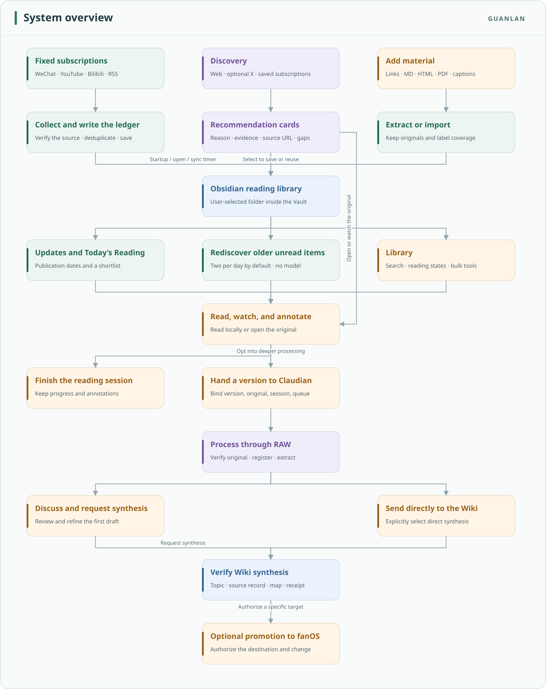](docs/workflow/public/en/overview.svg)

**凡例**：緑は自動処理、金は利用者の操作、紫はモデルの処理、青はファイルや状態の保存、赤は検証と保護です。

[01 購読の収集と同期](#flow-subscriptions) · [02 関心に沿った探索](#flow-discovery) · [03 リンク、ファイル、文字起こし](#flow-importing) · [04 読書と選読](#flow-reading) · [05 Claudian、RAW、Wiki](#flow-knowledge) · [06 復旧、更新、バックアップ](#flow-recovery)

[各工程の入力、出力、保存先、関連コードを調べる（英語）](docs/workflow/public/en/README.md)

<a name="flow-subscriptions"></a>

### 01 · 購読の収集と同期

取得後に配信元の識別情報、公開日、本文を確認します。サービスが先に収集台帳に書き込み、プラグインはページ単位で同期します。そのページをすべて処理できてから同期位置を進めます。

[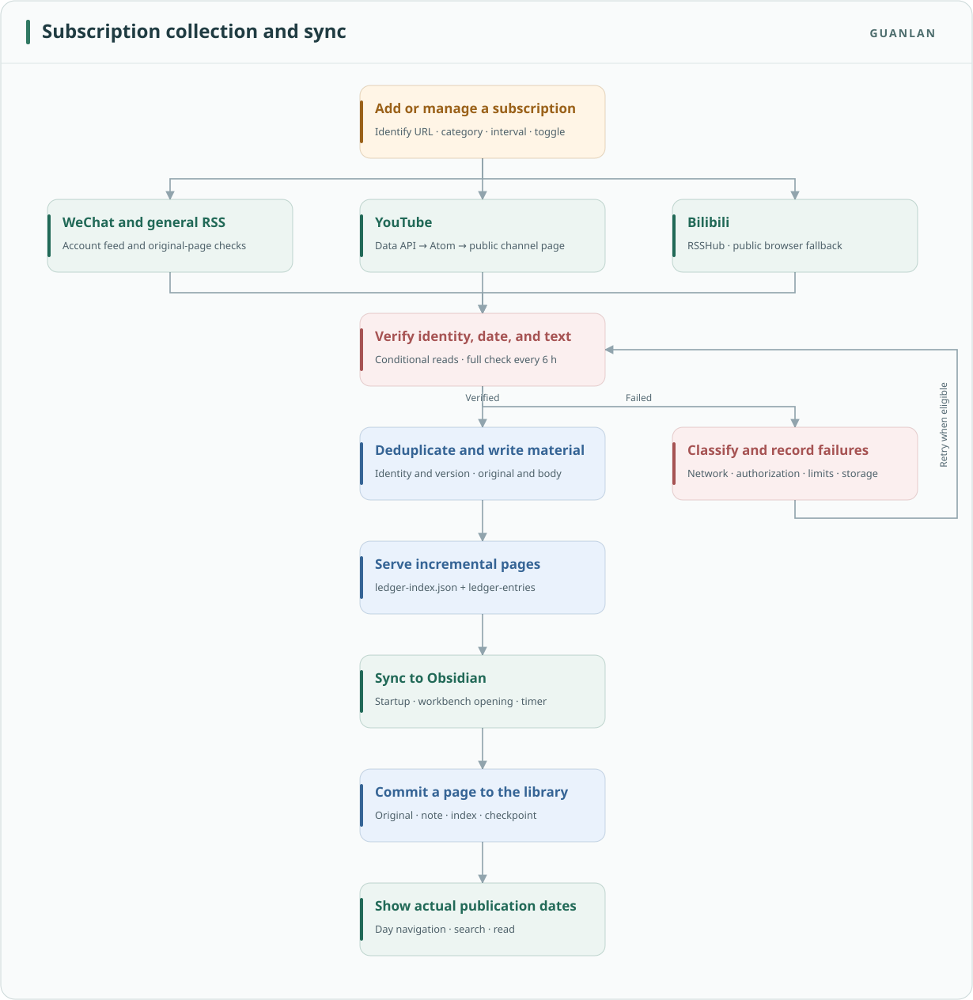](docs/workflow/public/en/subscriptions.svg)

[技術仕様（英語）](docs/workflow/public/en/README.md#subscriptions)

<a name="flow-discovery"></a>

### 02 · 関心に沿った探索

ウェブ、任意で有効にした X、最近の未読記事をまとめて候補にします。一部のリンク先を確認し、モデルの採点結果をプログラムで検証します。その日の探索結果と読書ライブラリは別々に保存します。

[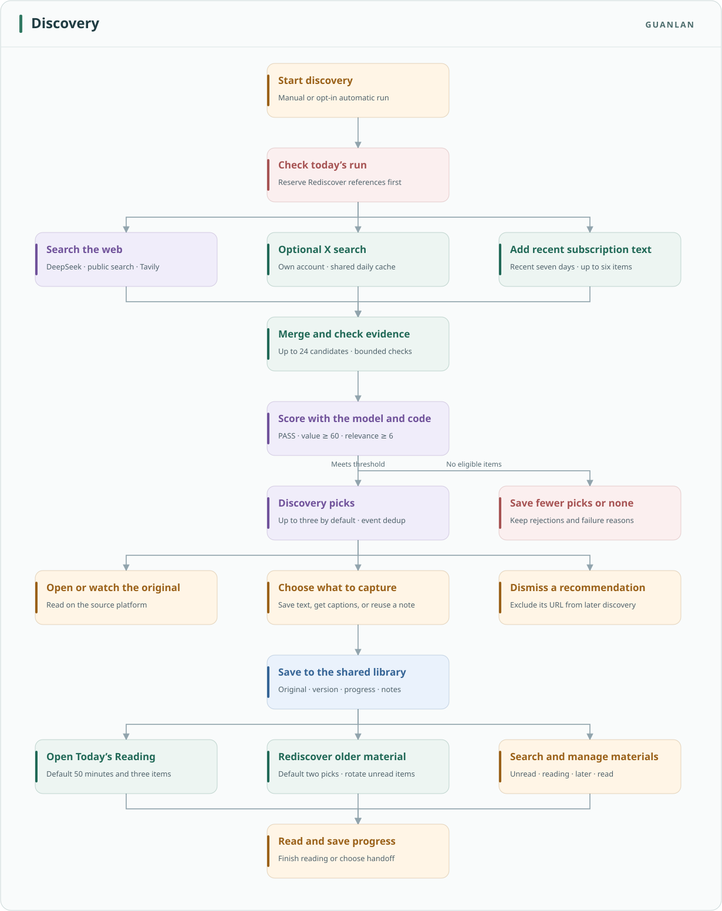](docs/workflow/public/en/discovery.svg)

[技術仕様（英語）](docs/workflow/public/en/README.md#discovery)

<a name="flow-importing"></a>

### 03 · リンク、ファイル、動画の文字起こし

取り込み方に応じて本文を抽出し、どこまで取得できたかを記録します。資料の識別子と内容の版で重複を防ぎます。保存順序と復旧用の記録があるので、書き込みが途中で止まっても再開できます。

[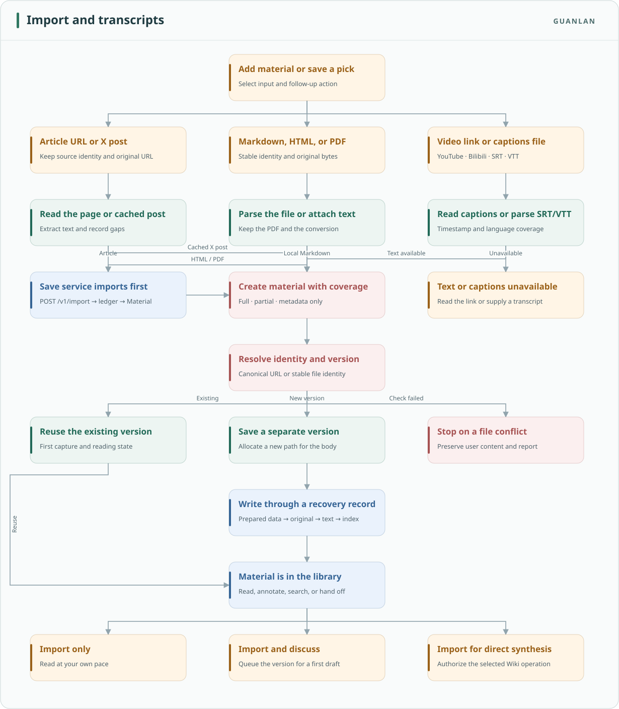](docs/workflow/public/en/importing.svg)

[技術仕様（英語）](docs/workflow/public/en/README.md#importing)

<a name="flow-reading"></a>

### 04 · 読書、今日の選読、過去の未読資料

今日の選読、過去の資料の入れ替え、ライブラリ管理には同じインデックスを使います。ルールで決まる選読、AI の短いガイド、ごみ箱にはそれぞれの保存条件があります。

[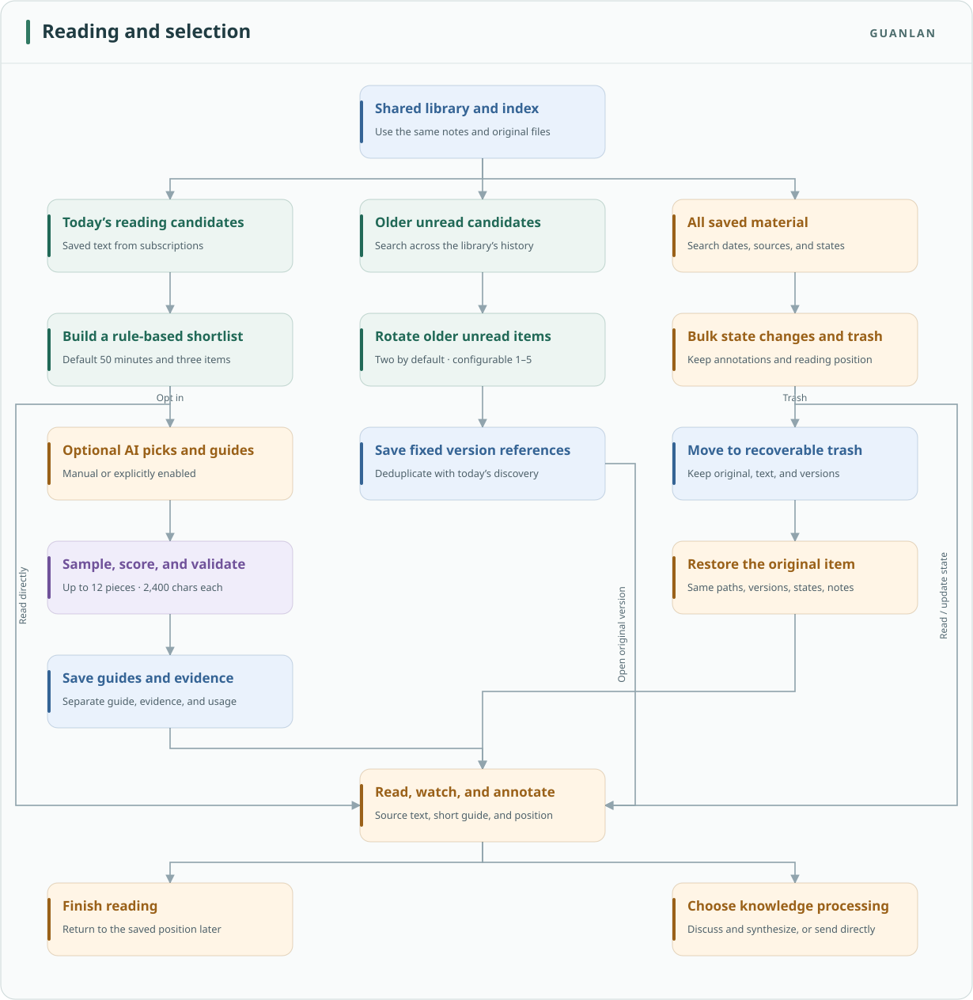](docs/workflow/public/en/reading.svg)

[技術仕様（英語）](docs/workflow/public/en/README.md#reading)

<a name="flow-knowledge"></a>

### 05 · Claudian、RAW、Wiki への引き継ぎ

資料の指定版をキューに入れ、送信予定を保存してから Claudian に渡します。議論する場合も直接まとめる場合も、原本、処理結果の記録、実際の Wiki ファイルを確認します。知識ベースの整理には Andrej Karpathy の LLM Wiki の考え方を取り入れています。 [LLM Wiki の原文](https://gist.github.com/karpathy/442a6bf555914893e9891c11519de94f)

[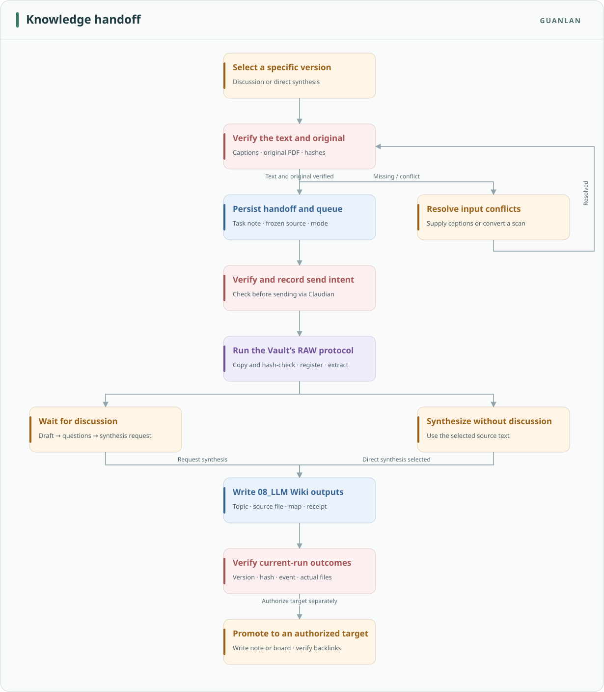](docs/workflow/public/en/knowledge.svg)

[技術仕様（英語）](docs/workflow/public/en/README.md#knowledge)

<a name="flow-recovery"></a>

### 06 · 復旧、更新、バックアップ

通信はエラーの種類に応じて再試行し、モデルの処理は最初の結果から復旧を試みます。プラグインの更新は Obsidian が行います。収集サービスはデータをバックアップしてから別途更新します。

[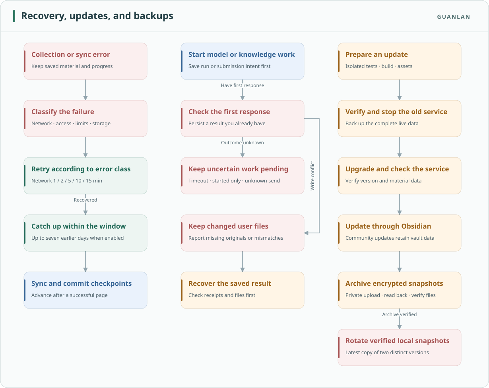](docs/workflow/public/en/recovery.svg)

[技術仕様（英語）](docs/workflow/public/en/README.md#recovery)

## セットアップ

掲載後は Obsidian のコミュニティプラグインで **Guanlan** を検索してください。手動インストールは [GitHub Releases](https://github.com/wangkefan0309-ui/guanlan/releases) またはソースから行えます。購読やウェブページの取り込みには収集サービスが必要です。ローカルの Markdown・字幕の読み込みや読書記録にはアカウント、モデル、サービスは不要です。[通信先、送信するデータ、料金について（英語）](docs/data-and-network.md)。

**Obsidian デスクトップ版 1.13.0 以降**が必要です。ビルドと収集サービスには **Node.js 22.13 以降**が必要です。以下は Windows の例です。常駐運用、RSSHub、無料の X 検索を補助するスクリプトは Windows で検証しています。プラグインの画面は中国語なので、操作名は実際の表示に合わせています。

1. ZIP があれば `source-workbench` フォルダを取り出します。ソースからインストールする場合は、リポジトリのルートで次を実行します。

   ```powershell
   npm ci
   npm run build
   ```

   ZIP の `source-workbench` を Vault 内の `.obsidian/plugins/` に置きます。ソースからビルドした場合は、その場所に `source-workbench` を作り、`dist/plugin/` 内の `manifest.json`、`main.js`、`styles.css` をコピーします。Obsidian のコミュニティプラグインから「观澜」を有効にします。

2. ウェブページの取得、定期購読、公開字幕の取得、外部検索を使う場合は、リポジトリのルートで収集サービスを起動します。まだ依存関係を導入していなければ、先に `npm ci` を実行します。

   ```powershell
   npm run dev:server
   ```

3. Obsidian 左側のレーダーアイコンを押して「设置 → 订阅连接与自动同步」（設定 → 購読の接続と自動同期）を開きます。既定の接続先は `http://127.0.0.1:27183`、トークンは収集サービスのプロジェクト内の `.local/server/token.txt` にあります。入力後に「检查连接」で接続を確認し、画面下の「保存配置」で保存します。別のサービスを使う場合は、そのアドレス、ポート、トークンを入力します。
4. 「信源 → 添加来源」（配信元 → 配信元を追加）を開き、RSS、Atom、または対応チャンネルの URL を入力します。認識された配信元とカテゴリを確認して追加します。最初に用意されている配信元は無効で、購読 URL も空になっています。自分の購読先に変更できます。
5. 「信源 → 管理订阅与分类 → 立即检查更新」で最初の収集を実行します。成功したら「来讯」の「同步已采集材料」で取り込みます。ローカルファイルは「藏卷 → 添加材料 → 导入文件」から直接読み込めます。

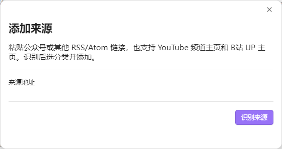

「添加来源」で「识别来源」を押し、アカウントやチャンネルを確認します。表示名、カテゴリ、自動チェックの有無を選び、「添加订阅」で保存します。複数の配信元を集めた RSS は通常のフィードとして追加できます。WeChat 公式アカウント一件を追う場合は、そのアカウント専用の URL を使います。

Windows では、まずサービスを手動で起動して試せます。ログイン後にバックグラウンドで収集する場合は、自動起動を設定してください。Bilibili を RSSHub 経由で購読する場合は、RSSHub の手順に沿って必要な環境を用意します。手動起動とバックグラウンド起動のサービスを同時に動かす場合は、それぞれに別の接続先アドレスとデータディレクトリを割り当ててください。リンク先の運用資料は中国語です。 [RSSHub の設定](docs/rsshub-runtime.md) · [Windows での常駐収集](docs/local-automation.md) · [サービスの運用手順](docs/operator-runbook.md)

## プラットフォームごとの接続方法

### WeChat 公式アカウント（微信公众号）

記事を一件だけ取り込むなら、URL を貼り付ければ十分です。自動収集には、新着記事の一覧を継続して取得できる配信元が必要です。WeChat が公開している公式アカウント用の API は、運営者が自分のアカウントを管理するためのものです。任意のアカウントを購読する公開 API は見つかりませんでした。2026 年 10 月までに、私が試していた記事一覧の一括取得は動かなくなり、同じ仕組みに頼っていたオープンソースのツールにも影響が出ていました。

**WeRSS** を自分で動かしたところ、対象の五つのアカウントは登録できましたが、記事一覧を読むと `200013` が返り、本文を自動取得できた件数はゼロでした。再試行の間隔を延ばすと無駄なリクエストは減ります。この試験だけでは、WeChat 側で何がいつ変更されたか、ほかの環境でも同じ結果になるかまでは分かりません。個別の公開 URL が分かっていれば、記事単体の取り込みは引き続き使えました。[WeRSS の試験記録](docs/werss-runtime.md)

取阅に似たサービスの収集方法も調べました。確認したパターンには、管理画面の `appmsgpublish`、有効期間が短いクライアントの認証情報を使う `profile_ext/getmsg`（私の記録では約 25 分）、実アカウントの一斉配信を検知するフック、複数のアカウントとプロキシを使うサーバー側の収集がありました。切り分け試験では `searchbiz` は通りましたが、30 分待って `appmsgpublish` を一度だけ呼び出しても `200013` でした。私の環境ではアカウントのアクセス権が原因と考えましたが、ほかの環境にも当てはまるとは限りません。ローカルで動く候補のうち、mpider のように Frida でデスクトップ版 WeChat の既存セッションからアカウントのページを取得するものもありました。確認した版では認証情報は端末に残る一方、WeChat 4.1.15.56 に依存し、アカウント停止のリスクもあります。自分で維持したいと思える方法が見つからず、運用を任せられるサービスを選び、有料 API も候補に残しました。[調査時の記録（中国語）](README.zh-CN.md#微信公众号)

| 方法 | 使い方 |
| --- | --- |
| **取阅（Quyue）、接続実績あり** | 取阅で対象アカウントを購読します。全文に対応したプランでは「RSS 全文输出」を有効にし、**アカウントごとの RSS URL** を「添加来源」に貼り付けます。グループやまとめのフィードは要約だけの場合があります。2026 年 11 月 15 日時点の作者の確認では **月額 29 元で 20 アカウントまで**です。購入前に決済画面を確認してください。非公開の購読 URL は認証情報として扱います。[取阅](https://feed.zoro.build/) · [接続記録](docs/acceptance-v0.4.0-2026-10-10.md) |
| **极致了（Dajiala）、有料 API の候補** | 提供元でキーを取得します。アカウントの識別子で履歴 API（`post_history`）を呼び、必要に応じて記事 URL から詳細（`article_detail`）を取得します。观澜につなぐには、一覧を RSS に変換するサービスを用意するか、収集サービス側にアダプターを追加し、元の URL、公開日、元のレスポンスを保存します。このリポジトリに専用の収集機能はなく、有料の実収集も試していません。[提供元の手順](https://www.jzl.com/news/760) · [記事詳細 API](https://apifox.com/apidoc/shared/410674f9-f451-4b4f-957a-5f54f243bc83/api-199752498) |
| **手元にある RSS または記事 URL** | 継続して読める RSS/Atom があれば「添加来源」、一件だけ保存するなら「藏卷 → 添加材料 → 添加链接」を使います。 |

RSS から候補記事を取得し、原ページのアカウント、日付、本文を検証します。検証に通らない場合は「信源」にエラーを残します。公開動画や有料記事の公開プレビューは、実際に取得できた範囲を記録します。取阅の契約更新後もエラーが出る場合は、購読管理で「立即检查更新」を実行してください。以前の失敗記録は残るので、復旧したかどうかは新しい確認結果を見ます。[収集と取りこぼしの回収](docs/collection-setup.md)

ローカルで動くオープンソースの方法をご存じなら、ぜひ教えてください。

### YouTube

チャンネルの新着動画を実際の公開日つきで把握するために、まず公式の **YouTube Data API v3** を使います。以前はチャンネルのフィードや公開ページを使っていましたが、フィードのエラーやページ側の制限に遭遇しました。どちらも代替手段として残しています。収集サービスは `channels.list` でアップロードの再生リストを取得し、`playlistItems.list` で新着を確認します。チャンネルと動画の ID を照合し、実際の公開日で保存します。

1. YouTube チャンネルを追加します。
2. Google Cloud で YouTube Data API v3 を有効にし、その API に用途を制限したキーを作成します。
3. 「信源 → 管理订阅与分类 → YouTube 稳定连接」で「验证并保存 YouTube 密钥」を押します。検証に成功したら「立即检查更新」を実行し、確認結果で「YouTube 官方接口」を探します。

| 方法 | 適している場面 |
| --- | --- |
| **公式 Data API** | 通常使う方法です。自分のキーが必要で、Google Cloud プロジェクトの割り当て上限があります。タイムアウトなら収集サービスのネットワークを先に調べ、キー、権限、割り当てのエラーが出た場合は Google Cloud を確認します。[Google のガイド](https://developers.google.com/youtube/data/getting-started) · [观澜の設定手順](docs/youtube-official-api.md) |
| **チャンネルの Atom フィード** | 直近の新着向けです。キーがない場合や API に失敗した場合に使います。形式は `https://www.youtube.com/feeds/videos.xml?channel_id=CHANNEL_ID` です。調査した Khazix の AIHOT の版では、共通の RSS 処理でこのフィードを読み、ときどき発生する 404 も扱っていました。[AIHOT の該当コミット](https://github.com/KKKKhazix/AIHOT/blob/59c8c814aa0dfc49edcca9dbee003f2949172172/packages/backend/src/sources/rss.ts) |
| **チャンネルの公開ページ** | Atom が失敗すると、同じチャンネルの Videos、Shorts、Streams を確認します。ログインを要求された場合や、公開日を確認できない場合は失敗を表示します。 |
| **WebSub プッシュ通知** | 外からアクセスできるコールバックを常時運用する場合の選択肢です。Google から更新の通知を受け取れます。現行の观澜は定期的に更新を確認します。[Google のプッシュ通知ガイド](https://developers.google.com/youtube/data/guides/push_notifications) |

ここで収集するのは **動画の項目** で、タイトル、チャンネル、公開日、リンクを保存します。文字起こしが必要なら、詳細の「取得视频文字稿」で公開字幕の取得を試すか、手元の SRT/VTT を取り込みます。公開動画でも字幕がない場合や、アクセス時の確認画面で取得できない場合があります。その不足は画面で確認できます。[インポートと字幕の仕様](docs/integration-guide.md)

### Bilibili、X、その他のウェブサイト

- **Bilibili** は投稿者ページや設定済みの RSSHub フィードを追加できます。サービス側では公開投稿の読み込みやブラウザーを使う代替経路もあります。使う方法は配信元とローカルの設定に応じて変わります。アクセス制限、リクエスト上限、通信エラーは確認結果を見てください。[配信元ごとの方法](docs/source-options.md)
- **X** は「远眺」でキーワード検索に使えます。無料の方法では自分の X アカウント、専用のログインウィンドウ、ローカルの `twscrape` を使います。一日に Top 検索の先頭ページを最大三回、各ページ最大 20 件まで確認します。失敗した場合や結果を確認できない場合はその日の取得を止めます。SocialData は手動で選ぶ有料の代替手段です。保存するのは投稿本文と取得時の API レスポンスです。動画字幕やリンク先の全文は別途取得します。[X の設定とログイン](docs/free-x-setup.md)
- **その他のサイト** は RSS/Atom で購読するか、本文を抽出できる公開記事を一件ずつ取り込めます。「远眺」では DeepSeek のウェブ検索、API キー不要の Hacker News と GitHub の公開検索、Tavily も使えます。キー不要の二つは技術系の情報が中心で、AI による絞り込みには対応モデルの設定が必要です。[探索の仕組み](docs/active-exploration.md)

収集できるかどうかは **収集サービスのプロセス** から接続先に到達できるかで決まります。このプロジェクトが検証した Windows のネットワークでは、YouTube と X に利用可能なプロキシが必要でした。手動起動なら起動前に `HTTPS_PROXY` を設定できます。ブラウザーでサイトが開いても、サービス側の結果を確認してください。Vault に保存したノートはオフラインで読めます。

## 画面ガイド

スクリーンショットはサンプルデータを入れた独立したデモ Vault で、v0.22.5 を動かして撮影したものです。画面の項目名は実際の中国語表記を併記しています。

### 来讯 · 購読先の新着を見る

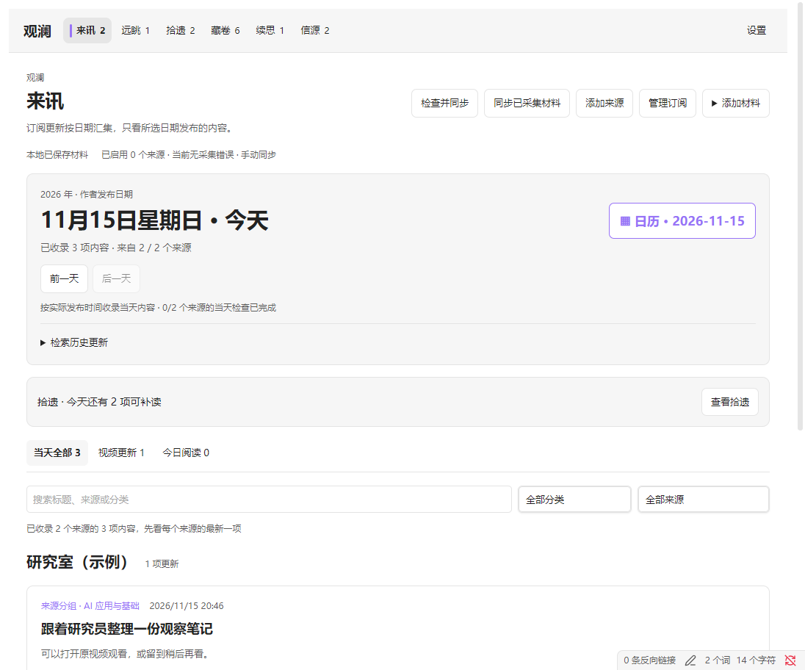

| 画面の項目 | 動作 |
| --- | --- |
| **检查并同步 / 同步已采集材料** | 前者は保存済みの資料を同期してから、確認時刻になった配信元や条件に合う通信障害のあった配信元を確認し、新着を同期します。画面で追跡するのは最大三分です。後者は収集台帳にある資料だけを同期します。 |
| **添加来源 / 管理订阅** | 購読先を追加するか、「信源」で既存の購読やエラーを確認します。 |
| **更新日期日历 / 前一天 / 后一天 / 回到今天** | タイムゾーンを北京時間として、投稿者の公開日で移動します。「检索历史更新」は過去のタイトル、配信元、保存済みの本文を検索します。 |
| **当天全部 / 视频更新 / 今日阅读** | 当日の全件、動画、今日の選読を切り替えます。最初は各投稿者の新着一件が見え、「展开本日全部」「收起其他更新」で表示範囲を切り替えます。 |
| **打开今日阅读笔记 / 生成 AI 精选** | ローカルの選読ノートを開くか、設定したモデルで原文の根拠つきの短いガイドを生成します。ルールでの選読はオフラインでも使えます。時間の上限は選読にだけ適用されます。 |
| **查看原因和重试时间 / 查看拾遗** | 「信源」の失敗理由と再試行時刻、または過去の未読資料に移動します。 |

**今日の選読と動画の文字起こし**

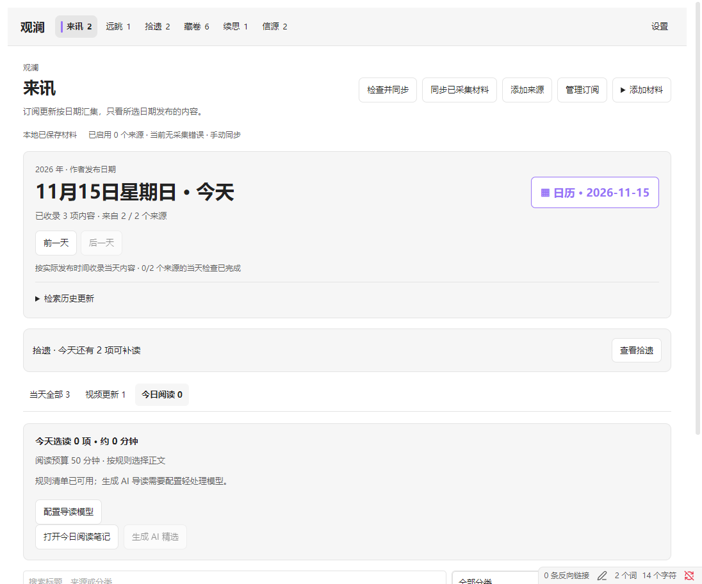

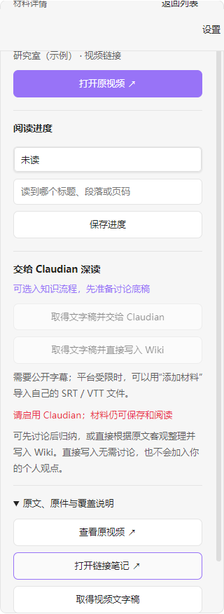

「观看视频」「打开原视频」は元のプラットフォームを開き、「打开链接笔记」はローカルのノートを開きます。公開字幕を取得するか手元の字幕を取り込むと、同じ動画に文字起こし版が追加されます。詳細画面から、文字起こしの取得後に Claudian に渡すか、直接 Wiki に書くかを選べます。

### 远眺 · フォローしていない書き手や記事を探す

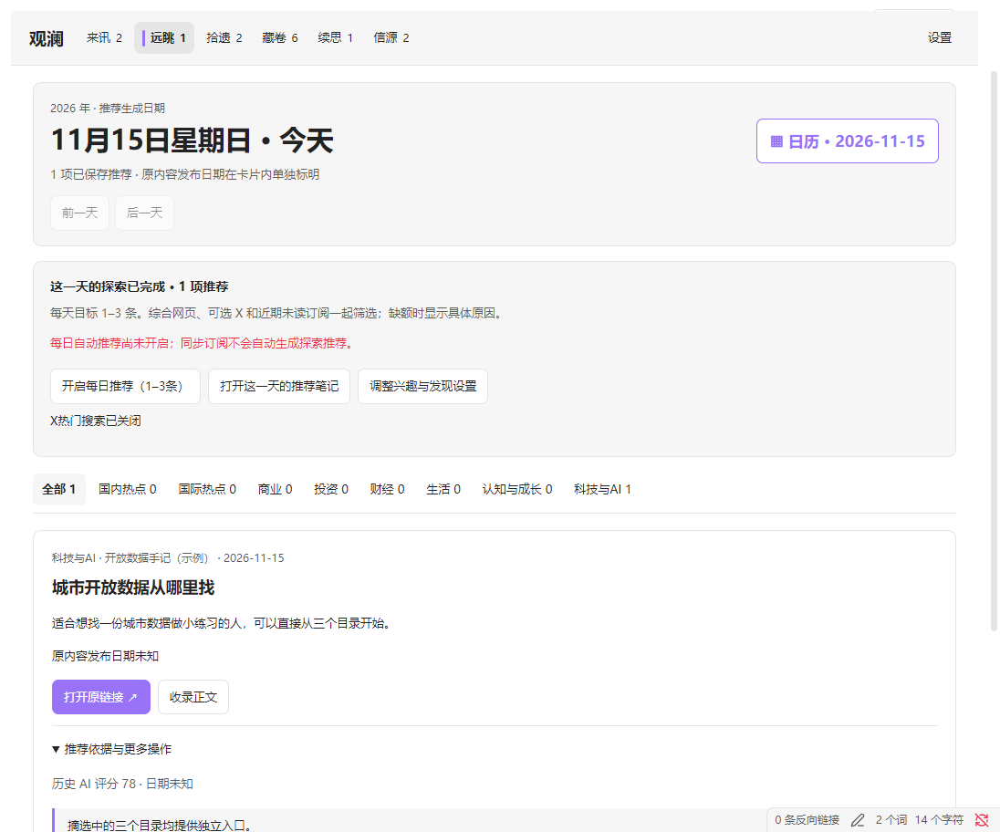

- **发现新内容**でその日の探索を実行し、「开启每日推荐」で自動化します。「调整兴趣与发现设置」では、検索方法、キーワード、分野、関心、件数上限を変えられます。
- **日历 / 前一天 / 后一天 / 回到今天 / 板块筛选**でおすすめが生成された日や分野を選べます。原文の公開日は別に表示し、「打开这一天的推荐笔记」でその日の結果を開きます。
- **打开原链接 / 打开 X 视频**で元のサイトを開きます。**收录正文 / 收录帖文**で実際の内容を保存し、保存済みの資料は「阅读已保存正文」や「标记已读」を選べます。
- **推荐依据与更多操作**で根拠、取得できなかった範囲、外部リンク、引き継ぎを確認します。**不再推荐**でその回の候補から除外します。「检查已保存结果」「重试保存」「重新校验首次结果」はその回の復旧に使います。完了済みや結果が不明の処理は、画面を開くだけではモデルに再送信しません。

### 拾遗 · 保存した未読資料を見直す

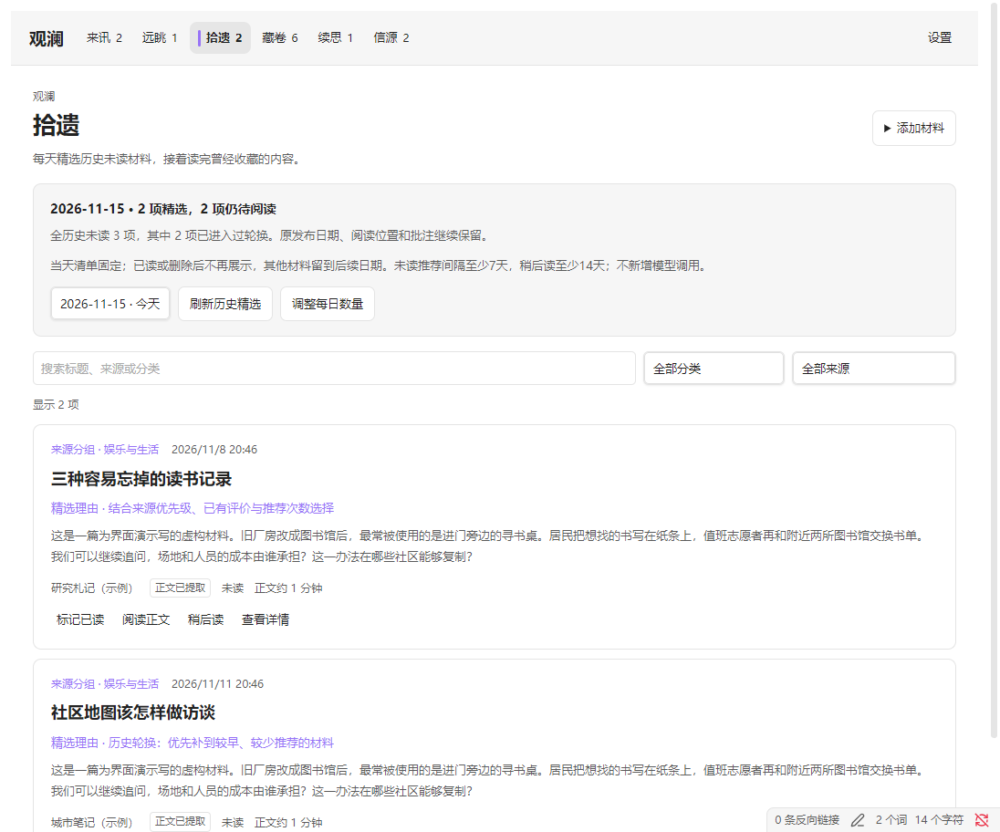

過去の未読本文から毎日二件を選ぶのが既定です。**历史精选日期**で別の日を表示し、**刷新历史精选**で保存済みのリストを読み直します。**调整每日数量**で 1～5 件に変更でき、反映は翌日です。**标记已读**にすると、その日の未読リストから外れます。次の候補の入れ替えは翌日です。元のノートを開くと、以前の読書位置と書き込みが残っています。モデルは使いません。

### 藏卷 · 読書ライブラリ、インポート、ごみ箱

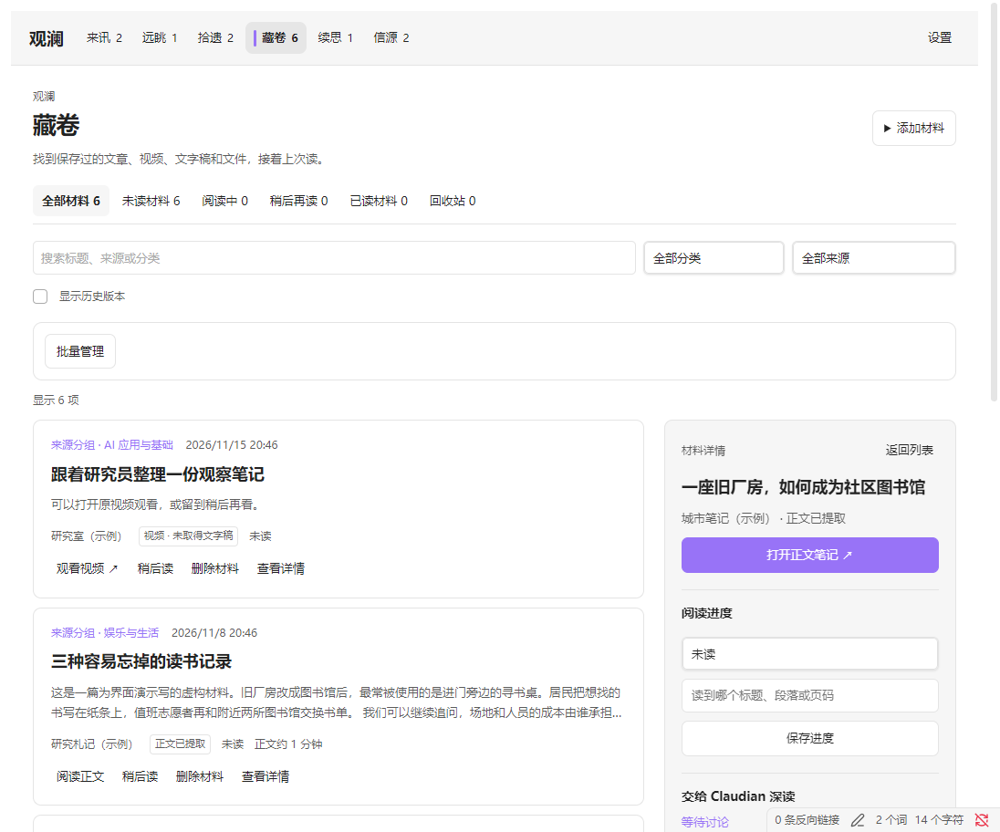

| 画面の項目 | 動作 |
| --- | --- |
| **添加材料 → 添加链接 / 导入文件** | カテゴリを選び、公開ページ、Markdown、HTML、PDF、SRT/VTT を保存します。テキスト層のある PDF からは文字を抽出できます。スキャン PDF には外部で変換した Markdown を添付でき、原本も残ります。 |
| **搜索材料 / 分类、来源、阅读状态 / 上一页、下一页** | 保存済みの資料を検索し、未読、読書中、あとで読む、既読、ごみ箱で絞り込めます。「显示历史版本」で過去の版を表示します。 |
| **阅读正文 / 查看详情 / 返回列表** | Markdown を読む、右側の詳細を見る、一覧に戻る操作です。詳細では版、取得範囲、元のリンク、原本を確認できます。 |
| **稍后读 / 移回未读 / 保存进度** | 読書状況を更新し、読んでいた位置を残します。本文には Obsidian の通常の Markdown で書き込みや内部リンクを追加できます。 |
| **批量管理 / 全选筛选结果 / 清空选择** | ページをまたいで選択し、一括で状態を変更、ごみ箱に移動、または復元できます。**删除材料**と**确认移入回收站**で本文、過去の版、原本は保持され、同期で勝手に戻らないようになります。 |

ファイルの取り込み時は「来源标识」で資料を識別できます。同じファイルの更新には同じ識別子を、ファイル名が同じ別資料には別の識別子を使います。「导入」「确认导入」でライブラリへ保存できます。その場で Claudian との議論や Wiki への整理を選ぶこともできます。

**読むリンクを追加**

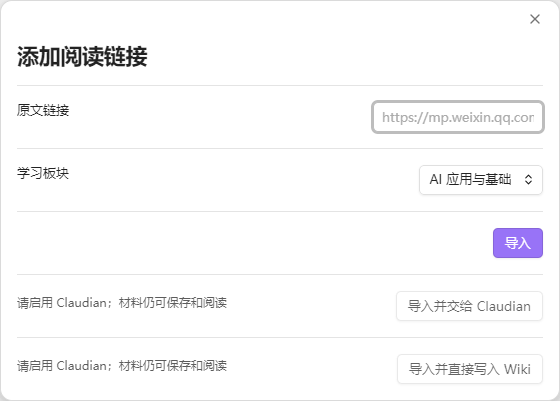

HTML の原本は取得時のレスポンスです。Markdown 内の外部画像を開くには通信が必要な場合があります。スクリプト、操作できる要素、複雑なレイアウトは抽出した本文に含まれません。[資料管理の仕様](docs/material-management.md)

### 续思 · AI エージェントと議論し、知識ノートにする

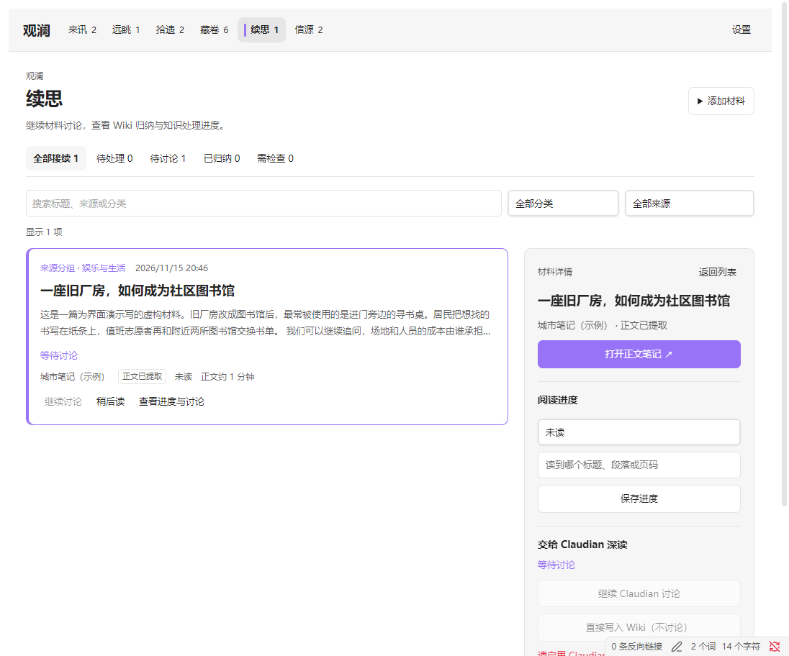

- **交给 Claudian 处理 / 继续 Claudian 讨论**で選んだ資料を検証済みの Claudian に渡し、あとで同じ会話に戻れます。**直接写入 Wiki**は原文に沿ってまとめたい資料に使えます。インポートや「远眺」の詳細からも引き継ぎ方を選べます。
- **取消待处理**は未送信のキューを取り消します。**打开接续笔记 / 打开讨论记录 / 查看来源与覆盖 / 阅读 Wiki / 查看晋升结果**は、対応する記録やファイルがある場合に開けます。前の会話を続けられない場合は**从回执恢复**を使い、復旧の初回は読み取りのみです。**准备 RAW 交接材料**で手動の引き継ぎもできます。
- 作者の Vault では `08_LLM Wiki` に RAW の原本、テーマごとの知識ノート、出典、処理結果を保存します。その先で個人ノートやボードに反映するには、別途具体的な許可が必要です。パスと手順はコードで制約されています。ほかの Vault では「藏卷」で読書や引き継ぎの準備をしたり、自分のフォルダやエージェントに合わせて接続処理を作り替えたりできます。
- 「设置 → Claudian 接续」で現在のインストールを検証できます。これはインターフェースの互換性確認です。RAW の登録、Wiki の書き込み、個人ノートへの反映は、「续思」の状態と実ファイルをそれぞれ確認してください。[引き継ぎと復旧の仕様](docs/knowledge-integration.md)

### 信源 · 購読を管理し、失敗の原因を調べる

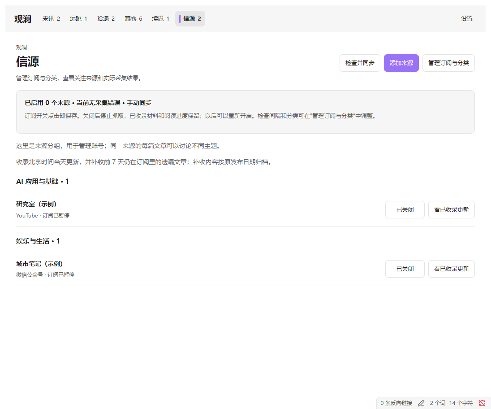

- **订阅中 / 已关闭**で既存の配信元の収集を切り替え、その操作はすぐ保存されます。**看已收录更新**で資料のある最新日へ、**最近检查记录**で各回の確認結果へ移動します。復旧しても**最近失败**には以前の失敗が残ります。
- **管理订阅与分类**で表示名、カテゴリ、有効・無効、確認間隔、過去分の回収範囲を調整できます。カテゴリは作成、改名、配信元を移してからの削除が可能です。ダイアログで編集したら**保存订阅配置**を押します。同じ収集サービスにつなぐ Vault は購読設定を共有します。
- **立即检查更新**は、保存済みの有効な配信元を予定時刻を待たず確認します。契約更新や認証の修復後に実行し、完了してから同期します。**验证并保存 YouTube 密钥**でキーを設定・変更し、**移除本地 YouTube 密钥**でキー不要の代替取得へ戻します。

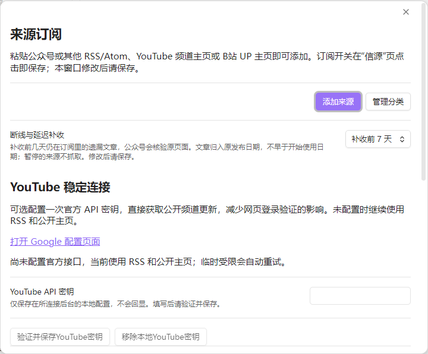

### 设置 · 自分の読み方に合わせる

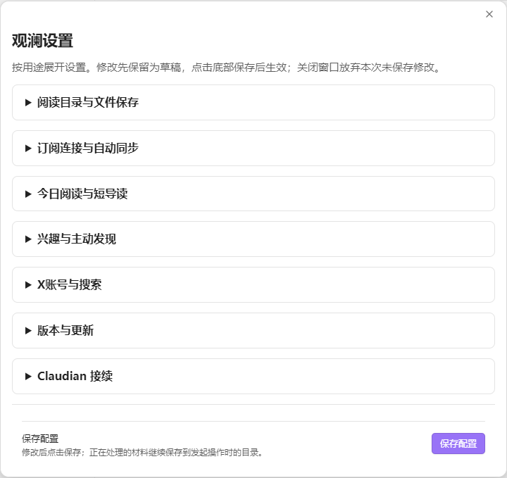

| 設定項目 | 変更できること |
| --- | --- |
| **阅读目录与文件保存** | 既定は `09_信息源` です。「选择已有文件夹」で既存のフォルダを選ぶか、Vault 内の相対パスを入力し、プレビュー後に保存します。新しいパスは初回保存時に作られます。切り替え先は別のライブラリです。既存ライブラリの移動にはインデックスと原本も移す必要があります。 |
| **订阅连接与自动同步** | サービスのアドレス、トークン、自動同期の有無、1～60 分の同期間隔を設定します。既定は 5 分です。配信元ごとの収集間隔は購読管理で 15～1440 分の範囲で設定し、既定は 60 分です。 |
| **今日阅读与短导读** | 選読は既定で 50 分・最大 3 件です。5～180 分、1～5 件に変更できます。学習の目標、知識の前提、使うモデルのアドレス、名前、キーを設定できます。AI の自動選読は既定で無効で、上限は既定で一日一回です。「拾遗」の件数とは別です。 |
| **兴趣与主动发现** | 自動探索の有無、八つの分野、検索方法、キーワード、好みを設定します。おすすめの上限は既定で一日 3 件、1～12 件に変更できます。自動探索は既定で無効です。探索の関心と、選読の学習目標は別々に設定できます。 |
| **X 账号与搜索** | X を検索に含めるか、無料のアカウント接続と有料ルートのどちらを使うかを選びます。「连接 X 账号」で専用ウィンドウを開き、「检查 X 连接」で状態を確認します。 |
| **Claudian 接续** | 現在の版を検証できます。議論と直接の整理は資料ごとに選びます。独自の Wiki やエージェントを使う場合は、接続処理と保存仕様を変更します。 |
| **版本与更新** | インストール済みのバージョンを表示します。更新は Obsidian のコミュニティプラグイン設定から行います。 |

編集内容は下書きとして保持され、画面下の「保存配置」を押すと反映されます。配信元のグループを変えるだけなら「信源」のカテゴリを変更します。分野名、既定カテゴリ、採点基準の変更は、ソースを AI エージェントに渡して相談できます。

## 自分の AI エージェントでカスタマイズ

インストールだけなら、プラグインの ZIP、この README、実現したいことを AI エージェントに渡してください。機能も変えたいなら、**リポジトリのソースコード**も渡すと進めやすくなります。ZIP の中身はビルド済みの JavaScript です。モジュール、型、テスト、フロー図、ビルド手順はリポジトリにあります。

まず自分の読み方を伝えてください。たとえば「法律ブログ十件と動画チャンネル二件だけを追いたい。読むのは毎日二十分。裁判所、企業コンプライアンス、技術に分けたい。ノートはローカルに残し、今は X も Wiki への書き込みも使わない」といった具合です。設定を変えるだけで対応できる部分も多くあります。

次の依頼文をそのままエージェントに渡せます。

> README とリポジトリの指示を読み、テスト用の Vault で观澜を動かしてください。テスト用のフィードを一件つなぎ、確認・同期を実行し、保存した本文と原本を開けることを確かめてください。配信元、読書フォルダ、一日の時間、探索したいテーマを先に設定してください。コード変更が必要なら、変更箇所と検証方法を説明してください。新しい配信元はテストデータで重複、タイムアウト、識別情報の不一致、再開を確認してください。認証情報は私がローカルで入力します。最後に設定の一覧、変更内容、検証結果、インストール用パッケージを渡してください。

| 変更したいもの | 参照先 |
| --- | --- |
| 関心、カテゴリ、読書時間、初期配信元 | [設定の既定値](src/core/settings.ts) · [カテゴリ](src/core/categories.ts) · [探索の分野](src/core/discovery-topics.ts) · [配信元の登録](src/core/source-registry.ts) |
| 新しいフィードや API への接続 | [購読サービス](src/server/subscriptions.ts) · [HTTP 仕様](docs/integration-guide.md) |
| 画面、ボタン、設定、Obsidian との接続 | [画面の実装](src/ui/workbench-view.ts) · [プラグインの入口](src/plugin/main.ts) |
| 重複の判定、ファイルの保存、読書履歴 | [読書ライブラリ](src/core/library.ts) · [設計](docs/architecture.md) |
| 独自のエージェント、Wiki、知識フォルダとの接続 | [Claudian アダプター](src/plugin/claudian.ts) · [引き継ぎ仕様](docs/knowledge-integration.md) |

`npm run verify` で型検査、テスト、ビルドを行います。Windows では `npm run package` で `release/source-workbench-<version>.zip` を生成できます。フロー図を編集する場合は [生成スクリプト](docs/workflow/generate.py)を参照し、`py -3 -X utf8 docs/workflow/generate.py --public` で[公開用の図と技術資料](docs/workflow/public/en/README.md)を再生成できます。

## 認証情報とクレジット

サービスのトークン、非公開 RSS、モデルのキー、Google のキー、X のログイン情報はローカルで入力してください。公開のデモや共有にはサンプルの Vault を使ってください。プラグイン設定、取得した原本、サービスのデータ、バックアップに非公開の情報が含まれることがあります。モデルや検索サービスを使うと、機能に応じて資料の一部や検索語が設定した提供元に送信されます。

Guanlan は [MIT ライセンス](LICENSE)で公開しています。収集と探索の一部には、Khazix（数字生命卡兹克）の [AIHOT](https://github.com/KKKKhazix/AIHOT) のコードと設計を活用しています。任意の Bilibili 接続には RSSHub を使います。利用範囲と各コンポーネントのライセンスは [AIHOT の利用記録](docs/aihot-reuse.md)と[サードパーティーのライセンス](THIRD_PARTY_NOTICES/)を参照してください。
