<p align="center">
  
</p>

<h1 align="center">Guanlan · An Obsidian workbench for following and reading sources</h1>

<p align="center">Follow the sources you choose, make time to read, and keep what is worth remembering.</p>

<p align="center">
  
  
  
</p>

<p align="center">
  <a href="README.zh-CN.md">简体中文</a> · <a href="#quick-start">Quick start</a> · <a href="#complete-workflow">Complete workflow</a> · <a href="#interface-guide">Interface guide</a> · <a href="#adapt-it-with-your-own-agent">Adapt it with your agent</a>
</p>

---

Guanlan brings updates from WeChat Official Accounts, YouTube, Bilibili, and RSS into Obsidian. I open one workbench to see what the people I follow have published, pick a few pieces to read, and find things I saved before. If a source is worth turning into a knowledge note, I can hand the original to my agent for discussion or synthesis.

## Why I built it

Finding things often took more effort than reading them. I opened WeChat to check an author's latest posts, switched to a video platform to find a different creator, then sent useful links to myself or pasted them into Obsidian. Every switch meant finding my way back in, remembering where I had left off, and keeping track of what I had come to find.

**Attention is a scarce resource.** I'd open an app to find one video and walk into a feed of clips, trending topics, and autoplay. By the time I remembered why I was there, I had less time for the article or long video I meant to spend it on. That shaped the workbench in five ways.

**01 / Check and read updates in one place**

I wanted to keep up with specific authors. Most of the work was finding out whether they had posted at all. Updates puts collected entries on one page, grouped by author and actual publication date, with each author's latest entry shown first. Video cards show the title, creator, and link, so I can decide what to watch before opening the platform. The local service can collect while the computer is on, and Obsidian can pull in the saved material later.

**02 / Give a short reading session an endpoint**

Sometimes I know I have twenty minutes before I open the workbench. Hundreds of unread entries won't help me spend them. Today's Reading offers a shortlist within my budget, and I can still browse the full set of collected updates. I also want to find writers outside my subscriptions, so Discover has its own page. It can bring back a few picks, explain why each is worth opening, and show the evidence it used. On a quiet day, there can be fewer picks. I can finish the list and go do something else.

**03 / Pick up where I left off**

A platform bookmark remembers that I clicked Save. When I only remember one line from an article I was halfway through two weeks ago, I need a way back to the text. Guanlan stores the reading note, its source and captured original, and where I stopped in Obsidian. The Library filters by source, category, and reading state. Rediscover rotates through older unread saves. Both lead back to the same note and annotations.

**04 / See where an update got stuck**

A blank list could mean an author published nothing. It could also mean the feed expired, a request timed out, the original page failed an identity check, or the service saved material that the plugin has yet to sync. Each case calls for a different response. Sources shows the actual check and retry time. Updates shows what's in the library. A video link, an article excerpt, and a saved full text come with their own coverage, so I know when I still need a transcript or the original page.

**05 / Keep the source close when I write a knowledge note**

A book, a saved article, and a recommendation blurb give me different evidence to work with. I want the original capture, my annotations, and what the AI wrote to remain traceable. Guanlan saves originals, reading note versions, and short guides separately. When I want a knowledge note, I choose a specific version and send it to Claudian for discussion or direct synthesis. Knowledge Handoff shows progress against receipts and actual files, so I can find out where a note came from later.

These choices grew out of my routine. You can start with one RSS feed and one reading folder, or bring your own sources, categories, budget, interests, model, and agent workflow.

## Complete workflow


Subscriptions, discovery, and manual imports all feed the same Obsidian reading library. The service collects and serves updates. The plugin saves them and manages what you read. You choose which material to send to Claudian for further work. Start with the whole system, then follow each stage through success, failure, and recovery.

[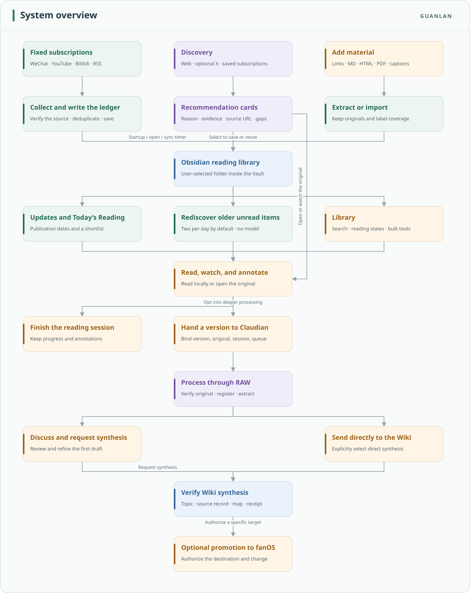](docs/workflow/public/en/overview.svg)

**Legend** · Green: automatic processing · Gold: your decision · Purple: model work · Blue: saved files and state · Red: checks and safeguards.

[01 Subscription collection and sync](#flow-subscriptions) · [02 Discovery](#flow-discovery) · [03 Links, files, and video transcripts](#flow-importing) · [04 Reading, daily picks, and older unread items](#flow-reading) · [05 Claudian, RAW, and Wiki handoff](#flow-knowledge) · [06 Recovery, updates, and backups](#flow-recovery)

[Trace each step to its inputs, outputs, saved files, and source code → Full technical reference](docs/workflow/public/en/README.md)

<a name="flow-subscriptions"></a>

### 01 · Subscription collection and sync

Validate identity, date, and content after retrieval. The service writes its ledger first. The plugin syncs in pages and advances the cursor after each successfully handled page.

[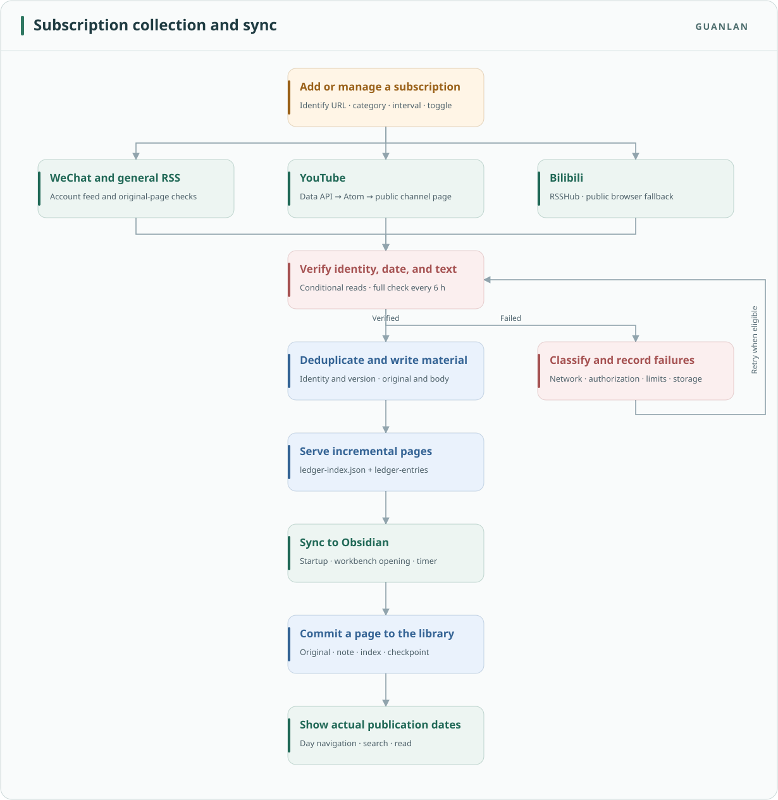](docs/workflow/public/en/subscriptions.svg)

[Open full-size diagram](docs/workflow/public/en/subscriptions.svg) · [Technical walkthrough](docs/workflow/public/en/README.md#subscriptions)

<a name="flow-discovery"></a>

### 02 · Discovery

Merge web, optional X, and recent unread subscription candidates. Gather bounded evidence, then validate the model scores in code. Daily runs are stored separately from reading notes.

[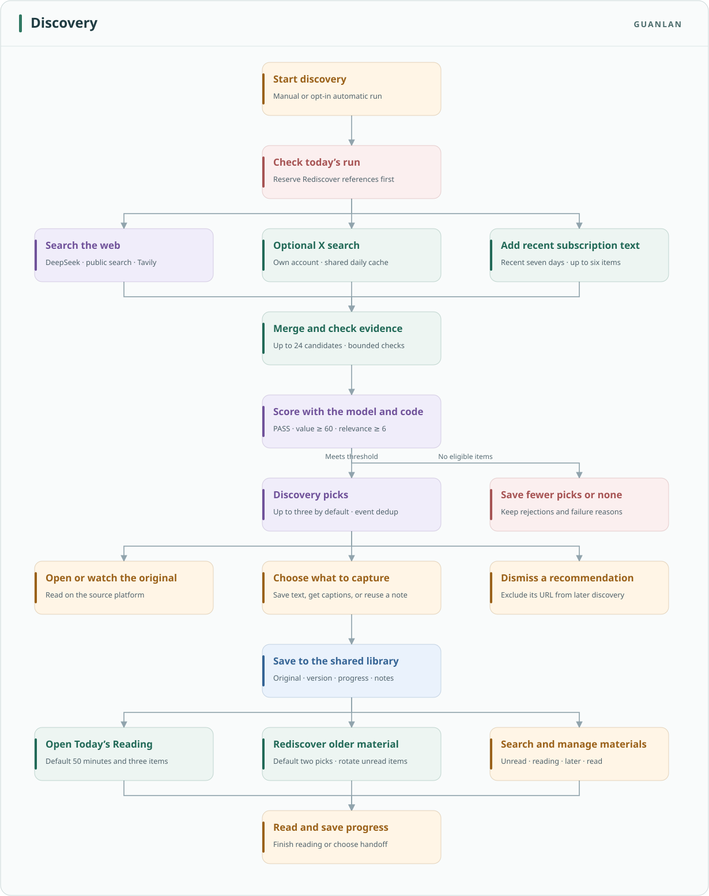](docs/workflow/public/en/discovery.svg)

[Open full-size diagram](docs/workflow/public/en/discovery.svg) · [Technical walkthrough](docs/workflow/public/en/README.md#discovery)

<a name="flow-importing"></a>

### 03 · Links, files, and video transcripts

Extract and label coverage for each input. Deduplicate by material identity and content version. Write order and recovery records allow an interrupted save to resume.

[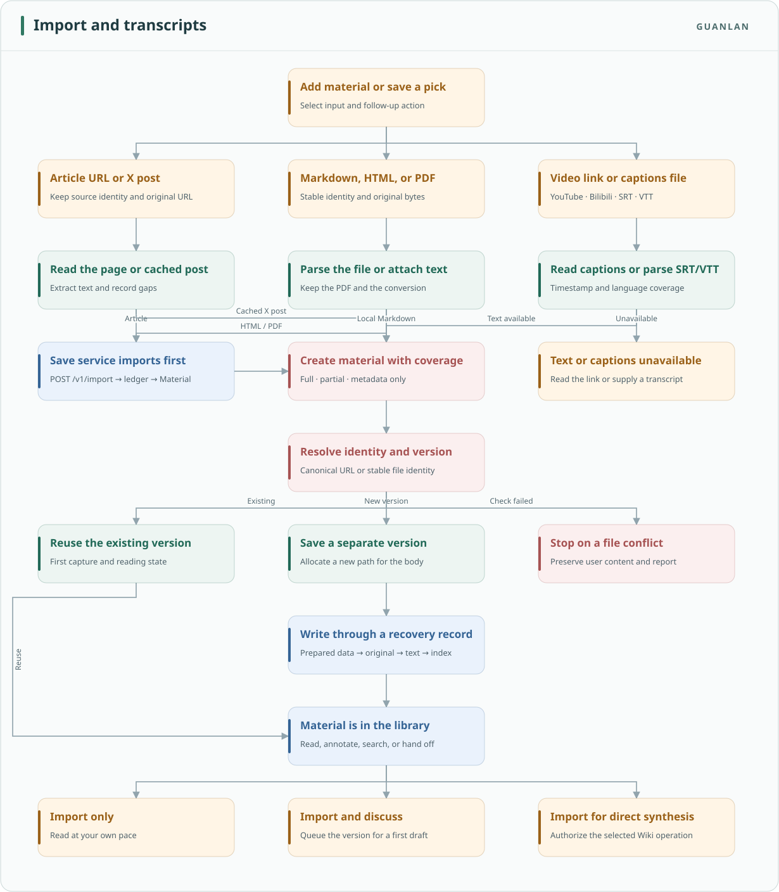](docs/workflow/public/en/importing.svg)

[Open full-size diagram](docs/workflow/public/en/importing.svg) · [Technical walkthrough](docs/workflow/public/en/README.md#importing)

<a name="flow-reading"></a>

### 04 · Reading, daily picks, and older unread items

One index supports the daily shortlist, older unread rotation, and material management. Rules, AI guides, and trash each have their own persistence rules.

[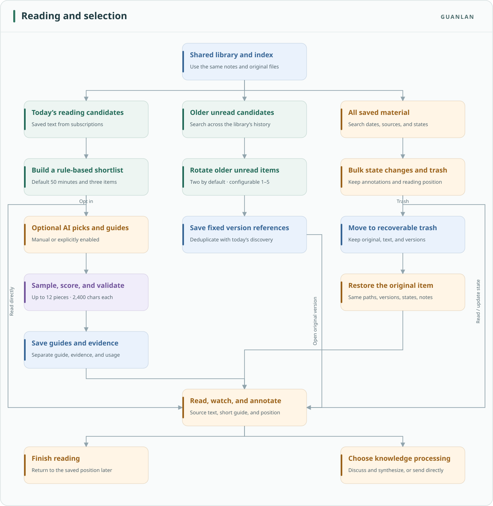](docs/workflow/public/en/reading.svg)

[Open full-size diagram](docs/workflow/public/en/reading.svg) · [Technical walkthrough](docs/workflow/public/en/README.md#reading)

<a name="flow-knowledge"></a>

### 05 · Claudian, RAW, and Wiki handoff

Queue a specific version and save the submission intent before sending. Discussion and direct synthesis both verify the original, the run receipt, and Wiki files.

[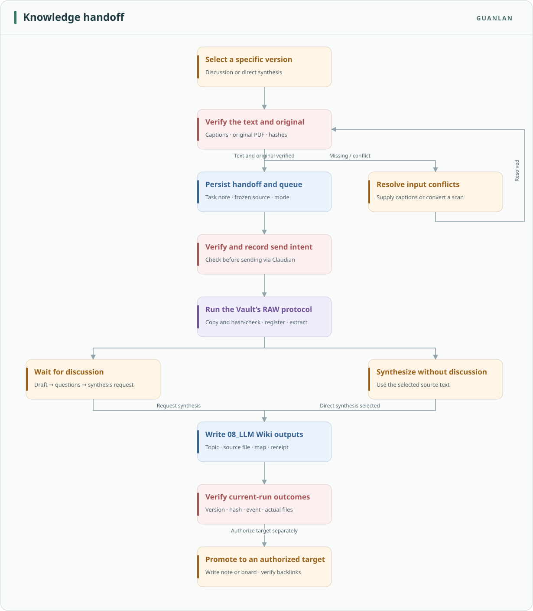](docs/workflow/public/en/knowledge.svg)

[Open full-size diagram](docs/workflow/public/en/knowledge.svg) · [Technical walkthrough](docs/workflow/public/en/README.md#knowledge)

<a name="flow-recovery"></a>

### 06 · Recovery, updates, and backups

Retry network failures according to type and recover model work from the first result. Back up before upgrades, verify signed updates, and rotate snapshots after archive read-back.

[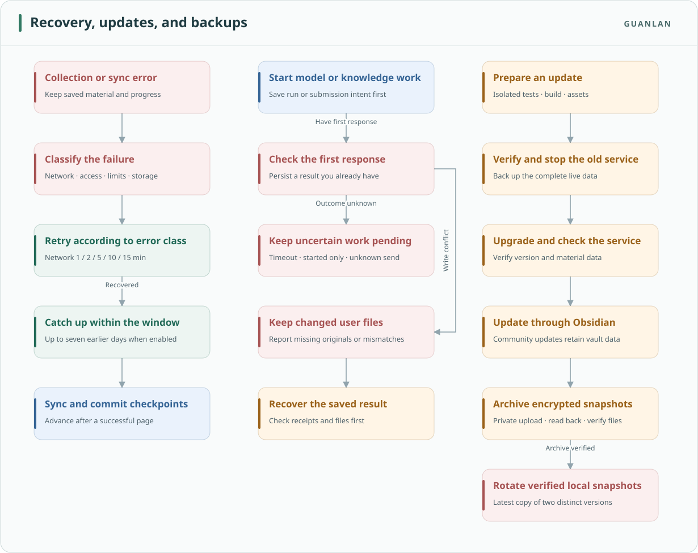](docs/workflow/public/en/recovery.svg)

[Open full-size diagram](docs/workflow/public/en/recovery.svg) · [Technical walkthrough](docs/workflow/public/en/README.md#recovery)

## Quick start

[**Download the v0.22.5 plugin**](https://github.com/wangkefan0309-ui/guanlan/releases/download/v0.22.5/source-workbench-0.22.5.zip) · You can also [build from source](#quick-start). The ZIP contains the plugin. Set up the collection service separately using the steps below.

You need **Obsidian desktop 1.13.0 or later**. Building from source and running the material service require **Node.js 22.13 or later**. The examples use Windows, the environment verified for the login startup controller, the bundled RSSHub setup scripts, and free X setup.

1. If you have a plugin ZIP, extract the `source-workbench` folder. From source, run the following in the repository:

   ```powershell
   npm ci
   npm run build
   ```

   Put the extracted `source-workbench` folder in your vault's `.obsidian/plugins/`. If you built from source, create the folder there and copy the four files from `dist/plugin/` into it: `manifest.json`, `main.js`, `styles.css`, and `AIHOT-MIT.txt`. Enable **观澜** under Obsidian's Community plugins.

2. Start the material service for subscriptions, webpage extraction, public captions, or external search. The plugin ZIP contains the plugin and its third-party notice. Start the service separately from source. Run `npm ci` first if you have yet to install dependencies.

   ```powershell
   npm run dev:server
   ```

3. Click the radar icon in Obsidian, then **设置 → 订阅连接与自动同步** (Settings → Connection and sync). The standalone service defaults to `http://127.0.0.1:27183`. Its token is in `.local/server/token.txt` under the service's project directory. Enter both, click **检查连接** (Test connection), and **保存配置** (Save settings). If you are connecting to another instance, use that instance's address and token.
4. Go to **信源 → 添加来源** (Sources → Add source). Paste an RSS, Atom, or supported channel link, confirm the source and category, and add it. The built-in source entries are disabled examples with blank feeds.
5. Use **信源 → 管理订阅与分类 → 立即检查更新** (Sources → Manage subscriptions and categories → Check now). Once a source reports success, use **同步已采集材料** (Sync collected items) in Updates. You can also start by importing a local file from the Library.

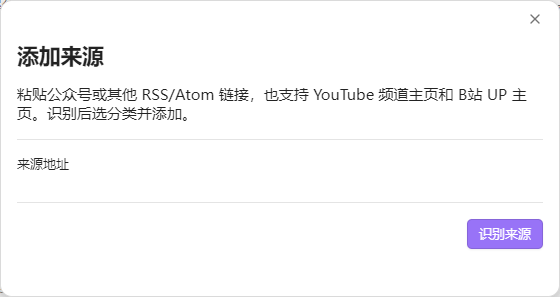

In Add source, click **识别来源** (Identify source), confirm the account or channel, and choose its name, category, and automatic check setting. Click **添加订阅** (Add subscription) to save. An aggregated feed can be added as a general feed. Use an individual account URL to track one WeChat account.

For a background service after Windows login, see [Windows Task Scheduler setup](docs/local-automation.md). For optional Bilibili feeds and service options, see [RSSHub setup](docs/rsshub-runtime.md) and the [service runbook](docs/operator-runbook.md).

## How each platform is connected

### WeChat Official Accounts

I wanted to follow other people's accounts. Pasting a link worked for saving an article, but I still needed a way to find out what each author had published. The WeChat Official Accounts platform exposes tools for operators to manage their own accounts. We did not find a general public subscription interface for following arbitrary accounts.

We tried self-hosted **WeRSS**. Five accounts could be registered, but the list request returned `200013` and the test collected zero article bodies automatically. Backoff reduced repeated requests. That test documents what happened in this project and leaves the exact upstream change and date unconfirmed. Public-link import remained useful when we already had an article URL. [WeRSS test record](docs/werss-runtime.md)

| Route | How to use it |
| --- | --- |
| **Quyue (取阅), tested in this project** | Subscribe to an account at Quyue. On a plan that supports full text, enable **RSS 全文输出** and copy the **individual account's RSS URL** into **Add source**. Group feeds may offer summaries. The maintainer reported **CNY 29/month for up to 20 accounts** on November 15, 2026. Check the provider's checkout before purchasing. Treat private feed URLs as credentials. [Quyue](https://feed.zoro.build/) · [Project test record](docs/acceptance-v0.4.0-2026-10-10.md) |
| **Dajiala (极致了), a paid API we researched** | Get your own key from the provider. Use an account identifier with the history endpoint (`post_history`), then query details as needed with the article URL (`article_detail`). To use it with Guanlan, build a small feed adapter or add a collector on the service side. Retain the article URL, publication date, and original response. The provider was researched for this project and would need a new integration and live validation here. [Provider's workflow](https://www.jzl.com/news/760) · [Article details API](https://apifox.com/apidoc/shared/410674f9-f451-4b4f-957a-5f54f243bc83/api-199752498) |
| **An existing feed or a single article** | Use **Add source** for a feed you already have. For a one-off save, use **Library → Add material → Add link**. |

**RSSAnt (蚁阅)** is a separate RSS reader. The subscription and purchase above were for **Quyue**. [RSSAnt project](https://github.com/anyant/rssant)

The feed supplies candidate articles. When the original page fails the account, date, or text checks, the source shows an error. A public preview of a paid article is saved with that coverage. If you renew an expired Quyue subscription and still see failures, use **Check now** under subscription management to run an explicit check. Read the new result alongside the retained failure history. [Collection and catch-up](docs/collection-setup.md)

### YouTube

I wanted to see a channel's new videos with their actual publication dates. The feed and public pages sometimes failed, so Guanlan now prefers **YouTube Data API v3** and keeps two fallbacks. It uses `channels.list` to find the channel's uploads playlist and `playlistItems.list` to read uploads, checking the channel and video identities before saving.

1. Add a YouTube channel.
2. Enable YouTube Data API v3 in Google Cloud. Create an API key and restrict it to that API.
3. Open **信源 → 管理订阅与分类 → YouTube 稳定连接** (Sources → Manage subscriptions and categories → YouTube connection). Click **验证并保存YouTube密钥** (Verify and save YouTube key). Then run **Check now** and look for **YouTube官方接口** in the source receipt.

| Route | When it fits |
| --- | --- |
| **Official Data API** | The primary route, with your own key and Google project quota. For timeouts, check the service's connection to Google first. Consult Google Cloud for explicit key, permission, or quota errors. [Google's setup guide](https://developers.google.com/youtube/data/getting-started) · [Guanlan setup](docs/youtube-official-api.md) |
| **Channel Atom feed** | Useful for recent uploads. Guanlan checks it when the key is absent or the API read fails. The URL is `https://www.youtube.com/feeds/videos.xml?channel_id=CHANNEL_ID`. In the version studied for this project, Khazix's AIHOT handled channel feeds through its general RSS collector, including intermittent YouTube feed 404s. [Pinned AIHOT code](https://github.com/KKKKhazix/AIHOT/blob/59c8c814aa0dfc49edcca9dbee003f2949172172/packages/backend/src/sources/rss.ts) |
| **Public channel pages** | When Atom fails, Guanlan checks the same channel's Videos, Shorts, or Streams pages. Login restrictions and missing verifiable dates can stop collection. Coverage depends on what YouTube serves. |
| **WebSub push** | A design option for a service with a reachable callback. Google can deliver channel updates to a subscriber. Guanlan's existing implementation polls. [Google's push notification guide](https://developers.google.com/youtube/data/guides/push_notifications) |

These routes save **video entries** with titles, channels, publication dates, and links. If you need text, use **取得视频文字稿** (Get transcript) in the detail pane to try public captions, or import your own SRT/VTT. Captions can be missing or inaccessible, in which case the material shows the gap. [Import and transcript contracts](docs/integration-guide.md)

### Bilibili, X, and the open web

- **Bilibili** supports uploader pages and configured RSSHub feeds. The service can also read public uploads or fall back to a browser, depending on source configuration and local setup. Check the source receipt for rate limits and network failures. [Source options](docs/source-options.md)
- **X** participates in keyword discovery. The free route uses your own X account, a dedicated login window, and local `twscrape`. It checks at most three Top result pages per day, up to 20 posts each. A failed or uncertain request pauses the route for the day. SocialData is an optional paid route you can select. Saving a post captures its text and original response. Video captions and linked pages have their own collection steps. [X setup and login](docs/free-x-setup.md)
- **Other sites** can be followed through RSS/Atom or saved from a supported public article URL. Discover also supports DeepSeek web search, public Hacker News/GitHub lookups, and Tavily. The public lookups need no search key and lean toward tech sources. AI selection still needs a configured model. [Discovery workflow](docs/active-exploration.md)

The **material service process** needs a working network path to each provider. On the maintainer's tested Windows network, YouTube and X needed a working proxy. A standalone service can inherit `HTTPS_PROXY` at startup. The Windows controller can read the enabled local Windows system proxy. Check the service receipt even if the same site opens in your browser. Saved vault notes are available offline.

## Interface guide

Screenshots show v0.22.5 in an isolated demo vault with example sources, notes, and recommendations. The plugin's interface is in Chinese, so the guide includes the on-screen labels.

### 来讯 · Updates

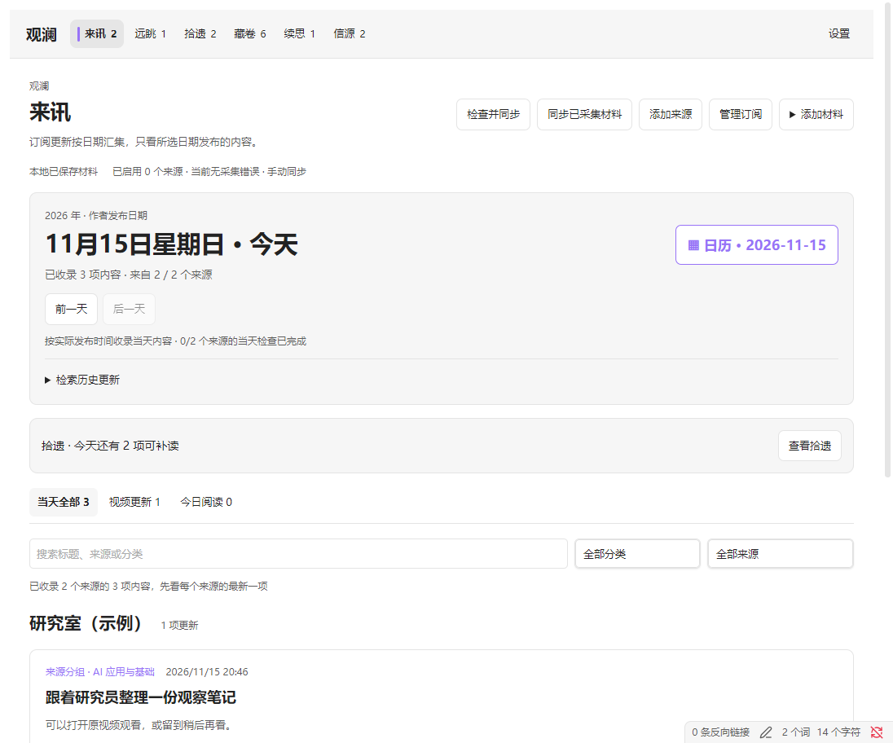

| Control | What it does |
| --- | --- |
| **检查并同步 / 同步已采集材料** (Check and sync / Sync collected items) | The first pulls material already saved, checks due or eligible network-failed sources, then pulls newly collected items. The UI follows the check for up to three minutes. The second only reads the existing service ledger. |
| **添加来源 / 管理订阅** (Add source / Manage subscriptions) | Add an ongoing subscription or go to Sources to inspect and edit existing ones. |
| **更新日期日历 / 前一天 / 后一天 / 回到今天** (Calendar / Previous / Next / Today) | Browse by author publication date in Beijing time. **检索历史更新** searches titles, sources, and saved text across dates. |
| **当天全部 / 视频更新 / 今日阅读** (All updates / Videos / Today's Reading) | Switch lists or open the reading shortlist. The newest item per author appears first. Use **展开本日全部** and **收起其他更新** to show or hide the rest. |
| **打开今日阅读笔记 / 生成 AI 精选** (Open reading note / Generate AI picks) | Open the local shortlist, which can use basic rules, or request evidence-linked short notes from the configured model. The budget limits the shortlist. |
| **查看原因和重试时间 / 查看拾遗** (View failures and retry times / Rediscover) | Jump to source receipts or older unread picks. |

**Today's Reading and video transcripts**

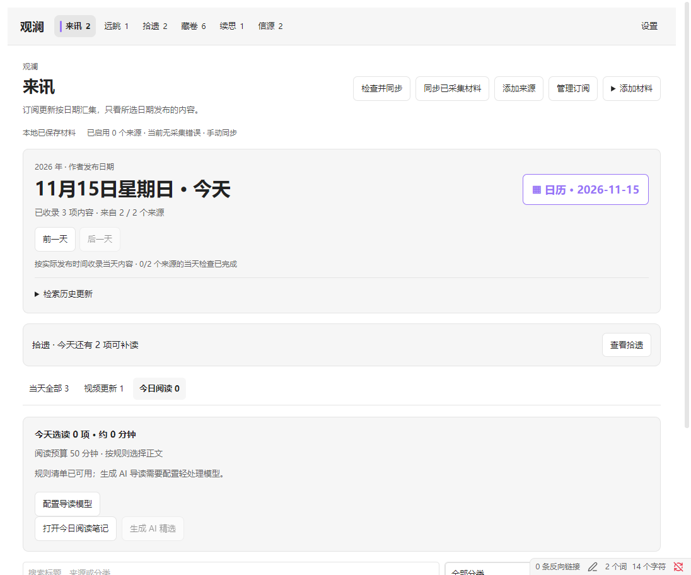

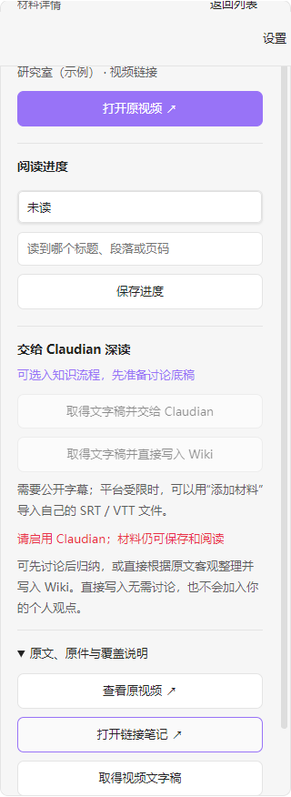

**观看视频 / 打开原视频** open the platform. **打开链接笔记** opens the local entry. If you obtain public captions or import your own captions, a transcript version appears for the same video. The detail pane can also obtain a transcript before sending it to Claudian or the Wiki.

### 远眺 · Discover

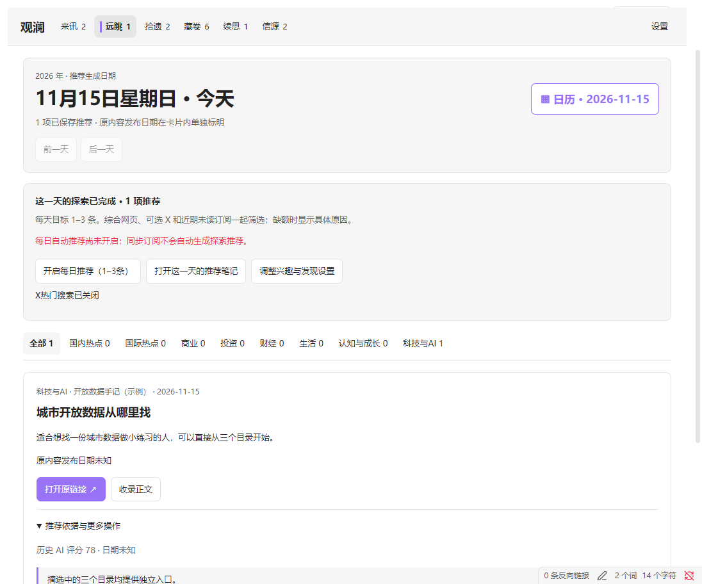

- **发现新内容** runs discovery for today. **开启每日推荐** schedules daily discovery. **调整兴趣与发现设置** opens the provider, topic, keyword, preference, and limit settings.
- The calendar, day buttons, and topic filters browse by recommendation date. The item's publication date is shown separately. **打开这一天的推荐笔记** opens the saved daily results.
- **打开原链接 / 打开X视频** opens the original link. **收录正文 / 收录帖文** tries to save the available content. For saved items, use **阅读已保存正文** or **标记已读**.
- **推荐依据与更多操作** expands evidence, gaps, external links, and handoff actions. **不再推荐** removes the item from the recommendations. **检查已保存结果**, **重试保存**, and **重新校验首次结果** recover an existing run. Daily run records protect completed and uncertain calls from duplicate model requests.

### 拾遗 · Rediscover

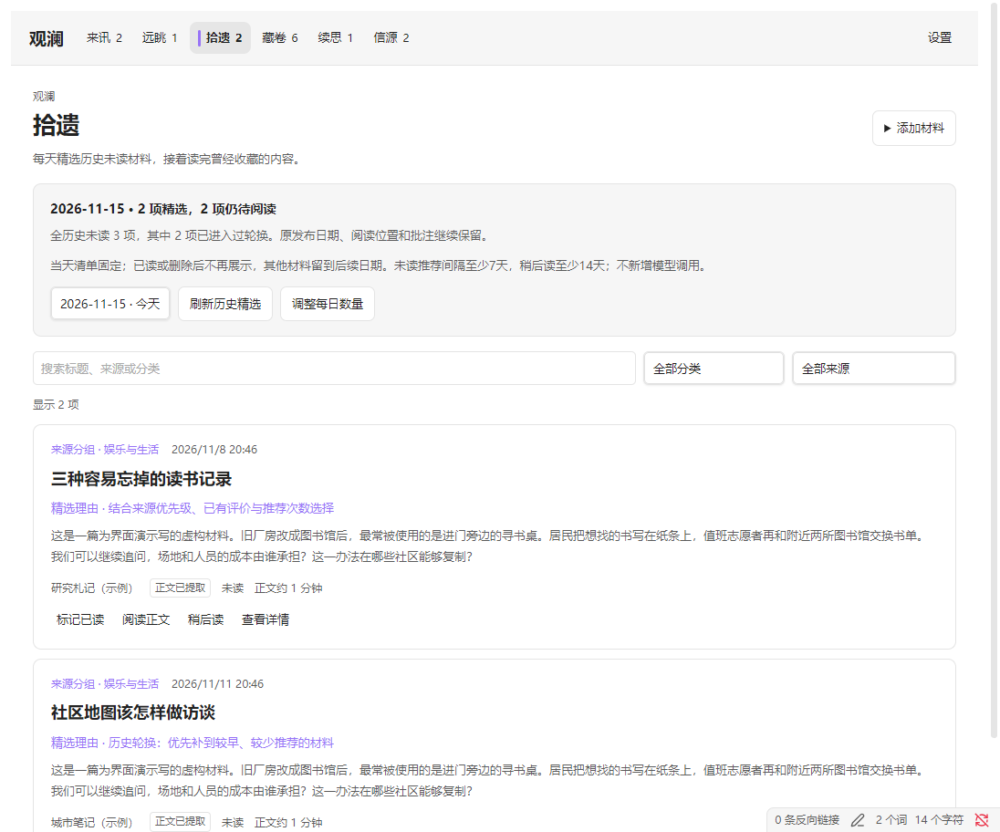

Rediscover rotates through all older unread reading material, two picks per day by default. **历史精选日期** opens prior lists, **刷新历史精选** reloads the saved list, and **调整每日数量** sets 1–5 items starting the next day. **标记已读** removes an item from today's list. Other items get their turn on later days. Reading opens the original note with its annotations and position, with no model call.

### 藏卷 · Library

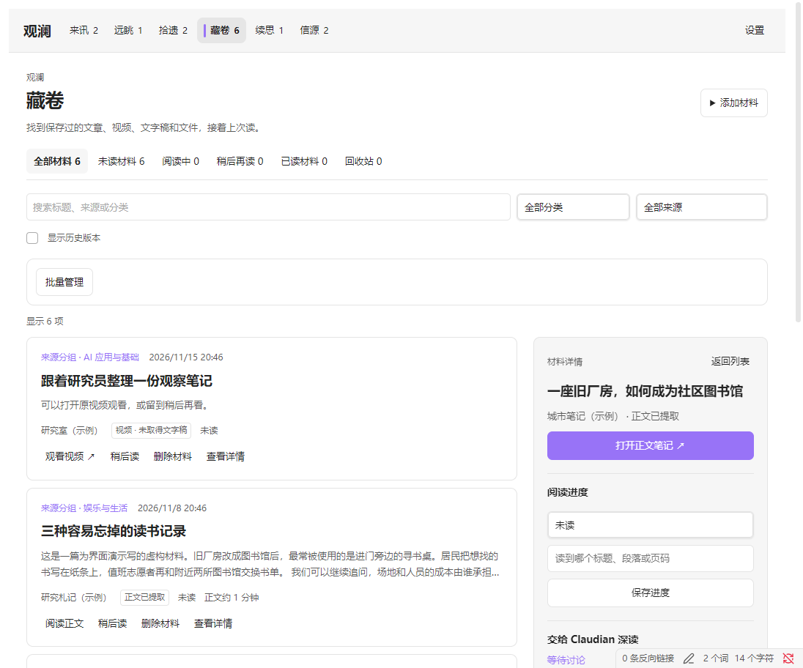

| Control | What it does |
| --- | --- |
| **添加材料 → 添加链接 / 导入文件** (Add material → Add link / Import file) | Choose a category, then save a public page or a Markdown, HTML, PDF, SRT, or VTT file. Text PDFs can be extracted. For a scanned PDF, attach Markdown prepared elsewhere and keep the PDF. |
| Search, category, source, state, and paging | Find saved items by title, source, or category, or switch between unread, in progress, later, read, and trash. Clear filters to return to the full list. **显示历史版本** reveals earlier versions. |
| **阅读正文 / 查看详情 / 返回列表** (Read / Details / Back) | Open the Markdown or the detail pane. Details show versions, coverage, the original URL, and the captured original when available. |
| **稍后读 / 移回未读 / 保存进度** (Read later / Mark unread / Save progress) | Change the state or save a reading position. Add annotations and Obsidian links directly in the Markdown note. |
| **批量管理 / 全选筛选结果 / 清空选择** (Bulk actions / Select filtered items / Clear selection) | Select across pages, change reading states, trash or restore items. Trashing keeps originals and all versions and stops sync from adding that item back. Restore from the trash view. |

The file import dialog lets you set a source identifier. Reuse it for a new version of the same file. Give unrelated files different identifiers even if they share a filename. **导入** or **确认导入** saves to the reading library. You can also choose Claudian discussion or direct Wiki handoff at import.

**Add link dialog**

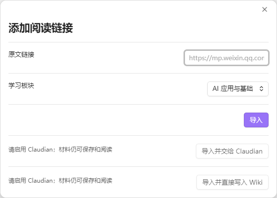

Captured HTML preserves the fetched response. Remote images in Markdown may still need internet access. Scripts, interactive behavior, and complex layouts are outside the Markdown capture. [Material management](docs/material-management.md)

### 续思 · Knowledge handoff

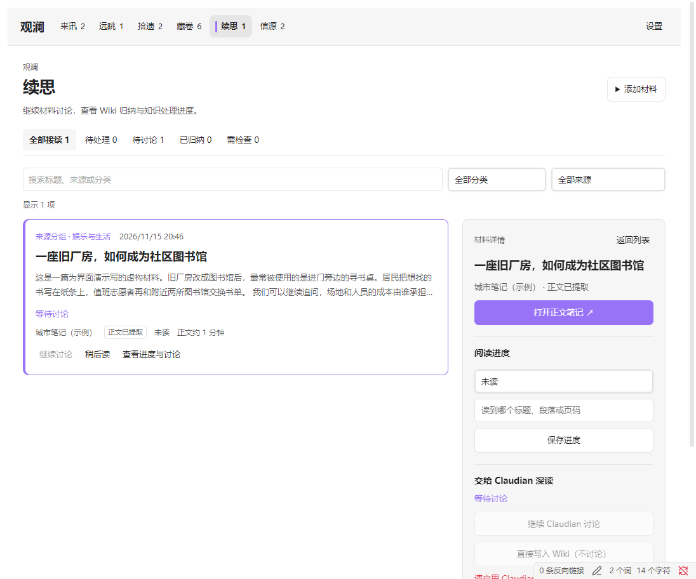

- **交给 Claudian 处理 / 继续 Claudian 讨论** hands the selected material to a verified Claudian installation and reopens the same conversation later. **直接写入 Wiki** passes the source for direct synthesis. Both routes can also be chosen during import and from a discovery card.
- **取消待处理** cancels a queued item before submission. **打开接续笔记**, **打开讨论记录**, **查看来源与覆盖**, **阅读 Wiki**, and **查看晋升结果** open the corresponding records and files when available. **从回执恢复** is for a conversation that cannot be reopened. The first recovery round reads the existing work. **准备 RAW 交接材料** prepares a manual handoff.
- In the maintainer's vault, `08_LLM Wiki` holds RAW originals, topic notes, source records, and receipts. Promotion to a personal note or board (fanOS) needs a specified destination and separate authorization. These paths and checks are tied to the maintainer's workflow. Other vaults can use the library or a manual handoff and adapt the bridge if needed.
- Use **设置 → Claudian 接续** to verify the installed version. That check proves interface compatibility. Look at the corresponding state and files to confirm RAW registration, Wiki completion, or promotion. [Knowledge handoff and recovery](docs/knowledge-integration.md)

### 信源 · Sources

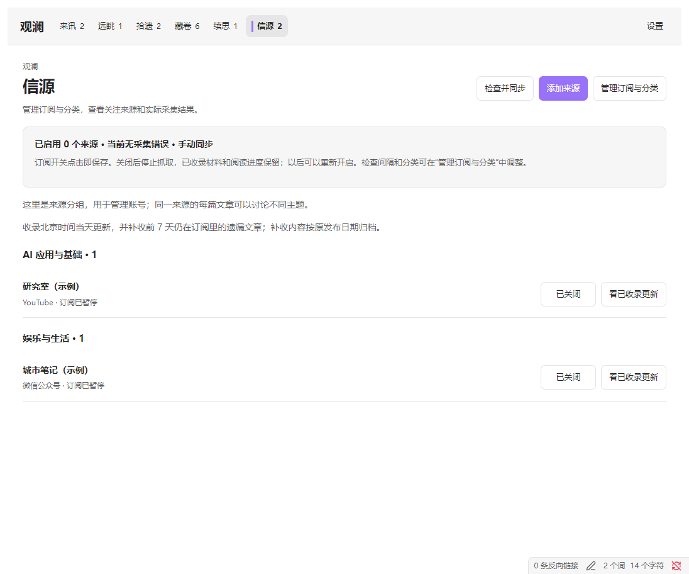

- **订阅中 / 已关闭** toggles collection and saves immediately. **看已收录更新** opens the most recent date with saved items for that source. **最近检查记录** shows individual checks. **最近失败** stays visible after recovery.
- **管理订阅与分类** opens the editor for display names, categories, toggles, check intervals, and catch-up. Create or rename categories there. Move sources out of a custom category before deleting it. Click **保存订阅配置** to commit the dialog changes. Vaults connected to the same service share subscription settings.
- **立即检查更新** checks saved enabled sources before their usual scheduled time. Use it after renewing access, then sync the results. **验证并保存YouTube密钥** verifies a key before storing it. **移除本地YouTube密钥** returns to the keyless fallback routes.

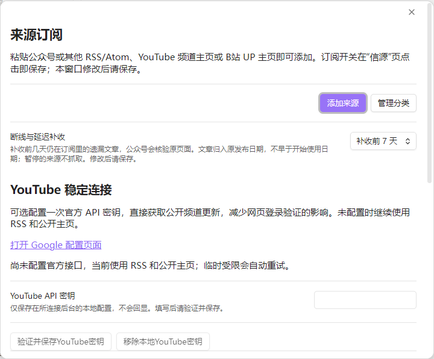

### 设置 · Make it fit your own habits

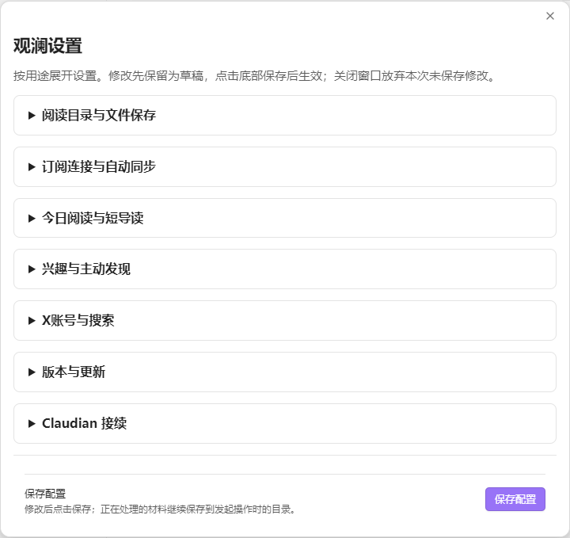

| Group | What you can change |
| --- | --- |
| **阅读目录与文件保存** (Storage) | Default is `09_信息源`. Pick an existing folder or enter a vault-relative path, check the preview, and save. The first write creates a new folder. Switching opens an independent library. Moving an existing library also requires moving its index and originals. |
| **订阅连接与自动同步** (Connection and sync) | Service address, token, and automatic sync. The interval is 1–60 minutes and defaults to 5. Per-source collection intervals live in subscription management. They default to 60 minutes and range from 15–1440. |
| **今日阅读与短导读** (Reading and short guides) | The 50-minute, three-item reading list can be set to 5–180 minutes and 1–5 items. Set your learning goals, model address, name, and key. Automatic AI picks start off, with one batch per day by default. Rediscover has its own daily limit. |
| **兴趣与主动发现** (Discovery) | Toggle automatic discovery, choose among eight topic areas, and change the search provider, keywords, and preferences. The daily default is up to 3 recommendations, adjustable to 1–12. Automatic discovery starts off. |
| **X账号与搜索** (X account and search) | Include or exclude X, and choose a free account connection or a paid provider. **连接X账号** opens a dedicated login window, and **检查X连接** shows connection state. |
| **Claudian 接续** (Claudian handoff) | Verify the installed version. Choose discussion or direct Wiki handoff for each item. Switching to a different agent or Wiki layout calls for a source change to the bridge and storage contract. |
| **版本与更新** (Updates) | Check for a signed package prepared by the local maintainer. Use **一键更新插件** to install it. A plain GitHub ZIP is for manual installation. The signed update channel needs separate setup. |

Edits are a draft until you click **保存配置** (Save settings). Set categories per source in Sources. An agent can change the built-in category names, defaults, and scoring rules in source.

## Adapt it with your own agent

For installation, give the agent the plugin ZIP, these READMEs, and a description of your needs. For code changes, also give it the **source repository**. The ZIP contains compiled JavaScript. The repository has the modules, contracts, tests, and build entry points needed to change it.

Start with your reading habits. For example, “I follow ten legal blogs and two video channels. I read for 20 minutes a day. Group sources under courts, corporate compliance, and technology. Keep my notes local and leave X and Wiki writing off.” Much of that can be handled in settings.

You can give your agent this prompt:

> Read README and AGENTS.md first. Set up Guanlan in a test vault. Connect one test feed and verify a successful check, sync, and read-back of the note and captured original. Configure my sources, reading directory, daily budget, and discovery interests. For any behavior that needs a code change, explain where it belongs and how you will verify it. Test duplicated imports, timeouts, identity mismatches, and retries for new providers. I will enter credentials locally. Deliver the settings, a summary of changes, verification results, and an installable plugin package.

| To change | Start here |
| --- | --- |
| Default interests, categories, budgets, or example sources | [Settings defaults](src/core/settings.ts) · [Categories](src/core/categories.ts) · [Discovery topics](src/core/discovery-topics.ts) · [Source registry](src/core/source-registry.ts) |
| Add a feed or provider API | [Subscription service](src/server/subscriptions.ts) · [HTTP contracts](docs/integration-guide.md) |
| Change pages, controls, or the Obsidian integration | [Workbench views](src/ui/workbench-view.ts) · [Plugin entry point](src/plugin/main.ts) |
| Change deduplication, storage, or reading history | [Reading library](src/core/library.ts) · [Architecture](docs/architecture.md) |
| Connect your own agent or Wiki | [Claudian adapter](src/plugin/claudian.ts) · [Handoff contracts](docs/knowledge-integration.md) |

Run `npm run verify` for type checks, tests, and both builds. On Windows, `npm run package` creates `release/source-workbench-<version>.zip`. Use the [workflow generator](docs/workflow/generate.py) to update the diagrams. Run `py -3 -X utf8 docs/workflow/generate.py --public` to rebuild the [public workflow reference](docs/workflow/public/en/README.md).

## Credentials and credits

Enter service tokens, private RSS URLs, model keys, Google keys, and X login information locally. Use a demo vault for screenshots or shared reproductions. Plugin settings, raw captures, runtime folders, and backups can hold private material. Configured search and model providers receive the queries and source excerpts required by the relevant feature.

Some collection and discovery code and ideas came from [AIHOT](https://github.com/KKKKhazix/AIHOT) by Khazix (数字生命卡兹克). RSSHub is used for the optional Bilibili route. See [AIHOT reuse](docs/aihot-reuse.md) and the [third-party notices](THIRD_PARTY_NOTICES/). Those notices cover the respective third-party components. The maintainer still needs to choose a repository-wide license.
