<p align="center">
  
</p>

<h1 align="center">观澜 · Obsidian 信息源工作台</h1>

<p align="center">汇百川，见新知。把关注的更新、选读和知识笔记汇聚在一起，并通过与 AI Agent 的协作进行知识沉淀，让打造你的 Obsidian 个人知识库更加高效。</p>

<p align="center">
  
  
  
</p>

<p align="center">
  <a href="README.md">English</a> · <a href="#快速上手">快速安装</a> · <a href="#完整工作流">完整工作流</a> · <a href="#界面使用指南">界面指南</a> · <a href="#交给你的-agent-改造">交给你的 Agent</a>
</p>

---

作为一款 Obsidian 插件，观澜可以把公众号、YouTube、B 站和其他 RSS 的更新汇集到 Obsidian里。只要打开一个工作台，就能看到自己关注的作者或博主发布了什么、挑几篇阅读，或者找回以前收藏的内容。读完之后如果有值得留下的精华，还可以再把原文交给 AI Agent 进行讨论或整理成知识笔记。

## 为什么要做观澜

我发现自己花在找信息上的力气，常常比花在读信息上的还多：如果想看一个作者最近写了什么，要在微信翻公众号；想找另一位创作者的内容，又得打开某个视频平台去搜索。中途可能还会有各种和摄取高质量信息目标所违背的“不良诱惑”来干扰你，可能本来是为了去好好学习的，结果却刷起视频来了。最后，可能还要把值得反复读的链接发给自己，或者复制进 Obsidian。每换一个地方，都得重新找入口、回想上次看到哪儿，以及思考这次到底要找什么。

**当今时代，注意力是很稀缺且宝贵的资源。** 明明只想找一个视频，首页却已经给我安排了一串短视频、热搜和续播。等我再想起来开这个 App 是做什么的，留给那篇文章或那段长视频的时间和精力已经少了一大截。因此，观澜将帮助你，从这里开始取舍。

**01 / 把找更新和读内容汇聚到同一个地方**

我想追的是某几个特定的博主，最费力的事情却是每天挨个确认他们发没发。“来讯”会把各个平台已收录的更新放在一个地方，按照作者和真实发布日期来组织，默认先露出每个来源最新的一项。视频也先以标题、作者和链接出现，这样，用户就可以看完这一页再决定要不要打开平台来进行阅读。电脑开着、后台在运行时，采集可以先运行，等用户打开 Obsidian 之后再把已保存的材料同步过来。

**02 / 让一段有限的阅读时间有个明确的结束点**

打开工作台之前，我常常就知道自己今天只有二十分钟。此时几百条未读的订阅内容对我帮助有限。“今日阅读”可以按照当日的个人时间与精力的预算选几篇来阅读，想查完整更新仍可回到来讯。在订阅之外，如果用户也希望发现新的作者或内容，所以“远眺”单独留了一个入口。它可以每天只给几条推荐阅读，说明为什么值得点开、手头的证据是什么，没合适的内容就少给。这样，用户就可以带着问题浏览一份有限的信息源清单，读够了就关掉。

**03 / 收藏之后，还能找回来、接着读**

平台收藏夹知道我点过收藏，却很难帮我找回半个月前读到一半、只记得一句话的文章。我把正文、来源信息、原件和阅读位置一起存进了 Obsidian。“藏卷”可以按来源、分类和状态来筛选，“拾遗”则会从旧的未读材料里轮换几项。以后回来看的是原来的笔记，批注和上次停的位置也会一起回来。

**04 / 遇到缺项时，我得知道缺的是哪一步**

更新列表上空空的，可能是作者没发，也可能是订阅过期、网络超时、原页账号对不上，或者后台已经保存、插件还没同步等各种原因。这几种情况对应的处理是完全不同的。所以“信源”会显示实际采集回执和下次重试时间，“来讯”只展示已经收录的材料。视频链接、文章节选和完整正文也各自标注覆盖范围。需要补正文或字幕时，用户能从当前材料直接往下处理。

**05 / 先把原文读明白，再决定要不要写进知识库**

一本书、一篇文章、一条推荐理由，能支持的判断各不一样。我想保留出处、自己做过的批注和 AI 据以生成的内容。因此，观澜会把原件、正文版本、短导读分开保存。读到确实值得整理的一篇，我可以把指定版本交给 Claudian，先讨论或直接归纳。续思根据回执和实际文件显示进度，方便日后追溯一条知识是从哪里来的。

不过，这些取舍来自我个人的阅读习惯。你也可以只用一个 RSS 和一个阅读目录，也可以改来源、分类、预算、兴趣、模型和接续方式，所有你需要个性化的东西只要和你的 Agent 沟通就行。

## 完整工作流


从固定订阅、兴趣探索和手动导入拿到的材料，最后都会进入 Obsidian 的阅读库。后台负责采集与增量传递，插件负责保存、选读和阅读进度。哪一篇要交给 Claudian 接着整理，由你来决定。下图先串起全程，再按环节看各自的成功、失败与恢复路径。

[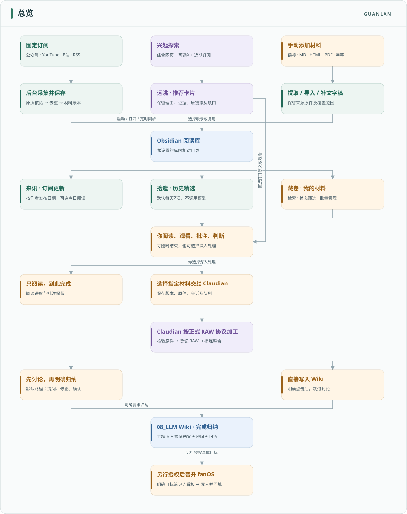](docs/workflow/public/zh-CN/overview.svg)

**图例**　绿色：自动处理 · 金色：你来决定 · 紫色：模型参与 · 蓝色：文件或状态写入 · 红色：核验与保护。

[01 订阅采集与同步](#flow-subscriptions) · [02 兴趣探索](#flow-discovery) · [03 链接、文件与视频文字稿](#flow-importing) · [04 阅读、今日选读与拾遗](#flow-reading) · [05 Claudian、RAW 与 Wiki 接续](#flow-knowledge) · [06 故障恢复、程序更新与备份](#flow-recovery)

[按节点查输入、输出、存储与对应源码 → 完整技术说明](docs/workflow/public/zh-CN/README.md)

<a name="flow-subscriptions"></a>

### 01 · 订阅采集与同步

平台取数后核对身份、日期和正文。后台先写材料账本，插件再分页同步，整页成功后推进游标。

[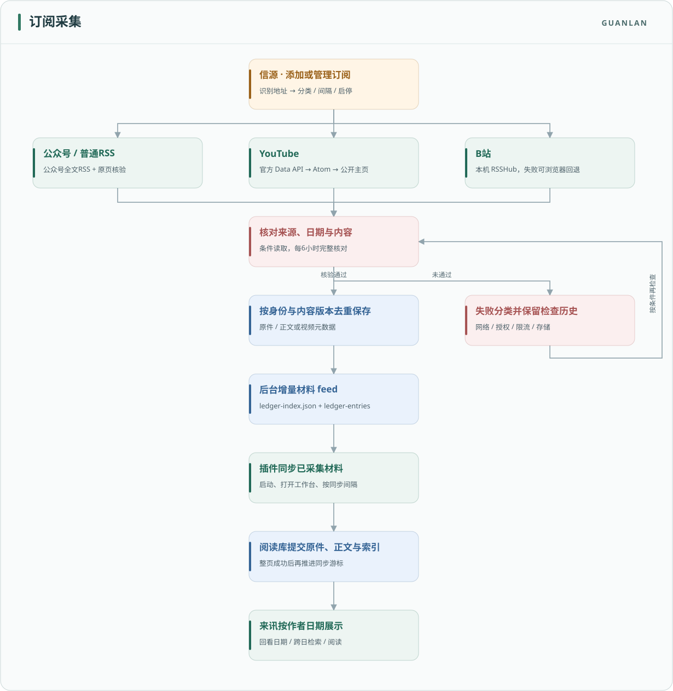](docs/workflow/public/zh-CN/subscriptions.svg)

[查看大图](docs/workflow/public/zh-CN/subscriptions.svg) · [逐步技术说明](docs/workflow/public/zh-CN/README.md#subscriptions)

<a name="flow-discovery"></a>

### 02 · 兴趣探索

网页、可选 X 和近期未读正文合并预筛，补读限量外链，模型评分后由程序复核。日批次和阅读库分别保存。

[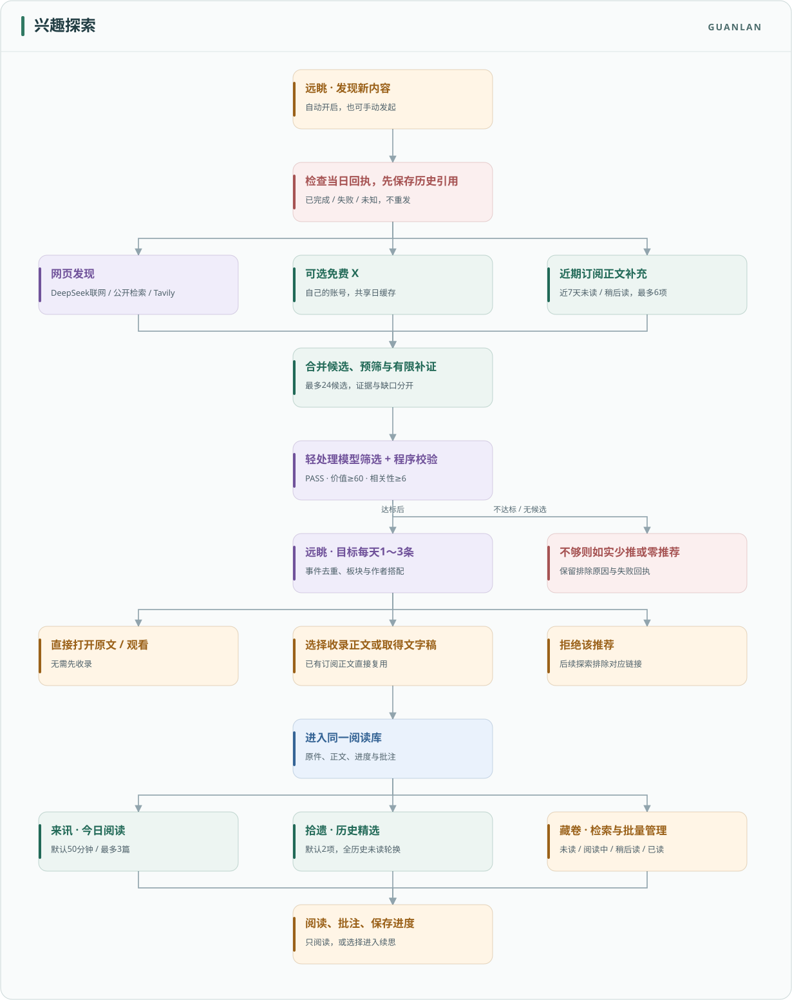](docs/workflow/public/zh-CN/discovery.svg)

[查看大图](docs/workflow/public/zh-CN/discovery.svg) · [逐步技术说明](docs/workflow/public/zh-CN/README.md#discovery)

<a name="flow-importing"></a>

### 03 · 链接、文件与视频文字稿

不同入口分别提取和标注覆盖，按材料身份和内容版本去重。保存顺序和恢复点决定失败后能否续跑。

[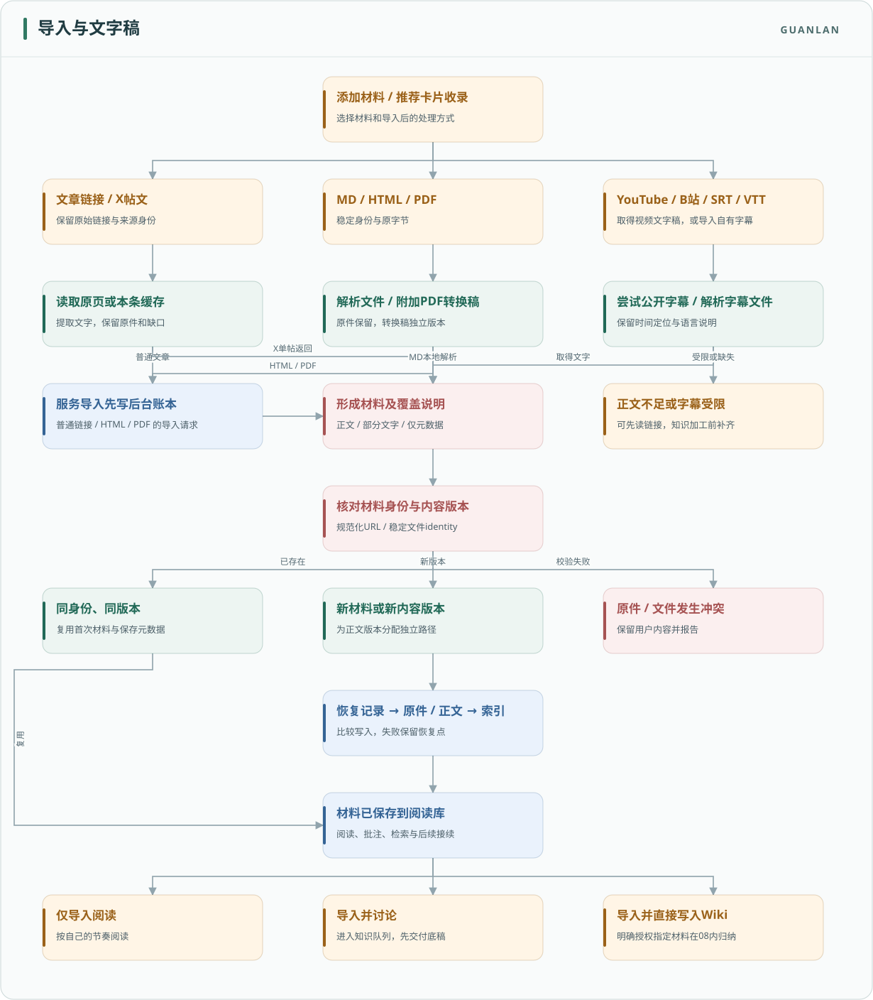](docs/workflow/public/zh-CN/importing.svg)

[查看大图](docs/workflow/public/zh-CN/importing.svg) · [逐步技术说明](docs/workflow/public/zh-CN/README.md#importing)

<a name="flow-reading"></a>

### 04 · 阅读、今日选读与拾遗

同一个索引支撑今日清单、历史轮换和材料管理。规则、AI 短导读与回收站各有保存条件。

[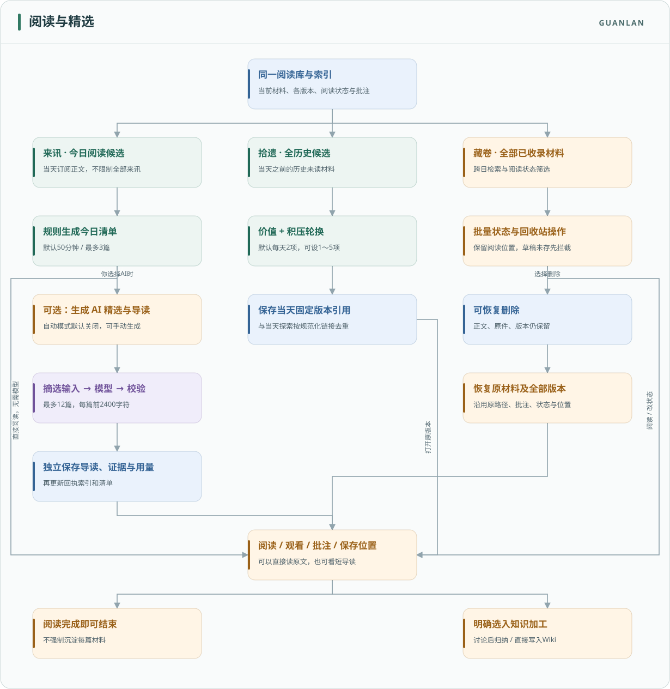](docs/workflow/public/zh-CN/reading.svg)

[查看大图](docs/workflow/public/zh-CN/reading.svg) · [逐步技术说明](docs/workflow/public/zh-CN/README.md#reading)

<a name="flow-knowledge"></a>

### 05 · Claudian、RAW 与 Wiki 接续

指定版本进入队列，先保存提交意图再发送。讨论与直达两条路径都核验原件、任务回执和 Wiki 文件。

[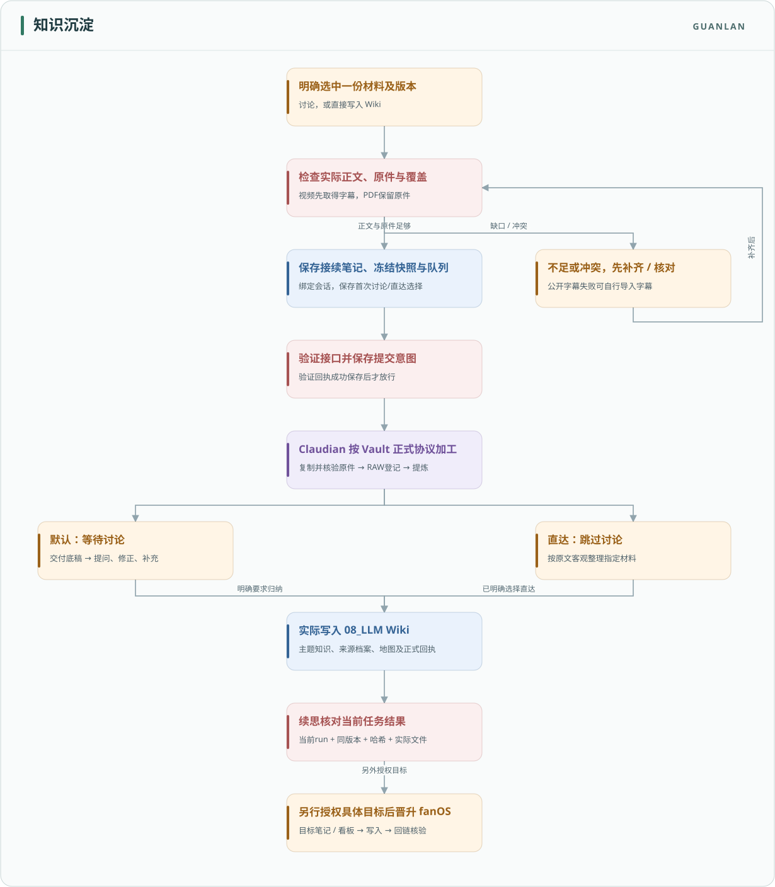](docs/workflow/public/zh-CN/knowledge.svg)

[查看大图](docs/workflow/public/zh-CN/knowledge.svg) · [逐步技术说明](docs/workflow/public/zh-CN/README.md#knowledge)

<a name="flow-recovery"></a>

### 06 · 故障恢复、程序更新与备份

网络按错误类型重试，模型按首次结果恢复。升级前备份，安装时核验签名，历史归档回读成功后才轮换。

[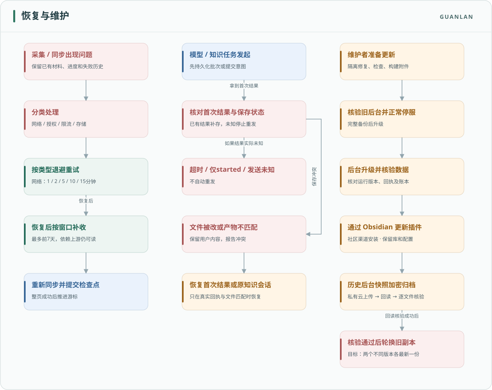](docs/workflow/public/zh-CN/recovery.svg)

[查看大图](docs/workflow/public/zh-CN/recovery.svg) · [逐步技术说明](docs/workflow/public/zh-CN/README.md#recovery)

## 快速上手

[**下载 v0.22.5 安装包**](https://github.com/wangkefan0309-ui/guanlan/releases/download/v0.22.5/source-workbench-0.22.5.zip) · 也可以[从源码构建](#快速上手)。ZIP 只含插件，订阅后台按下面的步骤单独运行。

需要 Obsidian **桌面版 1.13.0 或更新版本**。从源码构建和运行后台需要 **Node.js 22.13 或更高版本**。下面以 Windows 为例，后台常驻、RSSHub 和免费 X 的辅助脚本以 Windows 为已验证环境。

1. 如果你已有插件 ZIP，解压出 `source-workbench` 文件夹。如果你拿到的是源码，在项目根目录执行：

   ```powershell
   npm ci
   npm run build
   ```

   将 ZIP 中的 `source-workbench` 文件夹放进 Vault 的 `.obsidian/plugins/`。从源码安装时，在这个位置创建 `source-workbench`，把 `dist/plugin/` 的四个文件复制进去：`manifest.json`、`main.js`、`styles.css`、`AIHOT-MIT.txt`。在 Obsidian 的第三方插件页面启用「观澜」。

2. 需要抓取网页、订阅、公开字幕或使用外部探索渠道时，在项目目录运行后台。插件 ZIP 内只有插件程序和第三方版权说明，后台从源码单独启动。没有执行过 `npm ci` 的话先执行一次。

   ```powershell
   npm run dev:server
   ```

3. 点击 Obsidian 左侧雷达图标，进入「设置 → 订阅连接与自动同步」。独立服务默认是 `http://127.0.0.1:27183`，令牌在后台项目的 `.local/server/token.txt`。填完点击「检查连接」，在底部「保存配置」。如果你使用另一个服务实例，地址、端口和令牌取该实例的值。
4. 打开「信源 → 添加来源」，填入一个可用的 RSS、Atom 或频道链接，确认识别出的身份和分类，再添加。初始来源登记是一些示例，默认停用、未填订阅地址，换成你自己的即可。
5. 用「信源 → 管理订阅与分类 → 立即检查更新」跑第一轮。看到来源回执成功后，在来讯点击「同步已采集材料」。本地文件也可以直接从「藏卷 → 添加材料 → 导入文件」开始阅读。

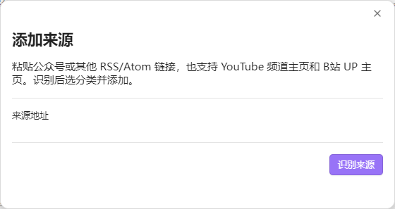

在「添加来源」里，先点「识别来源」，确认账号或频道，再选名称、分类和是否自动检查。点「添加订阅」保存。聚合 RSS 可以按普通 Feed 接入，关注单个公众号时用它的单号地址。

需要后台在 Windows 登录后常驻时，可以配置[任务计划程序](docs/local-automation.md)。B 站 RSSHub 和独立服务分别见 [RSSHub 接入](docs/rsshub-runtime.md)和[运维说明](docs/operator-runbook.md)。

## 各平台是怎么接进来的

### 微信公众号

手动复制一篇文章链接可以导入，但是如果你想要完全地自动化这个任务，还需要一个持续返回发文列表的来源。目前微信公众平台开放的是运营者管理自己账号的能力，目前官方没有能直接订阅任意公众号的公开通用接口。令人更加遗憾的是，截至2026年10月，可以明确的是微信官方已经关闭了批量获取文章链接的接口，大量市面上开源的项目也已经随之失效。

我尝试了自建 **WeRSS**。当时测试的五个账号可以登记，调取列表却碰到 `200013`，自动拿到的正文是零。加退避只减少反复请求，无法保证接口恢复。这是项目当时的实测，单凭它无法判断微信哪天关闭了哪一个接口，也不能外推到其他部署。期间还试过单篇公开链接提取，它适合临时收藏，持续更新仍需要列表。 [WeRSS 实测](docs/werss-runtime.md)

同时，我也对市面上为数不多的类似“取阅”的项目进行了逆向，得出的结果是一条相似的路径：公众号后台 appmsgpublish、微信客户端凭据 profile_ext/getmsg（25分钟失效）、真实号 hook 监听群发，外加账号池+代理池摊平风控，采集逻辑全在服务端。我通过实测侧车只走 appmsgpublish，结果 searchbiz 正常、appmsgpublish 稳定 200013，30分钟静默后单次请求仍撞，判定为账号权限而非节奏。存活的开源方案已全放弃该接口，改用 Frida hook 本机微信原生会话抓主页（如 mpider），凭证保留在本机；代价是锁死微信 4.1.15.56、有封号风险。所以，如果想要个人进行本地部署的话，代价很大，目前我没有找到任何替代的方案，只能向SaaS服务或者付费API妥协。以下是我目前找到的比较好的方案。

| 路线 | 怎么用 |
| --- | --- |
| **取阅（Quyue），项目已经接通** | 在取阅订阅目标公众号。套餐支持全文时，开启「RSS 全文输出」，复制**单公众号 RSS**，粘贴到观澜的「添加来源」。分组、汇总可能只有摘要。作者 2026 年 11 月 15 日提供的套餐信息为 **¥29/月，可订阅 20 个公众号**。购买前以取阅结算页为准。私密订阅地址当作凭据保管。 [取阅入口](https://feed.zoro.build/) · [项目接入记录](docs/acceptance-v0.4.0-2026-10-10.md) |
| **极致了（Dajiala），付费 API 备选** | 在供应商控制台获取 Key，按官方说明先用公众号标识查询历史发文列表（`post_history`），再拿文章 URL 按需查详情（`article_detail`）。要接到观澜，可以自己写一个小服务，将列表转换为 RSS，或者在后台实现独立采集适配器，保存原文链接、日期与原始回执。这个仓库没有内置极致了采集器，项目也未用它付费实采。 [官方工作流](https://www.jzl.com/news/760) · [详情 API](https://apifox.com/apidoc/shared/410674f9-f451-4b4f-957a-5f54f243bc83/api-199752498) |
| **自己已有 RSS 或一篇链接** | 已有稳定 RSS/Atom 就用「添加来源」。只想留下一篇，用「藏卷 → 添加链接」。 |

RSS 提供候选文章。微信原页账号、日期或正文核验不过的时候，信源会留错误。公开视频、付费文章公开预览等也只保留实际取得的范围。会员续费后信源仍显示失败时，用订阅管理里的「立即检查更新」发起显式检查。续费前的失败回执会保留，看本轮结果判断是否恢复。 [采集与补收](docs/collection-setup.md)

另外，如果大家有找到开源的可以本地化的方案，也非常欢迎和我交流！

### YouTube

我想知道一个频道出了什么新视频，并保留真实发布日期。最初只用频道订阅或公开页面，遇到过 Feed 错误和页面限制。因此我现在优先选择的是官方的API—— **YouTube Data API v3**，仍留了两个备选入口。后台先用 `channels.list` 找到频道的 uploads 播放列表，再用 `playlistItems.list` 取更新，核对频道和视频 ID，并按实际视频发布时间保存。

1. 先添加 YouTube 频道。
2. 在 Google Cloud 启用 YouTube Data API v3，创建 API Key，并将 API 限制设为该服务。
3. 在「信源 → 管理订阅与分类 → YouTube 稳定连接」点击「验证并保存 YouTube 密钥」。验证成功后运行「立即检查更新」，看来源回执里的「YouTube 官方接口」。

| 获取方式 | 适合什么情况 |
| --- | --- |
| **官方 Data API** | 主路线，需要自己的 Key。普通读取受 Google 项目配额约束。后台连接超时先看网络，明确报密钥、权限或配额问题时再查 Google Cloud。 [Google 官方指南](https://developers.google.com/youtube/data/getting-started) · [观澜配置步骤](docs/youtube-official-api.md) |
| **频道 Atom** | 适合只跟踪近期更新。在没填 Key 或 API 失败时可用，格式是 `https://www.youtube.com/feeds/videos.xml?channel_id=CHANNEL_ID`。卡兹克的 AIHOT 在项目研究的固定版本中把此类频道 Feed 放进通用 RSS 流程，还处理了偶发 404。 [AIHOT 固定版本源码](https://github.com/KKKKhazix/AIHOT/blob/59c8c814aa0dfc49edcca9dbee003f2949172172/packages/backend/src/sources/rss.ts) |
| **频道公开页** | Atom 失败后检查同一频道的 Videos、Shorts、Streams 页面。页面登录限制或无法拿到可核验日期时会报告失败，覆盖随 YouTube 页面变化。 |
| **WebSub 推送** | 适合自己有常驻且可接收回调的服务时开发。Google 的推送可将频道更新送到回调地址，此仓库目前使用轮询。 [Google 推送说明](https://developers.google.com/youtube/data/guides/push_notifications) |

以上几种路线发现的是**视频条目**，保存标题、频道、发布日期、链接。需要读或引用视频的话，在详情点「取得视频文字稿」尝试公开字幕，或导入已有 SRT/VTT。遇到字幕不可用或原页验证时，界面会留下缺口。公开视频并不一定能获得字幕。 [导入与文字稿契约](docs/integration-guide.md)

### B站、X 和普通网站

- **B站**可以接 UP 主主页或自己配置的 RSSHub Feed。后台也有公开投稿读取与浏览器回退，适用路线取决于来源配置和本机准备。遇到风控、限流或网络失败时看本轮回执。 [B站和其他来源](docs/source-options.md)
- **X**在「远眺」参与按关键词发现。免费路线用自己的 X 账号、专用登录窗口和本机 `twscrape`，每天最多三个 Top 首页检查，每页最多 20 条。失败或结果未知时当日暂停。SocialData 是手动选择的付费备选。收录帖文保存本条正文及接口原件，视频字幕和外链全文要单独取得。 [X 设置与登录](docs/free-x-setup.md)
- **普通网站**可以通过 RSS/Atom 持续订阅，或输入任意支持提取的公开文章链接做单篇导入。远眺另外支持 DeepSeek 原生联网、免 Key 的 Hacker News/GitHub 公开检索和 Tavily。免 Key 检索的覆盖偏技术，AI 筛选仍需要匹配的模型配置。 [探索流程](docs/active-exploration.md)

采集能否工作取决于**后台进程**能否连到对应平台。在项目实测的 Windows 网络上，YouTube 和 X 需要走可用代理。使用手动服务时可在启动前配置 `HTTPS_PROXY`，Windows 常驻控制器可读取已开启的本机系统代理。浏览器能打开某个站点仍应以后台回执复验。Vault 内已存的笔记可离线阅读。

## 界面使用指南

截图取自运行 v0.22.5 的隔离演示库。材料、来源和推荐是示例，界面沿用插件里的中文标签。

### 来讯 · 看订阅更新

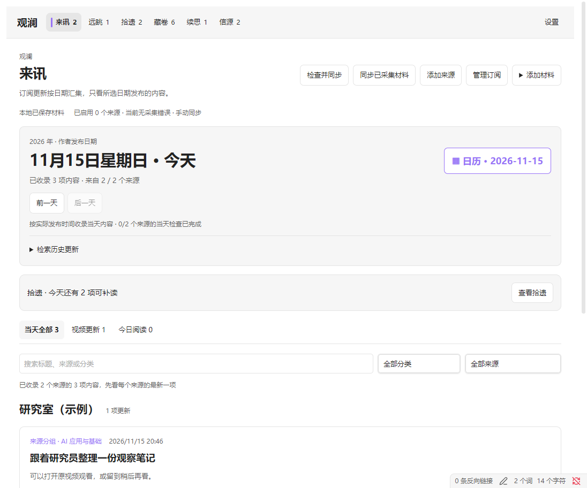

| 界面操作 | 做什么 |
| --- | --- |
| **检查并同步** / **同步已采集材料** | 前者先同步已保存材料，再检查已到期来源或符合网络恢复条件的来源，并尝试同步新抓到的材料。界面最多跟踪三分钟。后者只取后台账本已有材料。 |
| **添加来源** / **管理订阅** | 新建持续订阅，或转到信源看失败详情、修改订阅。 |
| **更新日期日历** / **前一天** / **后一天** / **回到今天** | 在北京时间的发布日期之间移动。反查旧文章用「检索历史更新」，可匹配标题、来源和已保存正文。 |
| **当天全部、视频更新、今日阅读** | 切换今日列表和选读清单。默认每个作者先显示最新一项，点击「展开本日全部」或「收起其他更新」控制当前作者。 |
| **打开今日阅读笔记** / **生成 AI 精选** | 前者打开本地选读笔记，规则选读可离线进行。后者用配置的轻处理模型产出带原文依据的短导读。预算只管选读，不影响订阅数量。 |
| **查看原因和重试时间** / **查看拾遗** | 去信源读本轮回执，或换到以前保存的未读选摘。 |

**今日阅读与视频文字稿**

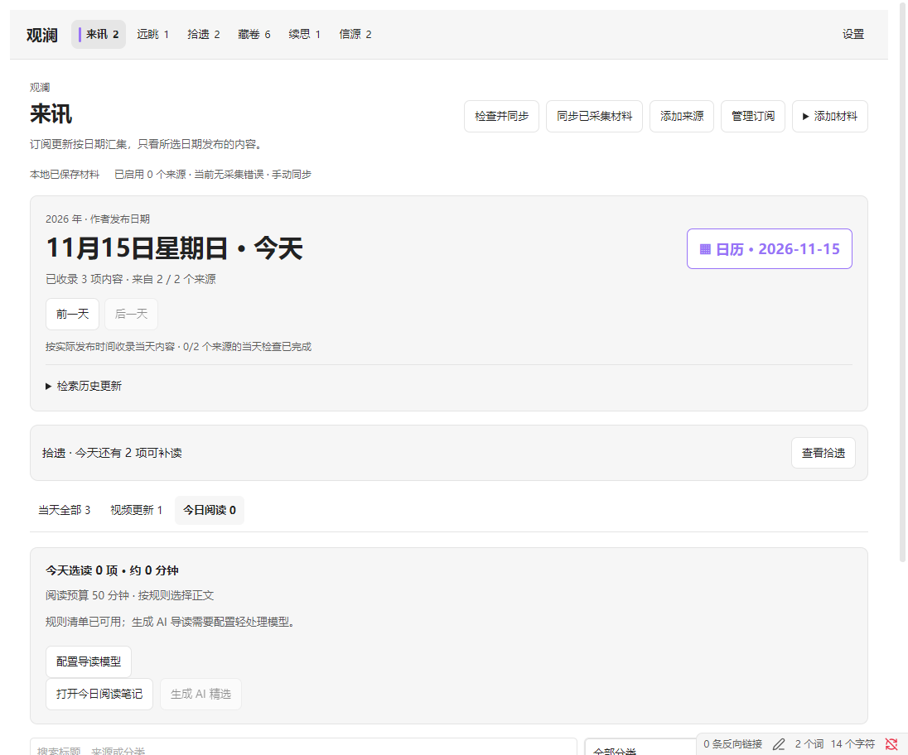

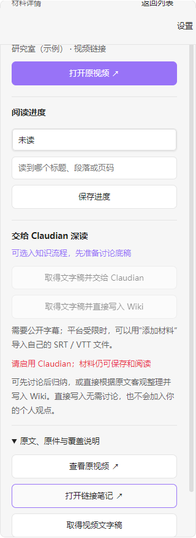

点「观看视频」或「打开原视频」跳到平台。点「打开链接笔记」可在本地查看条目。取得公开字幕或导入自己的字幕后，同一视频下会出现文字稿版本。详情里也可选择取得文字稿后交给 Claudian，或直接写入 Wiki。

### 远眺 · 找关注列表以外的内容

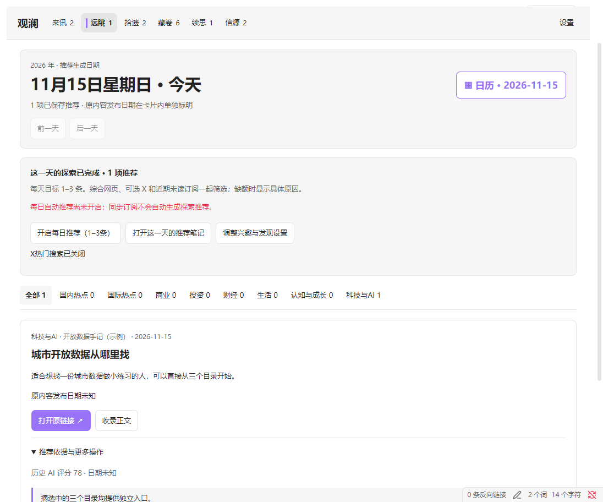

- **发现新内容**发起当天探索。「开启每日推荐」把它设为自动任务。由「调整兴趣与发现设置」更换检索渠道、关键词、板块、兴趣偏好和上限。
- **日历、前一天、后一天、回到今天、板块筛选**按推荐生成日回看。候选原文日期单独显示。「打开这一天的推荐笔记」打开当日保存的结果。
- **打开原链接／打开 X 视频**跳到原站。**收录正文／收录帖文**尝试保存实际内容。已收录的可「阅读已保存正文」或「标记已读」。
- **推荐依据与更多操作**展开证据、覆盖缺口、外链与接续入口。**不再推荐**从这批推荐中移除此项。「检查已保存结果」「重试保存」「重新校验首次结果」用来恢复原有批次。已完成或结果未知的任务有日批次保护，打开页面不会重复发模型请求。

### 拾遗 · 再遇见存过的好内容

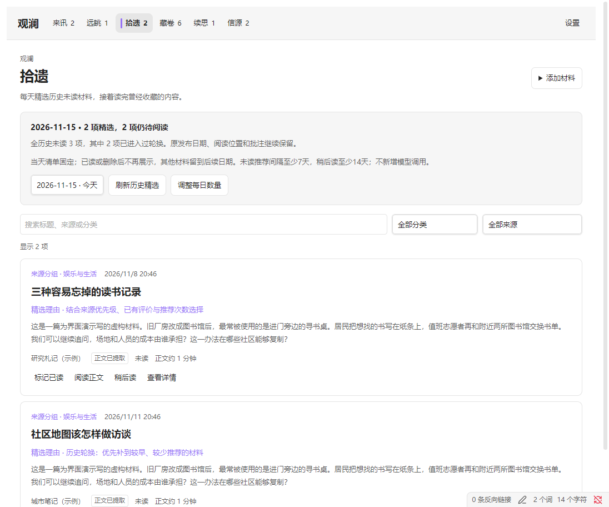

从全历史未读正文里每天默认挑两项。**历史精选日期**可回看其他日期，**刷新历史精选**重新读取已存清单，**调整每日数量**可设 1–5 项，次日生效。**标记已读**立即从当日待读列表退出，其他材料等下一天轮换。点击正文回到原来的那份笔记，沿用已有阅读位置与批注，无需模型。

### 藏卷 · 阅读库、导入和回收站

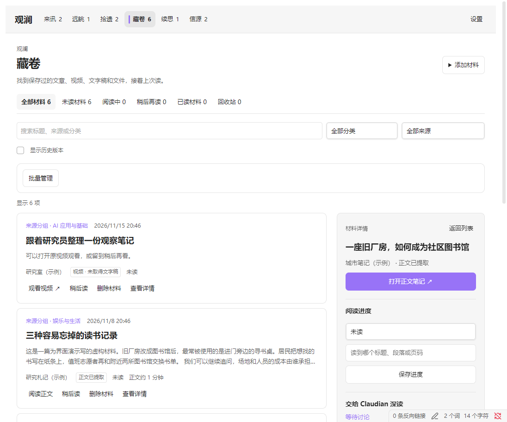

| 界面操作 | 做什么 |
| --- | --- |
| **添加材料 → 添加链接 / 导入文件** | 选类别后保存公开网页或 Markdown、HTML、PDF、SRT/VTT。带文字层的 PDF 可提取文字。扫描件可附外部转换的 Markdown，并保留原 PDF。 |
| **搜索材料** / **分类、来源、阅读状态** / **上一页、下一页** | 在已保存材料中定位。支持按未读、阅读中、稍后读、已读和回收站查看。清除筛选可回到完整列表。「显示历史版本」可展开早期版本。 |
| **阅读正文** / **查看详情** / **返回列表** | 打开 Markdown 或查看右侧详情。详情可看版本、覆盖说明、原文链接和来源原件。 |
| **稍后读 / 移回未读** / **保存进度** | 改状态或填写阅读位置。正文仍可在 Obsidian 里用普通 Markdown 写批注、加双链。 |
| **批量管理** / **全选筛选结果** / **清空选择** | 支持跨页选择、批量改状态、删除或恢复。**删除材料**和**确认移入回收站**保留正文、所有版本和原件，也防止同步把该材料自动加回来。回收站中可以恢复。 |

导入文件时可以填写「来源标识」。同一文件更新时沿用原标识，两个同名的不同文件用不同标识。选择「导入」或「确认导入」只保存到阅读库，也可以在导入时直接选 Claudian 讨论或 Wiki 归纳。

**添加阅读链接**

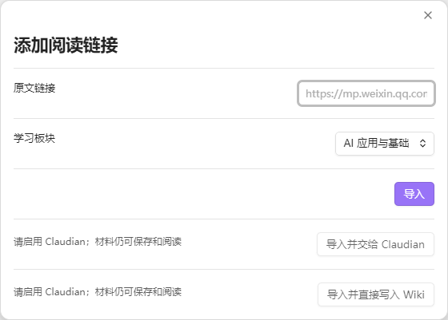

网页 HTML 原件保留抓取时的响应。Markdown 中的外链图片可能需要联网，脚本、交互和复杂页面版式不随正文保存。 [材料管理](docs/material-management.md)

### 续思 · 和 Agent 讨论，再写知识笔记

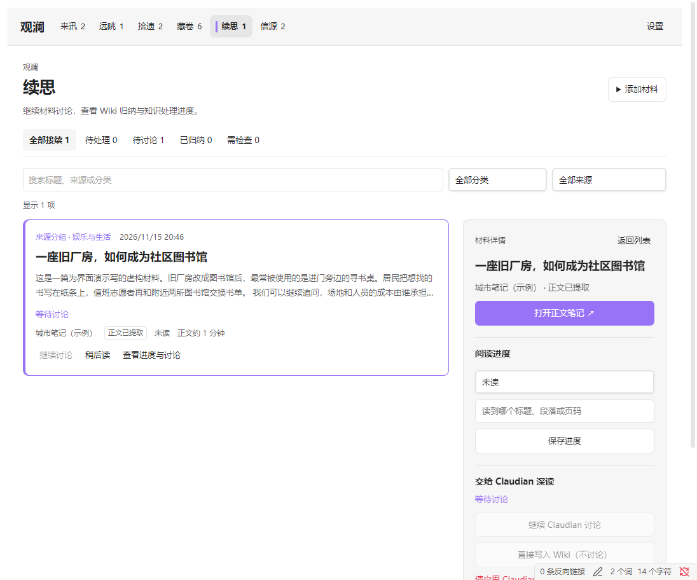

- **交给 Claudian 处理 / 继续 Claudian 讨论**把选中的材料交给经过验证的 Claudian，后续回到同一会话。**直接写入 Wiki**适合资料清楚、希望按原文整理的材料。导入和远眺详情也能选接续路径。
- **取消待处理**取消尚未提交的队列项。**打开接续笔记**、**打开讨论记录**、**查看来源与覆盖**、**阅读 Wiki**和**查看晋升结果**在有相应回执和文件时提供入口。**从回执恢复**用于原会话无法继续，恢复首轮只读。**准备 RAW 交接材料**也可用于人工交接。
- 作者自己的 Vault 使用 `08_LLM Wiki` 下的 RAW 原件、主题知识、来源档案和回执，再按具体授权写入个人笔记或看板（fanOS）。这些路径和协议有代码约束，通用 Vault 可以用藏卷阅读或准备交接，也可以按自己的目录与 Agent 改桥接。
- 在「设置 → Claudian 接续」验证当前安装。通过只表明接口兼容。RAW 是否登记、Wiki 是否写入、个人笔记是否更新，分别看「续思」里对应的状态和实际文件。 [知识接续与恢复](docs/knowledge-integration.md)

### 信源 · 管理订阅和追查失败

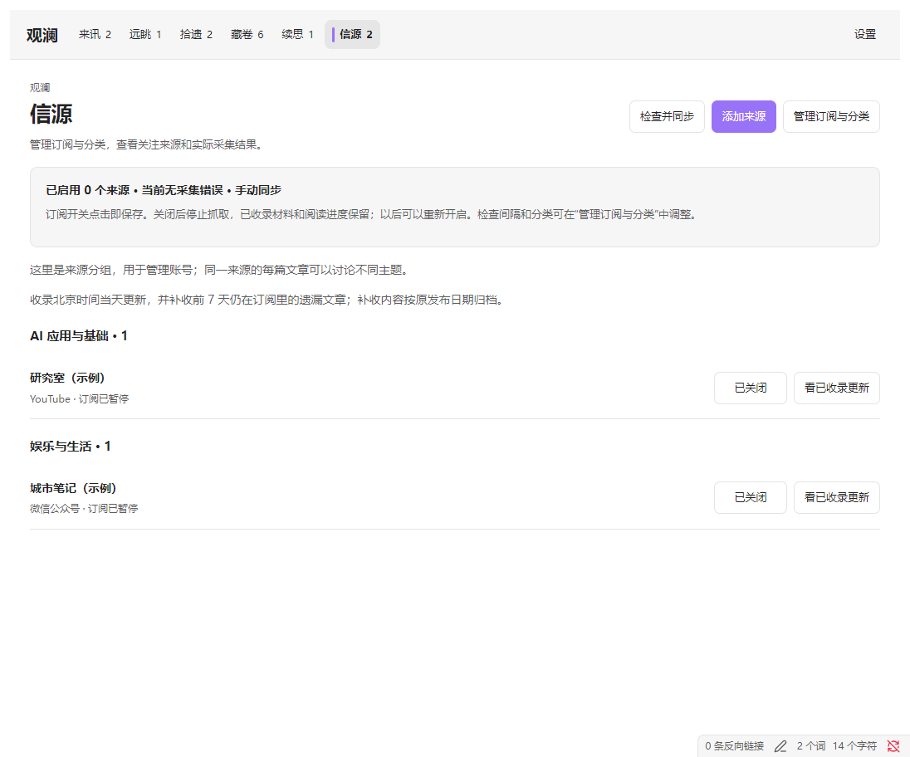

- **订阅中 / 已关闭**切换已有来源的采集，点击后直接保存。**看已收录更新**跳到该来源最近有材料的日期。**最近检查记录**显示逐次回执，**最近失败**在恢复后仍保留。
- **管理订阅与分类**集中调整来源别名、分类、开关、检查间隔和补收范围。分类可以新建、重命名、移动来源后删除自建分类。弹窗里编辑以后要点击**保存订阅配置**。共用同一个后台的 Vault 共用订阅配置。
- **立即检查更新**跳过计划等待，检查当前已保存的启用来源。续费或修复授权后用这个入口，检查结束再同步。**验证并保存 YouTube 密钥**用于首次接入和换 Key，**移除本地 YouTube 密钥**则恢复使用免 Key 的备用采集路线。

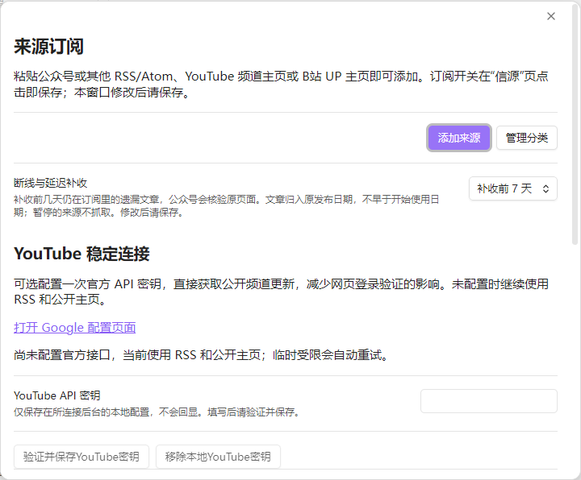

### 设置 · 哪些是自己的习惯，哪些可以改

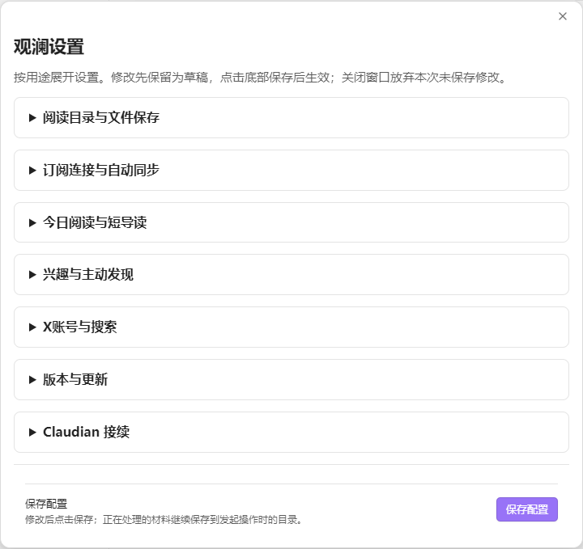

| 设置组 | 你能按自己的习惯改什么 |
| --- | --- |
| **阅读目录与文件保存** | 默认 `09_信息源`。用「选择已有文件夹」或输入 Vault 内相对目录，先看预览，再保存。新路径在首次写入时创建，切换目录相当于打开另一个独立阅读库。搬旧库需要连同索引和原件迁移。 |
| **订阅连接与自动同步** | 服务地址、令牌、自动同步和 1–60 分钟间隔。默认每 5 分钟同步。每个来源的后台抓取间隔要在订阅管理改，默认每小时，范围 15–1440 分钟。 |
| **今日阅读与短导读** | 默认选读 50 分钟、最多 3 项，分别可设 5–180 分钟、1–5 项。可以填自己的学习目标和起点，换轻处理模型的地址、名称和 Key。AI 自动精选默认关，每天默认最多 1 批；拾遗另有每日上限。 |
| **兴趣与主动发现** | 开关、八个发现板块、检索渠道、关键词和偏好。每天默认最多 3 条，可设 1–12 条。默认关闭自动探索。推荐兴趣与今日阅读的学习目标分开设置。 |
| **X 账号与搜索** | X 要不要纳入搜索、免费账号或付费渠道。用「连接 X 账号」打开专用登录窗口，随后「检查 X 连接」查看状态。 |
| **Claudian 接续** | 验证当前版本。讨论或直达在每篇材料接续时选。改成自己的 Wiki 或 Agent 需要调整源码里的桥接和存储契约。 |
| **版本与更新** | 检查本机维护者提供的签名包，确认后点击「一键更新插件」。普通 GitHub ZIP 是手动安装包，签名更新源需另行准备。 |

设置编辑先留在草稿，点击底部「保存配置」后生效。临时想用另一类来源，只要改信源分类。想让 Agent 改板块名称、默认分类和评分标准，可以从源码调整。

## 交给你的 Agent 改造

如果只想安装该插件，把插件 ZIP、这两份 README 和你的需求交给你自己的 Agent 就够了。要修改功能的话，建议同时给它**仓库源码**。ZIP 里是构建后的 JavaScript，源码里才有模块、类型、测试、流程图和构建入口。

先说明一下你的阅读场景。比如「我只追十个法律博客和两个视频频道。每天 20 分钟，按法院、公司合规和技术分组。我用本地笔记做整理，暂时不用 X 和 Wiki 写入」。许多改动在设置里就能完成。

可以把这段交给你的 Agent：

> 先读 README 和 AGENTS.md，帮我在一个测试 Vault 里跑通观澜，接一个测试 Feed，确认能检查、同步、读回正文和原件。把我的来源、阅读目录、每日时间、探索兴趣先落到设置里。需要改代码时，再说明改哪一处以及如何验证。新来源先用测试数据验证重复导入、超时、身份错误和续跑。凭据由我在本机填写。完成后交付设置清单、改动说明、测试结果和可安装的插件包。

| 想改什么 | 从哪里开始 |
| --- | --- |
| 默认兴趣、分类、阅读预算、初始示例来源 | [设置默认值](src/core/settings.ts) · [分类](src/core/categories.ts) · [发现板块](src/core/discovery-topics.ts) · [来源登记](src/core/source-registry.ts) |
| 接入新的 Feed 或来源 API | [订阅后台](src/server/subscriptions.ts) · [HTTP 契约](docs/integration-guide.md) |
| 改页面、按钮、安装与设置适配 | [工作台界面](src/ui/workbench-view.ts) · [Obsidian 接入](src/plugin/main.ts) |
| 改去重、文件保存、阅读历史 | [阅读库核心](src/core/library.ts) · [架构](docs/architecture.md) |
| 接到自己的 Agent、Wiki 或知识目录 | [Claudian 桥接](src/plugin/claudian.ts) · [知识接续契约](docs/knowledge-integration.md) |

构建与回归使用 `npm run verify`。Windows 上用 `npm run package` 生成 `release/source-workbench-<version>.zip`。修改流程图可从 [生成入口](docs/workflow/generate.py) 入手。执行 `py -3 -X utf8 docs/workflow/generate.py --public` 重新生成 [公开工作流与技术说明](docs/workflow/public/zh-CN/README.md)。

## 凭据与项目来源

在本机填写服务令牌、私密 RSS、模型 Key、Google Key 和 X 登录信息。分享仓库或演示时使用示例 Vault。插件配置文件、采集原件、运行目录和备份可能含私密内容。连接模型或搜索服务后，相关材料片段和查询会按所选功能发送给配置的提供方。

观澜的部分采集和探索设计参考并复用了数字生命卡兹克的 [AIHOT](https://github.com/KKKKhazix/AIHOT)。RSSHub 用于可选 B 站路线。复用范围和许可证见 [AIHOT 记录](docs/aihot-reuse.md) 与 [第三方声明](THIRD_PARTY_NOTICES/)。这些声明适用于相应第三方组件，项目根许可证需由维护者单独确定。
