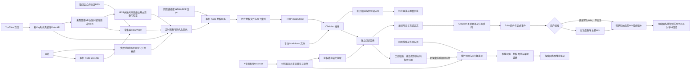

# 当前实现架构

完整数据流、用户操作与异常分支见七张工作流图和离线交互图；图为注明版本/日期的说明，运行状态及实际产物仍分别核对。

v0.20.0增加 `YoutubeApiAccess`，官方公开视频列表是配置Key后的可选主路线，未配置不发请求；失败依次回退RSS/公开主页。后台通过Bearer保护的 `GET/POST /v1/youtube/access` 管理私有凭据、修订、频道缓存及请求计数，状态和原件不回显Key；配额日上限和暂停保留到重启。验证/读取捕获配置修订，正常停服等待其在途保存，原材料与订阅truth不因配置Key重置。UI只有显式验证保存或移除才更改连接。契约见[官方接口说明](youtube-official-api.md)，用户配置后的真实采集与此前未配置/模拟边界分别见v0.20.0验收。

核心材料与状态逻辑在`src/core`，Obsidian适配和工作台分别在`src/plugin`与`src/ui`，采集、提取及增量feed在`src/server`。完整目标见规划，验收范围见[实现范围](first-release.md)，程序安装、原生加载与实际日推荐分别核对，结果见项目状态。AIHOT来源和许可见[复用记录](aihot-reuse.md)。

`subscription-days.ts`按北京时间作者日期生成每日视图及历史检索。v0.19.2订阅状态增加 `catchupDays`（0～7，兼容旧配置默认0）、每来源 `lastFullCheck/catchupImported`。`today`在窗口内补收遗漏文章，但首页仍仅显示真实当天；补收下界同时受开始使用日期限制。公众号必须核验原账号、日期和正文，未来/未知不入库；只确认实际保存的指纹，已确认旧文章不因缺少日期缓存而整批重抓。每六小时无条件完整读取一次；错误/待处理仍清除条件缓存。策略与来源配置均捕获到异步任务，修改后中止在途任务，保存和状态提交再次核对。旧状态仍按 `feed-window`读取，省略策略的配置更新保留原策略。详见[HTTP契约](integration-guide.md)。

v0.14.0的五入口、材料详情、分组设置及错误反馈见UI说明。界面状态按实际事件和文件呈现；启动目录缓存异常在布局就绪后再次完整核验，成功才恢复原开关，期间用户保存的新配置优先。

## 历史精选与索引兼容

v0.21.0新增`history.ts`及阅读索引`historyDays`，旧索引默认空历史。`ReadingLibrary.historyHighlights/historyUrls`沿用同库串行队列，非空日期只保存一次材料身份/版本/理由，提交成功才计推荐次数；不改正文、原件、进度或游标。全历史池按北京时间、真实作者日期（含既有修正）或未知日期的本地保存边界选取；最少曝光优先，价值位与最早积压轮换位互补，单项预算按日交替。未读材料推荐间隔至少7天，稍后读至少14天，新探索先预留历史引用再排除，已有探索按规范化链接排除。刷新捕获目标库与配置，失败保留真实错误，旧缓存不冒充今日；历史日期仅记录实际生成日。详见[历史精选](history-highlights.md)及对抗式审查。

`historyMaxItems`默认2、范围1～5，设置采用草稿和显式保存；当日非空清单使用首次提交的数量。`historyDays`与items/trash同组保存，恢复时不删除历史日期重置曝光。异步捕获发起时的库、数量与来源；后续配置变化不改变在途请求。`historyHighlights`可能写入，`historyUrls`只读。接口与数据形状见[接入说明](integration-guide.md#历史精选的本地接口)。

## 材料删除与批量管理

ReadingLibrary的items与trash在同一个索引中串行提交。删除将选中文章的全部版本移入trash，恢复原样追加回items；正文、批注、原件和知识接续文件保持原路径。同步按来源身份跳过回收站，手动导入要求先恢复。active及trash中的路径均先校验再缓存。批量阅读状态保留位置；未保存草稿阻止删除和批量修改。探索卡片按规范化URL关联当前库已保存的最新版本，捕获目标库后调用`updateManyProgress([id], 'done')`；未收录或已删除材料不提供该操作，不改推荐回执或重新生成推荐。具体交互见[材料管理](material-management.md)。

## 日历与交互恢复

date-calendar.ts共享两页日历，订阅按作者日期、探索按run.date；view-position.ts保留滚动祖先、库和材料版本绑定的焦点。列表在离屏构造后原子替换，避免Obsidian宿主样式触发中间高度钳制。ExplorationLibrary.archive同一快照返回完整推荐和日期状态，保留失败/未确认/零入选；跨库错误不保留旧库元数据。详见v0.16.0。

## 直接归纳 Wiki

KnowledgePipeline 回执兼容旧记录，并可持久保存 discussion/direct-wiki 模式。ClaudianBridge 在原生发送前保存意图；初次直达使用原材料任务，已有讨论使用同一会话追加客观 finalize 指令。后续请求有独立 wikiRequestedAt/wikiSubmittedAt，纳入原串行队列、取消与草稿保护。恢复会话只读，撤销旧未发送直达请求；已提交未知不重发。Wiki 完成仍由固定正式事件流、当前材料版本、原件哈希与实际文件共同核验。详见[知识接续](knowledge-integration.md)。

## 免费X与缓存收录

免费X使用`FreeXDiscovery`与本机Python桥接，契约见`src/core/free-x-contract.ts`。默认`xProvider=free`，原SocialData显式选择及历史`xUsage`保留，可选`freeXUsage`区分免费批次。各连接异步捕获，ReadingLibrary与材料身份规则保持。

免费X按材料服务共享北京时间日批次，发起意图先持久化，原响应独立保存并校验后才回放；同日中断或失败不补发，存储失败只重试保存首次响应。X凭据只在项目专用配置，不进入Vault原件。见[运行说明](free-x-setup.md)、真实验收、审查。

`x-content.ts`从已校验GraphQL原件按帖子ID恢复本条视频时长和安全外链；不串用引用帖附件，不获取转写。`FreeXDiscovery.result`从原响应重建元数据，让旧缓存获得新字段，旧模型结果及笔记不重写。`post`核验URL/作者/原件摘要，转义帖文中的Markdown和嵌入语法，返回实际完整帖文及原始对象容器；不写订阅feed，插件按推荐主归属交既有ReadingLibrary保存。

## 兴趣发现

`discovery-supply.ts`将公开技术索引中的中文兴趣清单改写为按天轮换的单方向查询，避免长串AND导致零候选；从当前捕获的阅读库补入最多六篇近期未读/稍后读的实际订阅正文。先按近30天推荐、拒绝和已读URL排除，再按作者轮流补给；candidate.origin=subscription明确来源。网页、X与订阅共用同一模型日批次和原有门槛，历史run不重写。已删除链接在归档展示中隐藏，恢复后可重新查看。

`deepseek-search.ts`构建官方Anthropic兼容web_search请求并只接受真实工具结果的URL；回答中的链接仅能优先已有结果，不能生成候选或供给正文。无明文引用时由`exploration-evidence.ts`按真实query轮流读取至多六个公网实页，保存HTML并提取前2400字符，从实际页面跟随带节目说明的YouTube/B站链接。`evidenceUrl`区分观看地址和介绍/讨论证据出处，原节目文字稿、作者身份、播放量不因此得到验证。

`exploration-search.ts`提供免KeyHN/GitHub和可选Tavily；固定提供方、DNS固定与有界JSON回执。原生联网在插件直接使用既有官方模型Key，材料服务只接候选做网页核对，不接模型Key。公网HTML经DNS校验与逐跳重定向复核，探索复用已有HTTPS代理时CONNECT到校验后的公网IP并保留原TLS名称，防止代理重解析私网。

`exploration.ts`按阅读目录保存始发回执、搜索原件、模型原回答/用量和推荐笔记；每天一批、24候选、默认目标1～3推荐、上限3（1～12可调）。规则预筛保留UNKNOWN，统计导航、已知超七天/未来发布日期排除。原帖只有元数据但已补读实际外链正文时，可以继续评价，未补读的纯标题或互动量不能当正文。当前提示exploration-8要求完整assessment、必填section与编号引用；缺字段、越界或无实际入口的预览保留无效回执，不采用模型自报总分。旧exploration-1～7及无分类回执兼容展示，不重算历史结果。

`exploration-scoring.ts`将推荐价值与材料覆盖分开。assessment包含basis（content/preview）、substance/novelty/relevance/utility四轴及support（firsthand/attributed/insufficient）。预览未读的作品或视频时substance必须为null；content必须评价已取得文字的份量。未知utility也可为null，程序剔除null轴后归一化。新闻、观点、学习/工具的权重分别为1/4/5/0、2/3/3/2、2/1/3/4，support不计入总分，firsthand不等于已核实。入选要求PASS、总分≥60、兴趣≥6、增量≥4或用途≥6，已评份量不得<4，线索不足排除。公式与说明见[AIHOT对照](aihot-reuse.md)。

X候选经插件合并前的有限补读，每批最多三条实际文章/项目链接、每帖一条，沿用公网地址校验与12秒有界读取。`linkedEvidence={url,excerpt}`单独保存40～1600字符外链摘选，HTML进入搜索原件，编号证据注明外链出处；原帖id/url/日期/摘选/覆盖及附件不覆盖。补读失败只加覆盖说明，不伪造正文、不读取视频或整个线程。网页原有最多六页证据预算与X外链预算分别限制。HTTP仅提供候选/证据，评分仍在插件调用模型并按目录保存。

同事件/同一期去重、优先合格原片，已读、回收站、拒绝及三十天内推荐URL排除；已保存但未读的订阅正文可以补入。先搭配达标板块，补充时对已选作者/站点后续项作8分排序折让，不改显示分数、门槛或设作者配额；X按账号、其他网页按hostname识别。未知日期不伪造，明确AI克隆/翻译缺口不显示成原始录制。

结果日志在索引前落盘；保存失败仅补存第一次结果，日志落盘后可重启恢复，用户编辑笔记保留并报冲突。`finish()`遇笔记冲突时，仅在原日志未变、已提交索引经schema规范化后与最终摘要完全一致（含journalHash、去rawModel/搜索快照）时释放冗余pending；未提交或不一致的结果继续保留待保存保护。释放已完成内存状态不改笔记、索引或首次模型回答。仅started/未知超时不重发。读取推荐与状态不等待进行中的模型请求。自动开关默认关闭，layout-ready/打开/小时检查复用同日回执，订阅同步独立。详情与实际质量限制见[主动发现](active-exploration.md)及v0.12.0真实验收。

`discovery-topics.ts`维护八板块枚举和OR查询；DeepSeek搜索分组跨天轮换，settings保存板块及探索上限，旧连接/自定义目标保持。`exploration-merge.ts`轮换合并网页和X候选；事件转述不抢占板块名额。UI区分新“推荐价值”与“历史AI评分”，另列未读/未看、原作者陈述或转述及证据缺口。升级不重发已有日批次。

`socialdata.ts`是材料服务全局串行实例，状态在数据目录socialdata/，费用以整数微美元记账。started和0.10美元预留先落盘，原API JSON成功落盘后再提交实际计数；重复和畸形返回条目也计费，Key/错误正文不存。pending保留首次返回，保存重试不重新请求；重启后缺最终结果保留未知预留并暂停当月。已知HTTP失败无费用，Top无cursor；当前月已知+未知预留+下一预留超过0.50美元不发，异常大页记录实际费后暂停。请求实际完成时间作为互动observedAt，日缓存核对原件哈希。status不查询供应商、不产生数据费；停止服务等待队列保存。历史回执/其他月份保留，新增月份额度独立。

## 本机后台

`MaterialLedger` 使用 `ledger-index.json` 保存实例、序号、版本和明确材料路径，正文与首份原件保存在 `ledger-entries/<seq>-<SHA256>.json`。先保存单条材料再原子提交索引；索引写失败不推进内存或序号，恢复复用同一结果。feed 分页逐条读取并核对文件哈希，缺失或变化不提交客户端游标。

旧 `ledger.json` 按流解析并逐条迁移，完整通过后才提交新索引；中断时旧文件仍是迁移真源，已保存材料可复用。新索引存在后不再解析或更新旧账本。v0.13.1 实机迁移约538MB、380条材料，逐条内容及原件相同；旧文件原样保留，作为历史证据，不代表当前新增材料。完整备份必须同时包含新索引与材料目录。云端准备读取当前提交索引；现有单文件快照工具上限100MB，超出时明确停止，不用旧账本导出过期快照。

材料服务提供独立鉴权的 `/v1/runtime/identity`，不依赖账本读取；控制器在健康检查失败时仅对PID与所持子进程一致的材料服务正常停止，不删锁、不按端口强杀。未提供独立身份的旧服务需要核验后单独正常停止。

`LocalSupervisor`经公开接口验证并发、停止、网络/服务恢复和长暂停补抓；`local-runtime.mjs`适配本机服务、loopback管理、现有账本实例和自有进程，`local-runtime.ps1`注册隐藏登录启动项。代理变更只正常重启自有进程，未知进程/端口保留。控制器补抓使用`POST /v1/subscriptions/poll`的`{recoverNetwork:true}`模式；网络类失败按1～15分钟退避，其他错误保留各自期限，后台健康、补抓请求和来源成功分别记录，见 [本机说明](local-automation.md)。

## 自动同步

界面复用日期格式化器，并按日期一次分组，避免日历对全库重复扫描；v0.16.3将整页在离屏构造后一次替换，我的材料每页25条，筛选与搜索仍对全量索引执行，订阅当天分组不因此截断。重叠刷新合并，目录切换、草稿/焦点及旧异步结果的隔离约束保留。原件使用原生Base64字节解码，首次写入复用已解码字节；版本和原件哈希契约不变。性能与位置恢复证据见v0.16.3，此前50条分页及日期性能修复保留于v0.16.2。

B站RSS/直接接口失败时，已配置Chrome的材料实例使用公开投稿页直连回退；读取页面自身列表并复用同一JSON身份校验，返回原JSON与派生XML。浏览器成功窗口复用五分钟，分批补齐阶段直接使用该窗口；正常小时检查不延长为整日缓存。失败、停止与UID不符不确认条目。回执collectionMethod与来源配置分开，配置和已有材料不重写，见验收。

插件在layout-ready、工作台打开及默认五分钟间隔补同步，配置可关闭或调整；同一连接共享进行中的请求，连接变化排队并捕获原目标库。后台同步保留原游标和写入保护，不调用AI；手动同步后的可选AI开关仍独立生效。默认“订阅更新”按作者北京时间发布日期显示当天内容，公众号按固定优先级和发布时间；历史按日期检索，未知日期留在材料库。早期无来源ID材料只在名称唯一且原链接平台匹配时归入订阅，材料原文不改写。

“检查并同步”由`SourceWorkbench.checkUpdates()`捕获阅读库和连接，交给`checkAndSyncSubscriptions`编排：请求恢复检查，先同步已有材料；每两秒读取本地回执，本轮采集结束后再同步一次。最多跟踪三分钟，后台仍运行时明确提示，随后依赖已启用的自动同步或使用者稍后同步。相同库/连接的重复操作合并，另一库/连接等待原操作结束后再发起；进行中的检查阻止程序更新。这个入口不调用模型；原“同步已采集材料”继续只读取材料feed。

## 进程与边界




| 模块 | 职责与入口 |
| --- | --- |
| `src/core/model.ts` | Material、ReadingItem、Feed、状态与问答契约；身份规范化、版本及路径规则 |
| `src/core/storage.ts` | 实际配置目录保护、阅读根路径与父子库校验、所有父目录/固定产物类型预检 |
| `src/core/knowledge.ts` / `src/plugin/claudian.ts` | 接续快照/哈希、会话绑定、队列/取消、发送意图及实际产物观察；Claudian内置历史版本与新版显式接口验证 |
| `src/core/transcript.ts` / `src/server/transcript.ts` | 字幕时间与缺口、原件、平台身份及公开字幕HTTP；PDF转稿沿用ReadingLibrary独立版本 |
| `src/core/library.ts` | 公开的导入、同步、进度、今日清单、历史精选、旧问答读取与 RAW 准备接口；每个库串行提交 |
| `src/core/history.ts` | 全历史未读候选、北京时间日期、价值与最早积压轮换、曝光冷却、日清单结构 |
| `src/core/daily.ts` / `daily-model.ts` | 每日预算/板块选文、十二项预选、轻处理消息与证据校验、提示/输入身份、同批复用与待保存回答 |
| `src/core/subscription-health.ts` / `subscription-refresh.ts` | 采集错误分类、脱敏和状态提示；捕获依赖后编排检查与同步 |
| `src/core/auto-sync.ts` / `updates.ts` | 自动补同步并发合并、连接切换隔离与停止；最新订阅版本、固定优先级和旧材料来源匹配 |
| `src/core/exploration.ts` / `deepseek-search.ts` | 原生检索工具归属、兴趣评价、事件归组、持久化与恢复、日期及导航过滤 |
| `src/core/exploration-scoring.ts` | 推荐价值公式、未知轴归一化、独立支持说明、兴趣/份量/增量及用途门槛 |
| `src/core/free-x-contract.ts` / `src/server/x-content.ts` | 免费X严格输入/状态；本条原件视频和安全外链、完整帖文及覆盖缺口 |
| `src/server/free-x.ts` / `free-x-runtime.ts` | 全实例共享日批次、先存意图/原件、摘要核验、缓存提取；有界Python桥接，不回退付费 |
| `src/server/exploration-search.ts` / `exploration-evidence.ts` | 固定检索渠道、有限网页证据、真实节目链接与独立出处，不写材料账本 |
| `src/server/material-ledger.ts` | 当前分段账本、流式旧账本迁移、逐条哈希与原子索引提交 |
| `src/server/cloud-export.ts` / `ledger.ts` | 云端单文件快照契约验证；保留实例/序号，重置来源回执，不读取Vault或模型Key |
| `src/core/settings.ts` | 配置校验、存储配置恢复、API 地址与客户端超时 |
| `scripts/runtime-backup-cloud.py` / `rotate-runtime-backups.mjs` | 发布后历史快照加密去重归档、云端回读核验、本地两版本保留及独立目录恢复 |
| `src/core/categories.ts` / `source-management.ts` | 分类契约、默认类兼容、来源到配置转换；新增 UP 继承已保存且 UID 匹配的 RSSHub origin |
| `scripts/rsshub.ps1` / `rsshub-runtime.mjs` | 自有 loopback wrapper、UA/代理配置、鉴权管理和固定原源码启动，不修改 RSSHub |
| `src/server/source-discovery.ts` | 地址识别、频道自身元数据与 feed 复核；不创建订阅或运行来源命令 |
| `src/core/subscriptions.ts` | 最多 100 个多平台来源配置、旧微信配置兼容、配置版本及公开回执契约 |
| `scripts/collection/discovery.py` | Discovery.tick/status：受控分页、身份校验、事务保存、持久化页进度及整组退避 |
| `scripts/collection/manage.py` / `status.html` | 独立 WeRSS 生命周期、授权恢复、受保护 feed 和只读采集状态页 |
| `src/server/rss.ts` / `feed-fetch.ts` | 改造 AIHOT RSS 正文/摘要及 Atom 解析，XML 校验，固定 DNS、请求上限与条件读取 |
| `src/server/subscriptions.ts` | SubscriptionCollector：定时/手动采集共用任务，分批处理，逐项持久化及失败恢复 |
| `src/server/bilibili.ts` / `bilibili-browser.ts` | 固定UP投稿JSON校验与RSS转换，访客Chrome直连公开页回退及五分钟成功窗口复用 |
| `src/server/youtube.ts` | 官方RSS失败后的同频道Videos/Shorts/Streams有限公开页检查，视频身份及精确日期核验 |
| `src/server/` | 公开网页抓取、HTML/PDF 提取、账本与 HTTP 分发 |
| `src/plugin/main.ts` | VaultStore、ItemView、设置及弹窗；requestUrl 调用 |
| `src/ui/workbench.ts` / `workbench-view.ts` / `workbench-state.ts` | 宿主契约、六个任务页面、筛选及材料详情；草稿、焦点、滚动和后台刷新保护；真实回执分组与预览 |

材料服务提供GET `/v1/status`、`/v1/runtime/identity`、`/v1/feed`，POST `/v1/runtime/stop`、`/v1/import`、`/v1/transcript`，GET/POST `/v1/subscriptions`，POST `/v1/subscriptions/poll`、`/v1/sources/resolve`。`poll`的`{}`为显式强制检查，`{recoverNetwork:true}`仅提前处理至少一分钟前失败的网络来源，其他来源遵守到期时间；运行中的采集合并。RSSHub wrapper独立提供鉴权GET `/_workbench/rsshub`及POST `/_workbench/rsshub/stop`，控制器管理API在27187。完整请求/响应见[接入说明](integration-guide.md)。


兴趣HTTP入口为POST `/v1/exploration/search`、`/v1/exploration/evidence`，免费X为GET `/v1/exploration/x/free/status`、POST `/v1/exploration/x/free/login`、`/v1/exploration/x/free/search`、`/v1/exploration/x/free/post`。暂停的付费入口GET `/v1/exploration/x/status`、POST `/v1/exploration/x/search`保留。全部需要材料Bearer；免费post仅返回材料，不改变订阅账本/游标。模型调用在插件，X凭据在专用本机配置，端点不接收Cookie。

## 单篇网页导入

`src/ui/workbench-view.ts` 的“添加材料 → 添加链接”调用插件 `importUrl()`，在弹窗前捕获目标 ReadingLibrary 与连接配置；普通文章发送 `/v1/import` 的 `format=url`，不修改订阅。`public-fetch.ts` 校验公网地址并直接读取 HTML，`extract.ts` 对微信取专用正文，对其他网页用 Readability，再以 Turndown 生成 Markdown，同时返回 HTML 原件和覆盖缺口。短导读取正文前180字符的摘选，不调用模型。服务先登记材料账本，插件再经 `ReadingLibrary.import()` 保存原件、独立正文版本及索引；后续同步按同一身份/版本去重。视频与X链接由插件分流到既有文字稿/帖文端点。网页导入不执行浏览器脚本、不接入 MinerU、不下载图片；相对路径图片和交互元素会被移除，保留 HTML 不代表完整离线页面。请求与限制见[导入请求](integration-guide.md#导入请求)。

## 存储与状态

### 旧 WeRSS 发现端（历史路线）

旧发现端保存整组退避和分页进度，事务保存后才推进偏移，目录与正文分别计数；五账号200013/正文0不描述当前取阅。schema、窗口、管理接口、授权和恢复统一见[历史WeRSS说明](werss-runtime.md)，不在当前主链路重复维护。

### 当前材料服务


`subscriptions.json` 保存当前八类默认值及用户自建分类，兼容已保存的旧六类配置；同时保存 1～100 个来源、配置 revision、关联账本实例、已处理条目的指纹、检查时间、失败原因和条件请求校验器。每来源`recentChecks`最多12项，记录`checkedAt/status/message`及可选错误`kind`；独立的`lastFailure`在后续成功后保留。两者与该轮最终回执同组原子保存，历史中的URL与凭据隐藏。相同来源的分类/开关修改保留历史，来源身份或账本实例更换则重置；旧状态缺失字段时默认空历史，不虚构过往检查。`subscription-snapshots/<SHA-256>.xml` 保存订阅XML，`.json` 保存官方API或其他适配原件；正文的原 HTML 字段与提取 Markdown 分开保存。私有 `youtube-access.json` 保存YouTube凭据、验证时点、修订、频道信息缓存及配额日计数，不进入公开包或采集原件。快照目前保留，尚无自动保留期清理。


采集每 30 秒查到期任务，默认每账号 60 分钟；账号间顺序处理，每轮每账号最多 30 个改变条目，剩余积压一分钟后继续。失败项不登记 seen，一页有失败或剩余条目就不提交校验器，独立成功项可先进入账本。重试和崩溃后依靠账本版本去重；账本实例重建会清除旧采集确认，重新发现材料。只有这一页完整处理成功才更新 lastSuccess，空但有效的 RSS 页可以显示“检查成功、新增 0 项”。

网络请求固定发起时的账号配置；等待期间账号暂停或修改，旧请求不能向新配置提交回执或后续材料。配置 revision 只随用户配置更新，采集回执不会使未修改的设置草稿失效。服务关闭时中断并等待采集，再释放服务锁。

订阅地址可为公网或明确配置的字面回环地址 `127.0.0.1` / `[::1]`，支持采集端端口；不开放其他内网地址，重定向只允许同源。微信条目使用公众号原链接；取阅根标题按实际账号名 accountName 核验（旧配置兼容预设登记名称）；显示别名不改变身份。YouTube 校验频道/作者 URI 与视频 ID，B站校验根 UID/视频链接，直接 API 还核对每条投稿 mid。视频采用 youtube:/bilibili: 身份，保存仅链接 metadata。普通网页导入继续只允许公网及标准端口；摘要回源核对登记 biz，未登记 biz 时核对原页名称。缺正文、身份不符、XML 无效及写入失败都不记为成功。

分类和来源共享配置 revision；旧 API 写入省略 categories 时保留自建分类。分类只影响主界面显示，不重写正文或改变材料版本；新材料记录 sourceId 和分类快照，旧材料先按原始来源名关联当前配置。默认学习方向继续用于今日清单规则，自建分类默认采用娱乐与生活方向，尚无 AI 个性化分类。

阅读目录由插件设置选择，默认 `09_信息源/`：

```text
阅读目录/
├── 阅读材料/       原正文 Markdown，各版本独立文件
├── 原件/           同次采集的 HTML/PDF/Markdown 原件
├── 陪读记录/       旧版本问答文件保留，新版不再生成
├── AI导读/         独立的批次输出、来源证据、模型及 token 回执
├── 探索推荐/       独立每日兴趣推荐，保留理由、证据及缺口
├── 知识接续/       指定版本的接续任务、冻结正文与引用，供Claudian消费
├── 交接材料/       RAW 准备文件，仍非正式登记
├── 今日阅读.md     受内容比较保护的生成清单
└── _工作台/
    ├── state.json  schema 1：材料/回收站、进度、feed 检查点、清单哈希、问答索引、冲突、reviews、historyDays
    ├── 待提交/     未完成导入、清单更新或有效 AI 导读的恢复记录
    ├── 模型回执/   校验失败的模型原回答与用量，不作为有效导读
    ├── 探索/       探索state、始发日志、搜索/网页原件及模型原回答/用量
    └── 知识接续/   会话绑定、队列/取消、发送意图及恢复回执
```

插件设置经Plugin.saveData保存在实际 `vault.configDir/plugins/source-workbench/data.json`，包括目录/连接、模型Key、学习目标、预算/上限、自动开关和内部目录使用记录；自定义configDir同样保护，同步配置目录也会同步其中密钥。板块与进度放产品状态，普通笔记遵循既有author格式。观察器读取当前Vault两条固定RAW事件流、明确列出的08产物，以及通过路径校验的晋升核验回执目标；禁止扫描私人日记，常规开发与故障复验在隔离库。


## 身份、版本与保存

新材料 ID 来自规范化来源身份的 SHA-256；URL 去掉锚点及部分追踪参数。手动文件使用稳定来源标识，内容哈希用于版本。版本包含标题、来源、类型、用途、正文、覆盖、缺口、发布时间；PDF 和仅元数据材料还包含原件哈希。已取得 HTML 正文时，页面跟踪脚本变化不制造新正文版本。

板块、导读与采集时间不参与版本哈希，同版本复用首次保存元数据。当前没有修改已登记材料板块的独立 UI。0.1.0 旧手动文件的默认身份在重新导入时整组关联，保留旧路径、进度和问答；自定义标识仍由使用者维护。

导入先落盘首次材料和原件的恢复记录，再保存原件及正文，最后提交索引。失败保留恢复点；重试核对相同文件并补交状态。成功后清理该恢复记录。已有正文修改会保留；同步只对已经登记且原件检查通过的批注材料继续推进。

VaultStore 创建文件时保留同名竞争文件；更新生成文本使用 Vault.process 原子比较。索引路径校验通过后才进入缓存，打开文件另检查阅读目录。同目录复用同一个 ReadingLibrary，避免多个状态缓存相互覆盖。

原件用 originalHash 检查。旧 PDF/仅元数据版本可通过原版本哈希回溯核验；旧 HTML 正文版本没有原件哈希，升级前的修改无法追溯，升级保留文件并建立此后校验基线。今日清单用已提交和待提交哈希识别自身写入结果。

## 推荐、历史记录与 RAW

本节是`daily.ts/daily-model.ts`对已收录材料生成的每日阅读清单与短导读，独立于前述订阅外兴趣发现；以下40分门槛和同板块降权不适用于exploration-8。

今日清单按每份材料最后保存的版本选取，排除 validation、仅元数据、已读、稍后读及娱乐生活正文；阅读中优先，板块搭配并按预算选择。默认每分钟 450 字、50 分钟/三项；预算可调5～180、篇数1～5。未在读的 AI 资讯/热点超过七天时不精选，学习材料保留；发布时间未知不伪造。正文的阅读方向取已保存 topic，来源分类仍独立筛选，不能凭来源分类保证每篇内容属于该学科。

AIHOT 的预筛/评分/证据及输入回执原则适配为一次批请求，最多十二项、每篇前2400字符。v0.6.1 提供最多八个原文编号片段，模型返回 quoteIndex，由程序从原材料读取引文；旧 quote 格式仍须逐字匹配。输出 PASS/BLOCK/UNKNOWN、0～100分、理由、导读与原文引文。部分/截取材料的 BLOCK 作为 UNKNOWN；PASS 且至少40分参与 AI 排序，同板块降权20，未评估材料继续规则排序。已通过一批真实 Flash，参数长期效果与专业样本仍待校准。

上下文哈希关联学习目标、模型、提供方、提示文本与版本；输入哈希关联候选版本、摘选、来源/日期等。`reviews` 保存始发回执、结果、读取范围、用量和导读路径，不存 API Key。调用前先提交 started；同批完成结果复用，失败/未知不再请求。每天默认一批（可调1～5），失败和未知也计入，北京日期用于限额。配置和异步目标库在调用开始时固定。

结果先进入会话待保存对象，再写 `_工作台/待提交/AI-哈希.json`、独立导读，最后提交回执索引。保存失败保留首次模型和回答，只补保存；恢复记录已落盘时重启可以补交，尚未落盘的内存结果需在退出前补保存。缓存复用仍验证/补建实际导读文件，用户改动保留。JSON 校验失败、提供方截断或超时不自动重发。Flash 官方接口使用非思考模式、JSON Output、8000输出tokens；其他兼容地址不附加 DeepSeek 专用参数。

v0.6.1 将模型内容校验失败的回答另存 `_工作台/模型回执/AI-哈希.json`，标记 validation: failed，保存首次请求身份、原回答和已返回用量，索引仅记 failed。它不进入导读或评分。回执写入失败时 pendingRejected 保留原回答，点击“重试保存模型回执”只补存，不调用模型；退出前应完成内存回执保存。历史 v0.6.0 的无效输出未保留用量，不能反推费用。

每次成功同步更新今日清单。自动 AI 默认关闭，用户开启后在同步中按同一限额选编；AI 或清单失败作为独立提示，不撤回已成功保存的材料/检查点。UI 和笔记均区分规则与 AI 并标明摘选范围；视频仅链接不参与全文评价。详情及实机证据见 v0.6.0。

内置伴读窗口、请求、会话及问答写入已移除。旧 dialogues 契约与 ReadingLibrary.dialogue 只读接口保留，升级、材料同步与清单更新继续保留旧索引和讨论文件。设置恢复忽略旧 modelUrl、model、modelKey，加载后经设置保存队列清除旧字段；每日 guide 配置、Key、限额与目标保留。后续其他解读形式按实际需求重新评估，当前由Claudian承接用户明确选入的指定材料，不恢复内置伴读。

RAW准备核对正文/原件并生成未登记交接笔记。正式接续由Claudian按Vault的fanos-raw真源登记、加工、讨论与归纳；具体目标隔离晋升已验证，工作台依据真实回执/目标哈希观察状态，自身不写fanOS。

验收边界见[实现范围](first-release.md)，知识/大库故障见v0.13.1审查，路径/配置见v0.13.2专项。启动、备份及恢复见[运维](operator-runbook.md)。

## 平台与网络适配

`src/core/source-registry.ts` 合并已选的公众号/视频登记生成十五个默认关闭配置，保留旧来源身份查询。已保存的旧五项配置按原样加载，不自动启用新来源；用户保存配置可新增、移除和暂停。`src/server/bilibili.ts` 请求固定官方 nav/投稿 API，WBI 签名和 UID 校验失败保留错误；真实 JSON 和适配 XML 分别快照，后者不标成官方原 RSS。

`src/server/source-proxy.ts` 仅对 feed.zoro.build、www.youtube.com、www.googleapis.com、api.bilibili.com 标准 HTTPS 复用操作者已有 HTTPS_PROXY；其他订阅保持固定 DNS 的直接请求。使用代理的固定主机由代理解析，请信任已配置代理；仍保留 TLS、响应大小及各适配器的重定向限制。官方Google请求不跟随重定向，不转发密钥到其他主机。没有把网页导入转到此代理通道。

`SubscriptionCollector`的feed和原页面GET仅在可识别网络瞬断时各额外读取一次；已取消任务不再请求，授权、限流、身份不符本身不触发即时重读。`collectionIssueKind`先识别限流、授权与存储错误，再识别网络；混合备用路线错误不会因含有网络字样而绕过限制。网络、HTTP408/5xx按1、2、5、10、15分钟重试；明确验证页、账号信息不完整及正文暂缺上限60分钟，其他错误从5分钟退避、上限1440分钟。加载旧状态将网络长退避收敛至15分钟、其他暂时错误收敛至60分钟。正常检查只执行到期项，恢复模式额外提前处理至少一分钟前失败的网络来源；成功恢复来源配置的检查间隔。后台健康、排定重试、取得正文和保存成功分别核验。

`extractHtml`优先保留已有正文；容器不存在或去脚本后只有空白/零宽占位时回退微信`content_noencode`。程序识别含微信自定义元素的结构化字段，保留可提取的段落和链接；纯文本保留字面标签，原容器或字段中的付费预览标记均进入gaps。取得公开预览只标partial，不计付费完整正文。账号、作者日期和保存确认仍由采集器分别校验。

微信原页身份/正文/作者日期核验失败时，后台保存`subscription-snapshots/<SHA-256>.html`及`<SHA-256>-<sourceId>.json`识别摘要；不将失败页分发为成功材料。缺账号信息、页面明确要求验证和真实错号分开报告。原失败页缺失时，不用后续成功页面反推历史失败原因。快照无自动清理，随私有数据备份，保密边界见[运维](operator-runbook.md)。

RSSHub 直接 API 成功或浏览器回退后生成标准 XML；本项目保存该响应，不将适配 XML 标为 B站官方 RSS。wrapper 复用既有代理匹配 Bilibili/hdslb，实际 Chromium UA 避免上游默认请求头生成失败；无用户登录 Cookie。本机配置和管理令牌在 `.local/rsshub/`，第三方固定资产仍在 `.local/bilibili-free/rsshub-test/`，详见运行说明。

## 知识接续、讨论及晋升观察

### Claudian 本地接口验证

`ClaudianBridge.available()`只放行内置2.3.17或当前适配契约验证过的确切Claudian版本。`verify()`与接续共用串行队列，按需激活视图、在没有聊天页时准备空白原生页，然后检查会话创建/查询/打开、队列运行态、输入/发送控制器及草稿结构。检查不创建关联材料会话、不追加输入或发送消息；验证期间插件身份或版本变化时拒绝把旧检查结果标成当前成功。

`SourceWorkbench`提供存储适配，将`{adapter:1,version,verifiedAt}`单独保存到实际`vault.configDir/plugins/source-workbench/claudian-compatibility.json`，写入成功后才在内存放行。启动通过`loadVerification()`加载并校验；读失败、损坏、适配契约或Claudian版本不匹配均不放行未知版本。改变适配契约时递增adapter，不能仅保留旧回执跳过检查。该文件与`data.json`的设置草稿独立，不随四程序更新覆盖；迁移时可保留，缺失时重新验证即可。

已有视图的运行接口会再次检查，发送前仍核对草稿和发送状态；侧聊模式先要求用户切回主聊天。该机制不验证模型连接或RAW/Wiki产物，不改变既有提交意图先保存、结果未知不重发及指定材料权限。使用见[知识接续](knowledge-integration.md)，本地调用入口见[接入说明](integration-guide.md#claudian-本地接续验证)。

### 材料会话与正式产物

接续以KnowledgePipeline独立回执为索引，材料正文快照排除AI导读，原件和快照保持哈希保护；Claudian通过关联笔记的会话承接指定任务，遵循正式fanos-raw脚本。会话摘要不包含linkedContentPath，队列使用getConversationSync及实际运行状态核对，包括已离开前台的运行；创建后绑定保存失败也按完整记录找回空会话。未知发送不自动重发，当前库已授权的未提交队列可恢复和取消。

RAW/Wiki状态不从Claudian回答文字推断，读取当前run的source/run事件、顺序、哈希、实际文件及材料版本；旧成功不覆盖新失败。完整职责、消费者及恢复说明见[知识接续](knowledge-integration.md)。

自动出队等待当前聊天草稿/图片草稿及回复结束。原会话原生写入冲突或被删除时，用户显式从已核验RAW/run回执恢复；保留旧会话，先保存新绑定/意图，首轮只读已有Wiki和讨论，同版本重复操作复用；恢复会清除未发送的旧直达请求，后续归纳须明确给出指令。

晋升核验读取 `08_LLM Wiki/logs/promotions/<runId>.json` 中明确授权的note/board目标，核对当前run、写后哈希及来源/Wiki/看板回链。用户后来编辑目标时保留修改并显示需核对，工作台不自动修订目标；Wiki已归纳和fanOS已晋升分开判断。

## 设置与目录保护

设置保留编辑草稿，选择文件夹和输入不落盘。preflightStorage检查库内规范路径、真实configDir、父子阅读库、父目录和固定产物类型；保存前读取目标索引校验路径。启动读取同样校验，损坏值不触发默认路径写入。VaultStore在原子替换回调复核TFile路径和写入许可。initializedDirectories与directoryApproved为插件内部目录使用记录；已使用根目录缺失时停止，移动/删除事件还暂停已捕获该库的旧异步任务。首写登记通过配置保存队列持久化，失败保留实际已保存文件并报告，不更新成功索引。新库切换不搬迁旧材料或RAW/Wiki引用。详见设置审查。

## 程序更新与数据隔离

社区版通过 Obsidian 更新插件程序，保持插件 ID 和现有目录不变。材料服务独立运行与升级；先备份现有库和服务数据。安装路径、构建产物和升级办法见[插件安装与更新](plugin-updates.md)。旧本机签名维护与私有归档不属于社区版分发。

## 历史后台快照归档

`release:local` 完成签名通道发布后，`rotate-runtime-backups.mjs` 使用归档专用 Python 环境调用 `runtime-backup-cloud.py sync --prune`。该维护者工具只处理 `.local/runtime-backups/`，不读取 Vault、不归档正在运行的材料目录，也不改变材料 HTTP 契约；与 `cloud-export.ts` 的可选云端部署快照分别维护。

`plan` 按快照时间选出两个不同版本各最新的一份作为保留名单。其余快照采用 AES-256 ZIP，完整文件清单与文件 SHA-256 加密保存；相同内容引用已核验附件内实际存放的文件，不建立嵌套文件引用链。云端必须保留所需历史附件，不能按本地两版本规则裁剪。`.local/runtime-backup-cloud/` 保存归档配置、内容目录、逐份回执及恢复缓存；GitHub 凭据由环境变量或 Git Credential Manager 读取，解密密码独立保存在 `.local/backup-secrets/`。

每份归档上传后完整回读，补齐引用内容、解密逐文件校验，并在清理前复核仓库私有性、当前附件与依赖、原快照内容及保留名单。先保存回执，再移除本地旧副本；中断后的部分清理只接受匹配既有已核验附件的剩余原文件。网络、密码、完整性或路径检查失败时保留未核验副本。归档失败发生在发布之后，不能据此将已发布通道记为未发布。

`restore` 在独立缓存中获取所需附件，重建到独立空目录并复核全部文件字节，拒绝覆盖项目运行目录。原有快照没有包含的源码、整个 Vault 或专用登录目录不因此获得云端备份。使用、密码保管与实际恢复证据统一见[备份与轮换](backup-retention.md)。

## 本地重校验回执

探索索引新增可选recoveries，首次runs和原始日志保持不变。recoverFirstEvaluation仅接受本日exploration-8的“预览评价缺少实际内容入口”已知失败；首次日志哈希、id/模型/连接/兴趣/查询和日期全部匹配才解析同一个rawModel。新回执记录recoveredFrom，日归档选择其派生结果；后续30日去重同时覆盖原run和派生选择。恢复日志与笔记沿用比较写入和pending补存，不存在搜索或模型回调。普通网页有文字证据时自身URL就是预览入口，X不沿用这一例外。
