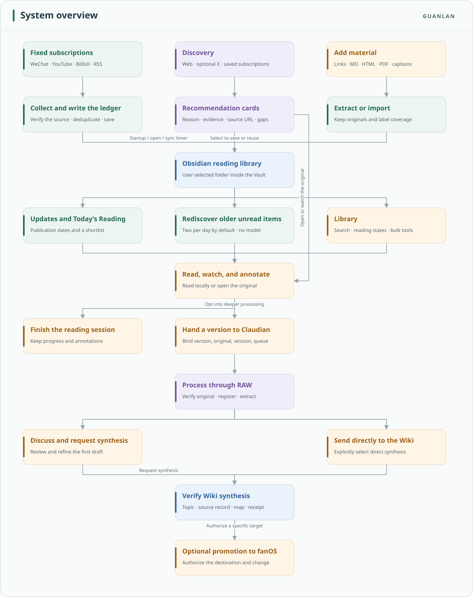
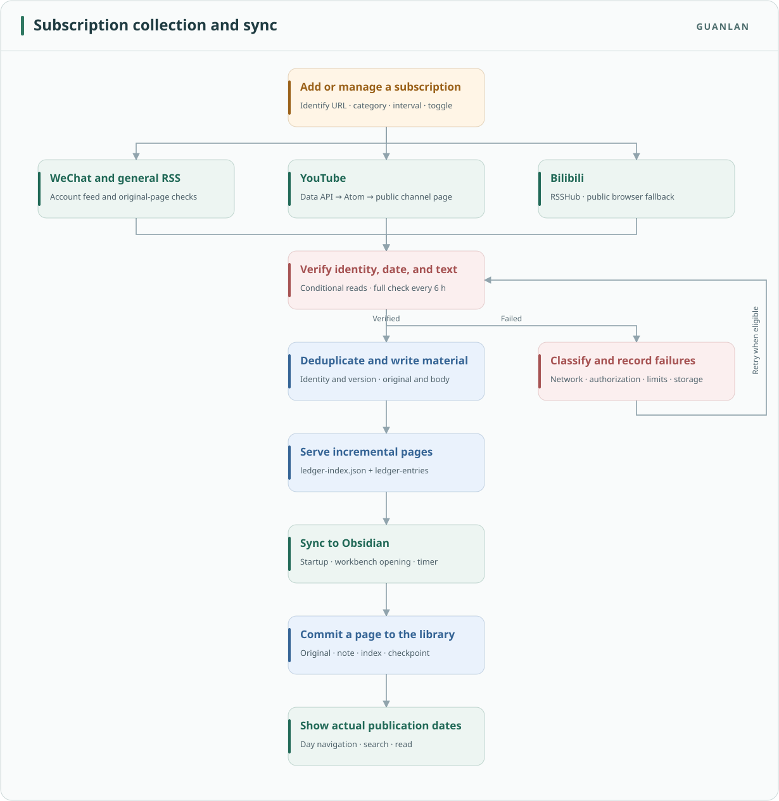
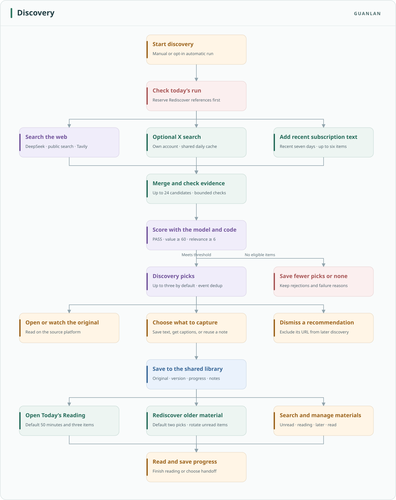
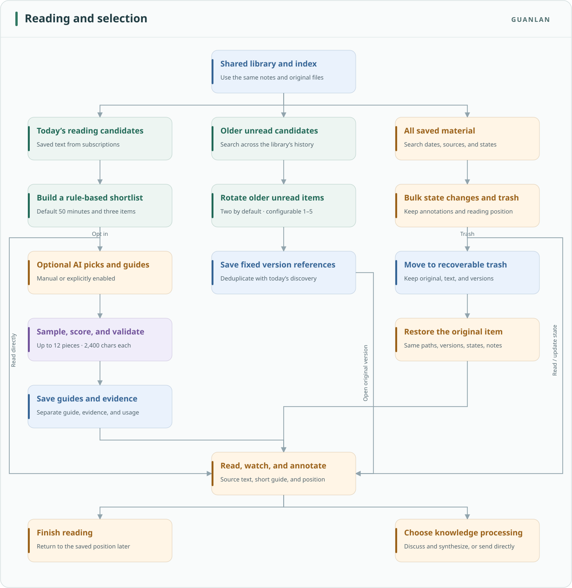
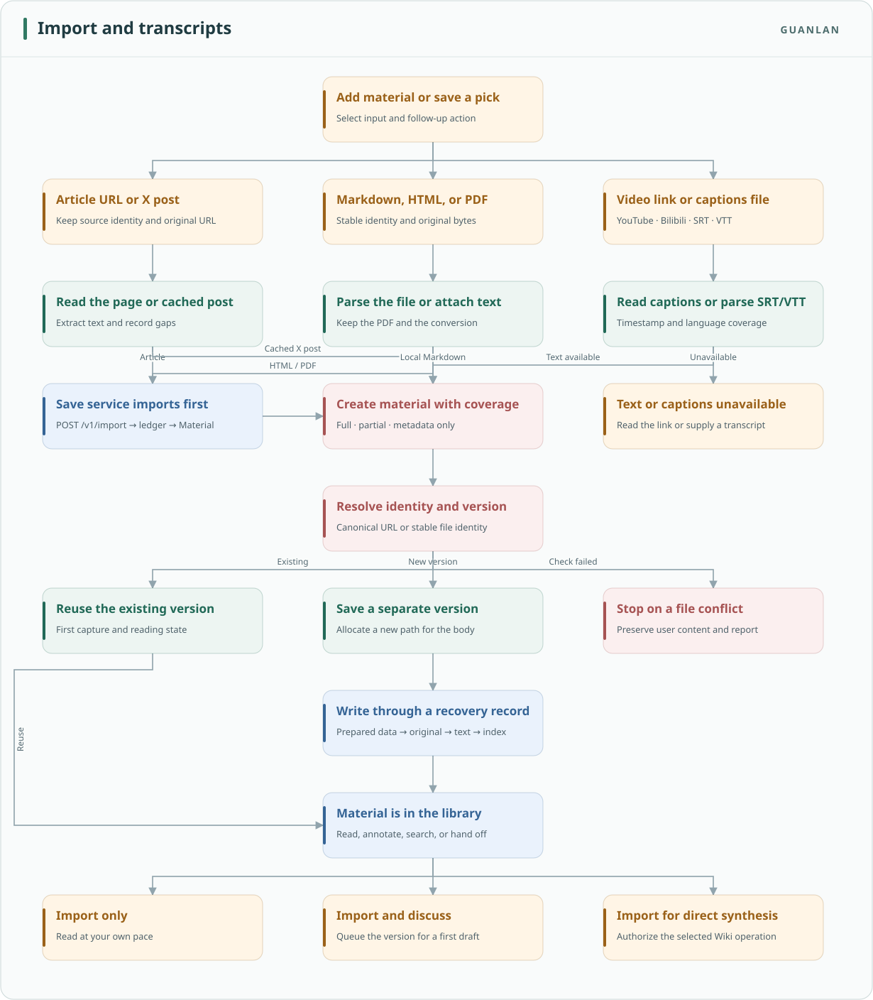
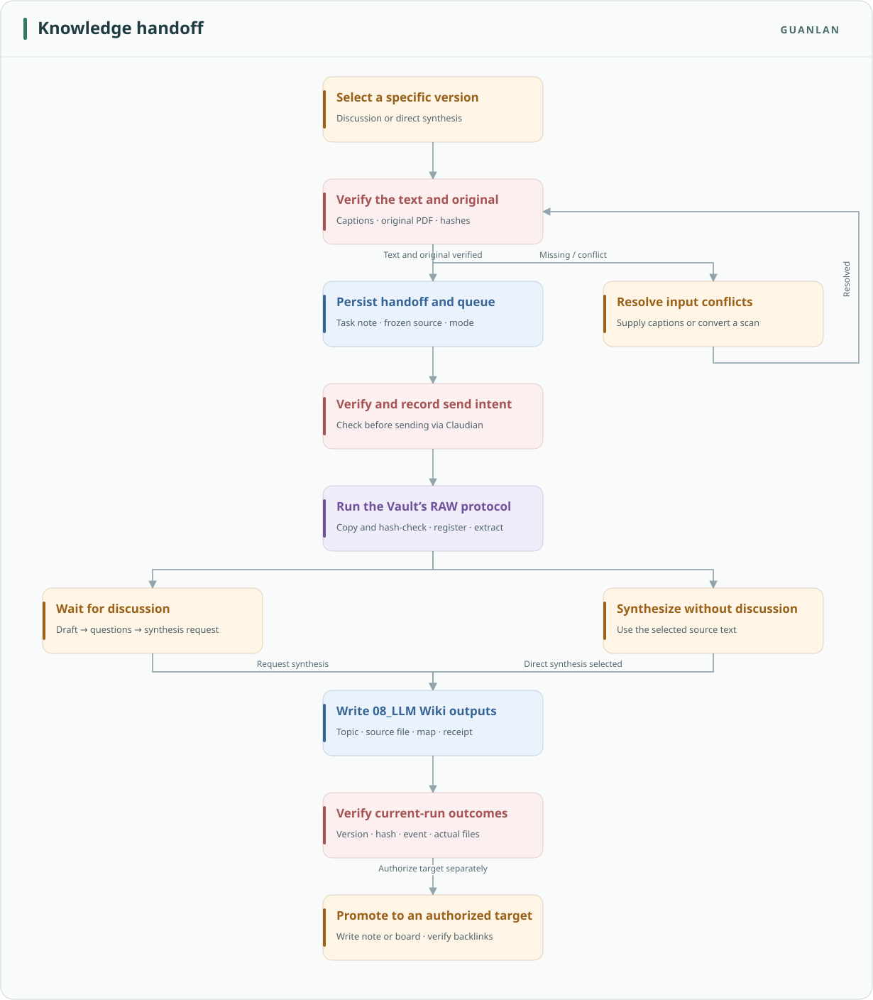
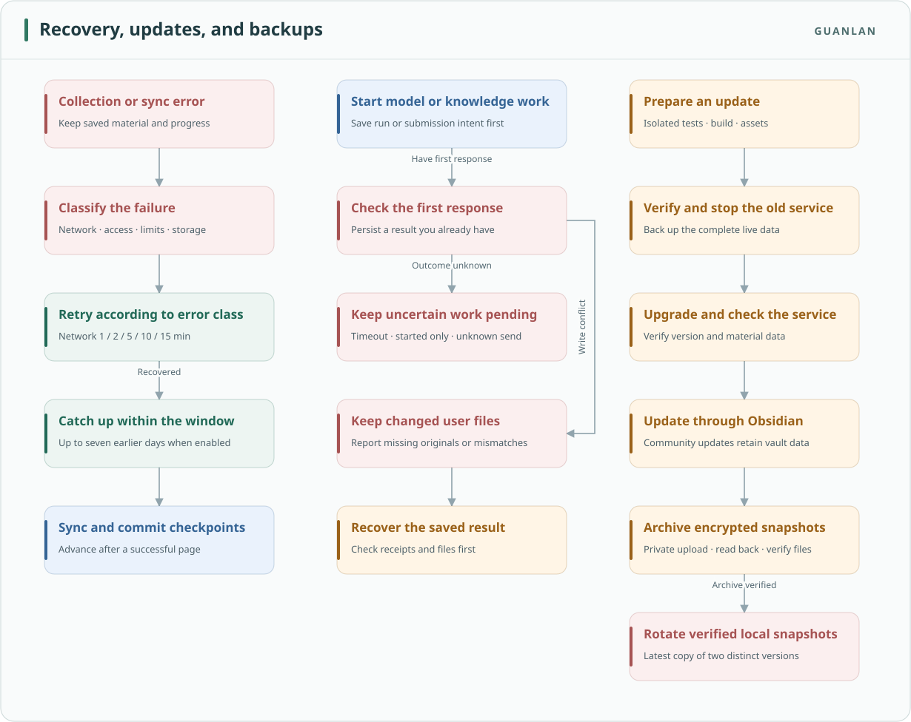

# Guanlan workflow reference

[Project README](../../../../README.md) · [简体中文](../zh-CN/README.md)

These diagrams describe the v0.22.5 design. Click through to the contracts for the behavior of each module. Default settings and optional paths are shown in the steps.

Green marks automatic or rule-based steps. Gold is user input or permission, purple is model work, blue is persistence, and red is verification or a safeguard.

[System overview](#overview) · [Subscription collection and sync](#subscriptions) · [Discovery](#discovery) · [Reading and selection](#reading) · [Import and transcripts](#importing) · [Knowledge handoff](#knowledge) · [Recovery, updates, and backups](#recovery)

## System overview

Three entry points share an Obsidian library. The local service, discovery model, and knowledge agent run independently.

- Collection requires an awake computer and running service. Plugin discovery and new knowledge submissions require Obsidian to be open.

### Steps

- **Fixed subscriptions** · Manage source URLs, categories, check intervals, and enablement in Sources. X appears under Discovery. [Reference](../../../../README.md)
- **Discovery** · Search by interests and topic areas. The configured light model shortlists up to three picks by default. Automatic discovery is opt-in. [Reference](../../../active-exploration.md)
- **Add material** · Import for reading, for discussion, or for direct Wiki synthesis. [Reference](../../../knowledge-integration.md)
- **Collect and write the ledger** · Poll enabled sources. Save article originals and text when obtained, and video metadata and links. Serve increments from ledger-index.json and ledger-entries. [Reference](../../../collection-setup.md)
- **Recommendation cards** · Save recommendations independently. Choose which external items to capture. Reuse existing subscription text. [Reference](../../../active-exploration.md)
- **Extract or import** · Try public captions or import SRT/VTT. A scanned PDF can be paired with text prepared elsewhere, kept as a distinct version. [Reference](../../../knowledge-integration.md)
- **Obsidian reading library** · Import or sync identified, versioned Material with coverage. Originals, reading notes, and _工作台/state.json track files, progress, and annotations. Confirm that indexed files exist and report conflicts. Keep AI output separately. [Reference](../../../architecture.md)
- **Updates and Today’s Reading** · By default the shortlist allows 50 minutes and three items. Browse the full collection independently. Basic selection needs no model. Automatic AI guides default to off. [Reference](../../../../README.md)
- **Rediscover older unread items** · Rotate through historical unread material and deduplicate against that day’s discovery. A saved nonempty list is fixed. Read and trashed items leave the list without replacement. [Reference](../../../history-highlights.md)
- **Library** · Browse collected material and versions. Trash retains originals and notes. Sync skips trashed identities. [Reference](../../../material-management.md)
- **Read, watch, and annotate** · Open the original, read a captured note, or save progress. Select a specific material to begin knowledge processing. [Reference](../../../../README.zh-CN.md)
- **Finish the reading session** · Finish after reading or watching and return to the note later. [Reference](../../../../README.zh-CN.md)
- **Hand a version to Claudian** · Check the selected original and text. A video needs actual transcript text for handoff. [Reference](../../../knowledge-integration.md)
- **Process through RAW** · The workbench prepares the handoff and observes receipts. Claudian runs the Vault’s fanos-raw protocol with its selected model. The integration check proves interface compatibility. [Reference](../../../knowledge-integration.md)
- **Discuss and request synthesis** · Ask questions, correct the draft, and explicitly request synthesis into the current Wiki. [Reference](../../../knowledge-integration.md)
- **Send directly to the Wiki** · Authorize synthesis of the chosen source in the Wiki. Keep private annotations and conversation ideas outside the source inputs. [Reference](../../../knowledge-integration.md)
- **Verify Wiki synthesis** · Check the current run’s formal events, selected version, original hash, and outputs on disk. [Reference](../../../knowledge-integration.md)
- **Optional promotion to fanOS** · Promote to a specified note or board with separate authorization. Wiki and promotion each have their own evidence. [Reference](../../../knowledge-integration.md)

[Process and storage boundaries](../../../architecture.md) · [Implemented capabilities](../../../first-release.md)

## Subscription collection and sync

Identify the source and validate the material before committing the ledger and syncing to Obsidian.

- Source identification, saving the configuration, collecting entries, obtaining verified text, and syncing to the Vault each have their own outcome.
- Sync collected items reads the ledger. Check and sync also starts a check of due and eligible network-failed sources. Check now explicitly checks saved enabled sources.

### Steps

- **Add or manage a subscription** · A source-row toggle saves immediately. Dialog edits require Save. Disabling stops collection and retains saved material. [Reference](../../../../README.md)
- **WeChat and general RSS** · Verify WeChat account, author date, and article text. General RSS/Atom keeps the feed body and can read the original page when needed. Keep private feed URLs in local configuration. [Reference](../../../collection-setup.md)
- **YouTube** · With a configured key, prefer the uploads API. Atom and same-channel public pages are bounded fallbacks. Captions are a separate operation from saving a video entry. [Reference](../../../youtube-official-api.md)
- **Bilibili** · Verify uploader UID and video identity. Save metadata and viewing links, with the route used in the receipt. [Reference](../../../collection-setup.md)
- **Verify identity, date, and text** · The service looks for due sources every 30 seconds. Sources default to hourly. Capture the source config for the check, validate account and link, and apply the author date, text, and catch-up rules. An unsaved item keeps its fingerprint pending. [Reference](../../../architecture.md)
- **Deduplicate and write material** · Write ledger-entries/<sequence>-<hash>.json, then commit ledger-index.json. The sequence and hash must match the item file. Failure leaves the index or fingerprint unconfirmed. A valid empty feed can succeed with zero items. [Reference](../../../architecture.md)
- **Classify and record failures** · Network retries after 1, 2, 5, 10, and up to 15 minutes. Authorization and limits have their own deadlines. Early network recovery only applies to eligible network errors. [Reference](../../../collection-setup.md)
- **Serve incremental pages** · Verify individual entries and serve new material from the current ledger instance. The earlier ledger.json is historical after migration. [Reference](../../../architecture.md)
- **Sync to Obsidian** · When enabled, pull /v1/feed?after=<cursor>&instance=<instance> on startup, workbench opening, and the configured timer. The interval defaults to five minutes. Check and sync starts collection, syncs saved material, and syncs again after the check. The UI follows it for up to three minutes. No model is needed. [Reference](../../../../src/core/subscription-refresh.ts)
- **Commit a page to the library** · Process each material before advancing the page cursor. Preserve known edited notes, skip trashed identities, and protect writes. A missing original, bad hash, or write failure blocks the checkpoint. [Reference](../../../../src/core/library.ts)
- **Show actual publication dates** · Optional catch-up covers up to seven earlier days when the upstream entry and original are still readable. File entries under their original dates. [Reference](../../../../README.md)

[Sources, collection, and retry](../../../collection-setup.md) · [Source scheduling and verification](../../../../src/server/subscriptions.ts) · [Check and sync](../../../../src/core/subscription-refresh.ts) · [Per-page commit](../../../../src/core/library.ts)

## Discovery

Search, gather evidence, score a shortlist, save the run, and choose which picks to capture.

- Discovery defaults to three picks, Rediscover to two picks, and Today’s Reading to three items. Each has its own setting.
- Free X has no data API charge. Search and scoring can use paid model tokens.

### Steps

- **Start discovery** · Automatic discovery checks on startup, workbench opening, hourly ticks, and return to the window. Recovery considers the current day. [Reference](../../../active-exploration.md)
- **Check today’s run** · Save today’s Rediscover references and exclude their URLs before a new batch. Failure to persist stops discovery. Save state and run logs under _工作台/探索. Completed, failed, or uncertain runs are kept and not resent. [Reference](../../../../src/plugin/main.ts)
- **Search the web** · DeepSeek search uses the configured model connection. Keyless HN/GitHub search leans toward technology. Tavily uses a separate key. [Reference](../../../active-exploration.md)
- **Optional X search** · Read up to three Top pages per day and up to 20 posts per page, without pagination. A failed or uncertain attempt pauses new requests that day. SocialData is an explicit paid choice. [Reference](../../../free-x-setup.md)
- **Add recent subscription text** · Reuse saved text and mark it as a subscription candidate. Exclude read, dismissed, and recently recommended URLs. [Reference](../../../active-exploration.md)
- **Merge and check evidence** · Verify up to six web pages and read excerpts of up to three X external links. Distinguish posts, linked excerpts, and unseen video. [Reference](../../../active-exploration.md)
- **Score with the model and code** · Give the light model up to 24 excerpts of up to 2,400 characters. Code also checks evidence, concrete novelty or utility, and known substance. Leave unassessed substance empty. Reject invalid fields, out-of-range values, or broken references. Search and scoring usage are separate. [Reference](../../../active-exploration.md)
- **Save fewer picks or none** · Titles, engagement counts, or unseen videos provide limited evidence. Keep the threshold and report empty results or gaps. [Reference](../../../active-exploration.md)
- **Discovery picks** · Diversify topics and authors. Exclude same-day Rediscover links, read and trashed items, dismissed entries, and the previous 30 days of recommendations. Keep run and publication dates separate. [Reference](../../../active-exploration.md)
- **Open or watch the original** · Opening the link is browsing. Capture is a separate action with its text and caption coverage recorded. [Reference](../../../active-exploration.md)
- **Choose what to capture** · Save the X post’s own text and its original response. Replies, linked pages, and videos have separate coverage. Articles use link import. [Reference](../../../active-exploration.md)
- **Dismiss a recommendation** · Keep the rejection in exclusions. Preserve the daily run and prior scores. [Reference](../../../active-exploration.md)
- **Save to the shared library** · Reuse identical content and save changed versions independently. Keep source text, annotations, and AI outputs separately. [Reference](../../../architecture.md)
- **Open Today’s Reading** · Use rules for the shortlist. Optional AI defaults to a daily batch of up to 12 pieces, with up to 2,400 characters each. [Reference](../../../../README.md)
- **Rediscover older material** · No model call. Repeat after seven days for unread and 14 for read later. A saved daily list does not refill after reading or deletion. [Reference](../../../history-highlights.md)
- **Search and manage materials** · Trash keeps originals and versions. Sync skips trashed identities. Handle unsaved drafts before bulk operations. [Reference](../../../material-management.md)
- **Read and save progress** · Choose the reading state yourself. Select a specific material when you want knowledge processing. [Reference](../../../knowledge-integration.md)

[Supply, scoring, and daily runs](../../../active-exploration.md) · [Score validation](../../../../src/core/exploration-scoring.ts) · [External evidence](../../../../src/server/exploration-evidence.ts)

## Reading and selection

One index supports the daily shortlist, older unread rotation, and library management.

- The daily guide threshold is 40. Discovery requires a value score of at least 60 and additional relevance and evidence checks.
- Rediscover makes no model calls and keeps its saved daily list fixed. Trash retains underlying files.

### Steps

- **Shared library and index** · Updates, Rediscover, and Library reuse the same ReadingLibrary, its files, indexes, versions, and annotations. [Reference](../../../architecture.md)
- **Today’s reading candidates** · Group by author publication date. Exclude read, read-later, metadata-only, and verification material from selection. Prioritize readings in progress and avoid stale news. [Reference](../../../architecture.md)
- **Older unread candidates** · For an unknown publication date, use the local save boundary for historical eligibility. Videos may be selected with an original link and a transcript coverage label. [Reference](../../../history-highlights.md)
- **All saved material** · Filter by unread, reading, read later, or read. Browse older dates. Bulk selection covers all matching pages. [Reference](../../../material-management.md)
- **Build a rule-based shortlist** · Estimate at 450 characters per minute by default. Balance categories and prioritize readings in progress. Compare before updating a saved list and report user edits. [Reference](../../../architecture.md)
- **Rotate older unread items** · Favor less-recommended material while considering priority, active reading, positive assessment, and backlog age. Repeat after seven days for unread or 14 for read later. [Reference](../../../history-highlights.md)
- **Bulk state changes and trash** · Update at article identity level. Trash moves all versions into the reading index’s trash and retains their files. Unsaved drafts require attention first. [Reference](../../../material-management.md)
- **Optional AI picks and guides** · Use the configured light model, one batch per day by default. Reuse the same batch. Failed or uncertain attempts count toward the daily limit. [Reference](../../../../README.md)
- **Save fixed version references** · Save identity, fixed version, reason, and date in historyDays in _工作台/state.json. Keep the registered version when a new one arrives. A saved nonempty list is fixed. Quantity changes apply on later days. Restore its index and reading folder together. [Reference](../../../history-highlights.md)
- **Move to recoverable trash** · Deletion applies to the current library. The shared ledger keeps its copy, and sync skips trashed identities. Existing knowledge tasks remain recorded. [Reference](../../../material-management.md)
- **Sample, score, and validate** · Give the model up to eight numbered quote choices and resolve references to the original text. PASS at 40 or above contributes to AI ranking. Unreviewed items keep rule ordering. Save started before calling and retry persistence of the first result. [Reference](../../../architecture.md)
- **Restore the original item** · Restore all versions and continue identity-based deduplication. Discovery and Wiki processing remain independent actions. [Reference](../../../material-management.md)
- **Save guides and evidence** · Save the guide, matched quote, and usage before updating indexes. Preserve invalid output in its model receipt. On write error retry saving the same result. [Reference](../../../architecture.md)
- **Read, watch, and annotate** · Choose the reading state. Resolve unsaved note edits before bulk changes or knowledge tasks that would affect the draft. [Reference](../../../knowledge-integration.md)
- **Finish reading** · Reading or watching completes the reading task. Wiki synthesis starts with a specific handoff. [Reference](../../../../README.zh-CN.md)
- **Choose knowledge processing** · Use actual text and originals from the chosen version. Supply missing evidence before calling Claudian. [Reference](../../../knowledge-integration.md)

[Historical rotation and version references](../../../history-highlights.md) · [Daily shortlist and guides](../../../../src/core/daily.ts) · [Reading index and trash](../../../../src/core/library.ts)

## Import and transcripts

Separate capture routes share identity, version, coverage, and protected writes.

- Video entries, transcript coverage, and completed knowledge tasks each have their own result. Captions supply text and leave visual context unexamined.
- Switching folders opens a separate library. Move materials, indexes, trash state, and downstream references together during an explicit migration.
- Manual RAW preparation produces a staging file. Formal RAW registration and Wiki completion are separate operations.

### Steps

- **Add material or save a pick** · Choose import only, import and discuss, or import for direct Wiki synthesis. Handoff follows successful storage. [Reference](../../../knowledge-integration.md)
- **Article URL or X post** · Read a public article. For X use the verified cache for the post text and original response. Replies, linked pages, and transcripts have separate routes. [Reference](../../../active-exploration.md)
- **Markdown, HTML, or PDF** · Give updates to the same material a stable identity and distinguish versions by content hash. Use separate IDs for unrelated files with matching names. [Reference](../../../integration-guide.md)
- **Video link or captions file** · Try public captions or supply a transcript. Captions are a separate operation from the subscription feed. [Reference](../../../knowledge-integration.md)
- **Read the page or cached post** · Allow public sites on standard ports and validate redirects. Keep the fetched response and absolute remote image URLs. Extraction runs without webpage scripts, OCR, or a model. A missing or invalid X original blocks capture. [Reference](../../../integration-guide.md)
- **Parse the file or attach text** · Extract an available text layer. Attach Markdown prepared externally for a scan, for example with MinerU. Preserve the PDF and register the conversion separately. [Reference](../../../knowledge-integration.md)
- **Read captions or parse SRT/VTT** · Mark public captions as partial and report auto captions and visual gaps. Keep original caption bytes and mark reverse or zero-length cues for review. [Reference](../../../knowledge-integration.md)
- **Create material with coverage** · Keep capture, extracted text, and AI output independently. Use the coverage that the material supports. [Reference](../../../architecture.md)
- **Save service imports first** · Save URL and HTML/PDF imports in the ledger before returning Material. Plugin imports save the return value directly. External HTTP clients sync later. Local MD/SRT/VTT, video captions, and cached X posts follow separate paths. [Reference](../../../../src/server/service.ts)
- **Text or captions unavailable** · A source may require login or offer no captions. Supply external text for restricted videos, X videos, or extra segments. [Reference](../../../knowledge-integration.md)
- **Resolve identity and version** · Material ID comes from source identity. The version includes text and coverage. Category, capture time, and AI guides are independent of the text version. [Reference](../../../architecture.md)
- **Reuse the existing version** · Keep the first metadata, position, and annotations for identical content. Restore a trashed item before importing it again. [Reference](../../../architecture.md)
- **Save a separate version** · Use an independent path for new text. Knowledge success remains tied to the version it processed. [Reference](../../../architecture.md)
- **Stop on a file conflict** · Missing originals, wrong hashes, and illegal paths need attention. Preserve and report edits in already indexed text. [Reference](../../../architecture.md)
- **Write through a recovery record** · Pin the first material and original in a recovery record before writing. Commit the index last, then clear the recovery record. A null expectation only creates a file. An expected old string is compared atomically before replacing. Keep partial writes and the recovery record on error. [Reference](../../../architecture.md)
- **Material is in the library** · Collecting a single item and subscribing are separate actions. The plugin saves imports immediately. HTTP clients can sync service imports later. Captions, X posts, and locally parsed MD/SRT/VTT remain separate from the service feed. [Reference](../../../integration-guide.md)
- **Import only** · Save or read independently of Claudian. Formal RAW registration is a later opt-in. [Reference](../../../knowledge-integration.md)
- **Import and discuss** · Freeze the text and prepare the handoff and queue. Claudian verifies and registers the actual RAW. [Reference](../../../knowledge-integration.md)
- **Import for direct synthesis** · Direct synthesis retains the original and version checks. Personal notes and boards need a separately specified target. [Reference](../../../knowledge-integration.md)

[Import, sync, and captions HTTP contracts](../../../integration-guide.md) · [Feed transport](../../../../src/server/feed-fetch.ts) · [Versioning and write protection](../../../../src/core/library.ts)

## Knowledge handoff

Queue a selected version and verify RAW, Wiki, and optional promotion against actual files.

- Each milestone has its own evidence, from interface verification and send intent to RAW registration, Wiki synthesis, and promotion.
- The first recovery round reads a verified prior receipt. It clears unsent direct synthesis intent. Synthesis then needs a new instruction.
- An unconfirmed submission stays recorded. After reopening Obsidian, only authorized unsent work in the current library resumes.

### Steps

- **Select a specific version** · Choose a version from a reading view, discovery card, or import. Knowledge work starts with explicit selection. [Reference](../../../knowledge-integration.md)
- **Verify the text and original** · Protect the original and frozen source text with hashes. Keep AI guides separate from the source snapshot. [Reference](../../../knowledge-integration.md)
- **Resolve input conflicts** · Supply external text when a video caption is unavailable or a scan needs OCR. Preserve changed files and report mismatches. [Reference](../../../knowledge-integration.md)
- **Persist handoff and queue** · Keep the task note and frozen source in 知识接续 and private receipts in _工作台/知识接续. Bind identity, version, original hash, and conversation. Submit in order after the current RAW task and any active reply or text/image draft. Unsent items can be canceled. [Reference](../../../knowledge-integration.md)
- **Verify and record send intent** · Use the historical 2.3.17 adapter or verify the installed version and interface. Validation sends no message and calls no model. Store the binding and submission intent before sending. Reuse the conversation on repeat clicks and preserve unconfirmed intent. [Reference](../../../../src/plugin/claudian.ts)
- **Run the Vault’s RAW protocol** · Claudian uses its selected model and the Vault’s fanos-raw protocol. The workbench’s light model serves a separate workflow. [Reference](../../../knowledge-integration.md)
- **Wait for discussion** · Discuss the draft. Explicitly request synthesis into the Wiki once you are ready. [Reference](../../../knowledge-integration.md)
- **Synthesize without discussion** · The direct choice authorizes synthesis in 08_LLM Wiki. Integrate with existing topics when appropriate, keep private annotations separate, and distinguish author claims from verified facts. [Reference](../../../knowledge-integration.md)
- **Write 08_LLM Wiki outputs** · Claudian saves the files and finalize event. Stop and report original, version, or file conflicts. [Reference](../../../knowledge-integration.md)
- **Verify current-run outcomes** · Queued means that material, original, snapshot, task note, and intent were saved. Submitted waits for a formal receipt. Verify RAW registration, discussion, Wiki synthesis, and optional promotion against the current run and actual files. [Reference](../../../knowledge-integration.md)
- **Promote to an authorized target** · Specify and authorize the destination and changes. Verify post-write hash and source, Wiki, and target backlinks. Preserve later edits and report conflicts. [Reference](../../../knowledge-integration.md)

[RAW, Wiki, recovery, and promotion](../../../knowledge-integration.md) · [Receipt and output verification](../../../../src/core/knowledge.ts) · [Claudian adapter](../../../../src/plugin/claudian.ts)

## Recovery, updates, and backups

Separate lanes for collection recovery, model and knowledge recovery, and program maintenance.

- The three lanes can run independently. Service readiness, installed plugin state, and backup verification each have their own evidence.
- The documented setup collects locally while the machine is awake. Video text uses public captions or a supplied transcript. Wiki updates use explicit handoff.

### Steps

- **Collection or sync error** · Inspect the source receipt, type, and retry time. Change credentials when the error points to authorization. [Reference](../../../collection-setup.md)
- **Start model or knowledge work** · Daily AI, discovery, and knowledge submission persist their first configuration, results, and usage independently. [Reference](../../../architecture.md)
- **Prepare an update** · Use a separate test Vault and verify old and new plugin and service versions. Keep synthetic material out of the actual library. [Reference](../../../plugin-updates.md)
- **Classify the failure** · Network recovery can bring eligible network failures forward. Authorization and rate limits keep their schedules. Report storage errors with file evidence. [Reference](../../../collection-setup.md)
- **Check the first response** · Save the first result and receipt before updating guide or recommendation indexes. Retry only the write after a save error. Keep an unknown outcome for review. [Reference](../../../architecture.md)
- **Verify and stop the old service** · Verify the process identity and perform a graceful stop. Back up the live segmented ledger, index, and associated data. [Reference](../../../operator-runbook.md)
- **Retry according to error class** · Verification pages and missing text may back off up to an hour. Other failures follow their own policies. The next retry is a scheduled time. [Reference](../../../collection-setup.md)
- **Keep uncertain work pending** · Retain the original run. Wait for a known outcome or inspect the saved material before acting. [Reference](../../../architecture.md)
- **Upgrade and check the service** · Check the new program, readiness, and material retention. Prepare the local signed channel after confirmation. Track cloud archive success independently. [Reference](../../../plugin-updates.md)
- **Catch up within the window** · Process entries still available upstream and within the configured window and start date. Count saved material after required text and original are persisted. [Reference](../../../collection-setup.md)
- **Keep changed user files** · Keep versions independent. Preserve registered annotations. Resolve missing originals, incorrect hashes, or a failed write before proceeding. [Reference](../../../architecture.md)
- **Install a verified plugin update** · Replace four program files and retain data.json and materials. Recover interrupted installs through their transaction and preserve unexpected external changes. [Reference](../../../plugin-updates.md)
- **Sync and commit checkpoints** · Known annotated notes can coexist with new imports. An original or file write error holds the cursor until the page can complete. [Reference](../../../../src/core/library.ts)
- **Recover the saved result** · Retry saving an existing first response. When recovering a conversation, inspect its receipts read-only on the first round. [Reference](../../../knowledge-integration.md)
- **Archive encrypted snapshots** · Retain cloud dependencies of historical snapshots, keep the password separate, and keep unverified local copies. Active data is outside rotation. [Reference](../../../backup-retention.md)
- **Rotate verified local snapshots** · After cloud read-back and per-file verification, rotate historical local service snapshots. Keep referenced cloud dependencies under their own retention policy. [Reference](../../../backup-retention.md)

[Local operation](../../../operator-runbook.md) · [Signed updates and recovery](../../../plugin-updates.md) · [Private archive and rotation](../../../backup-retention.md)
