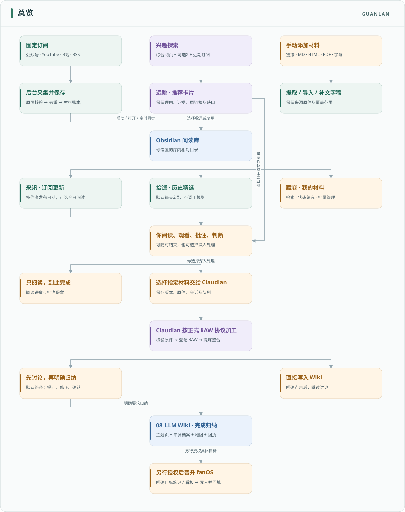
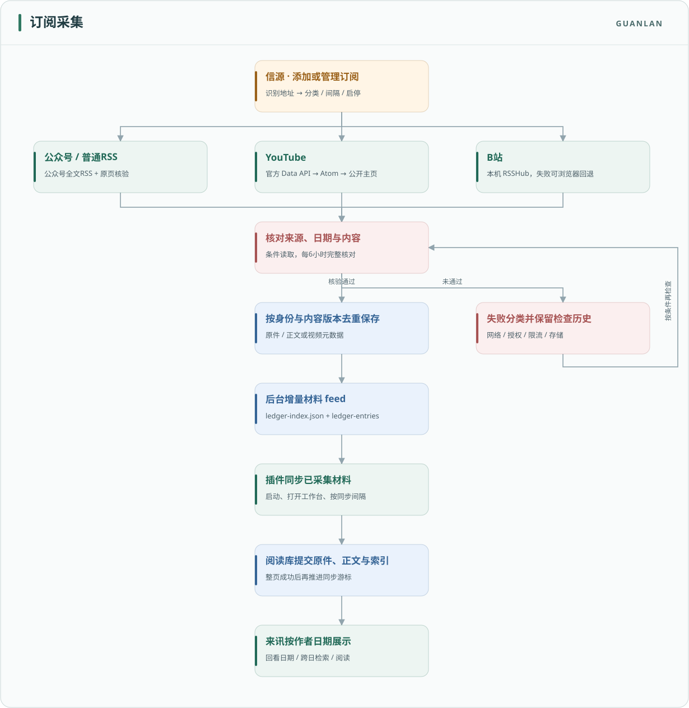
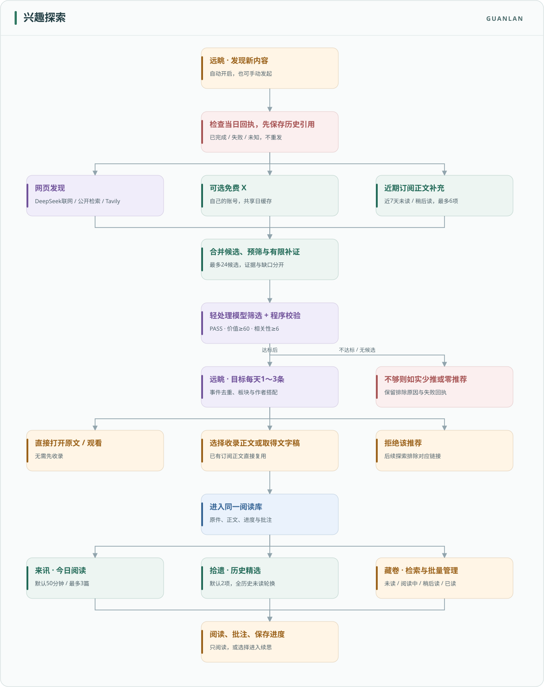
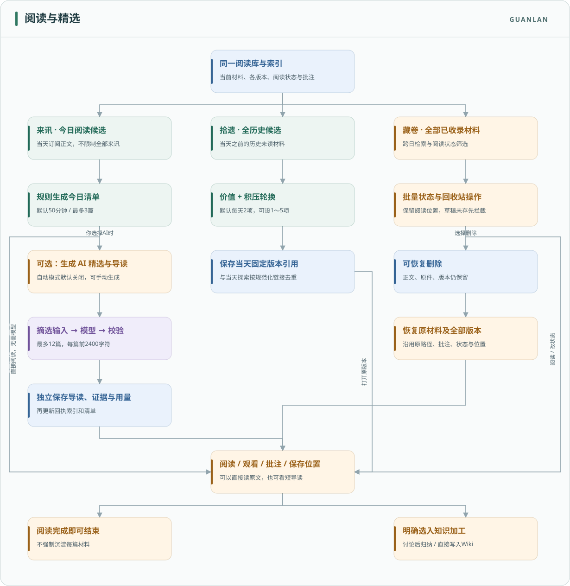
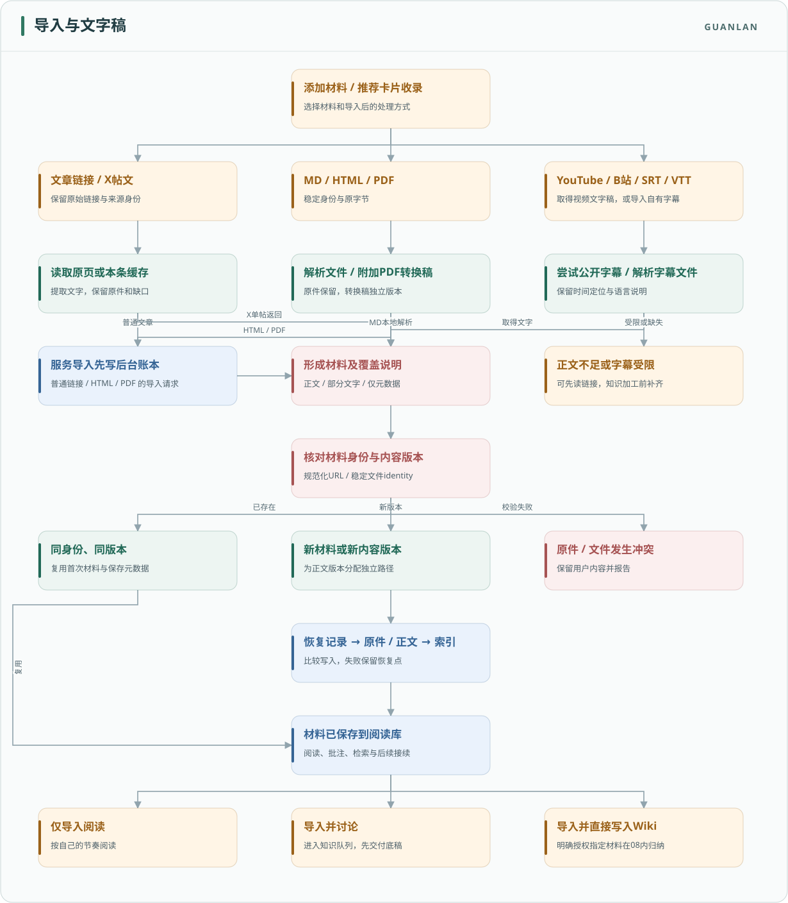
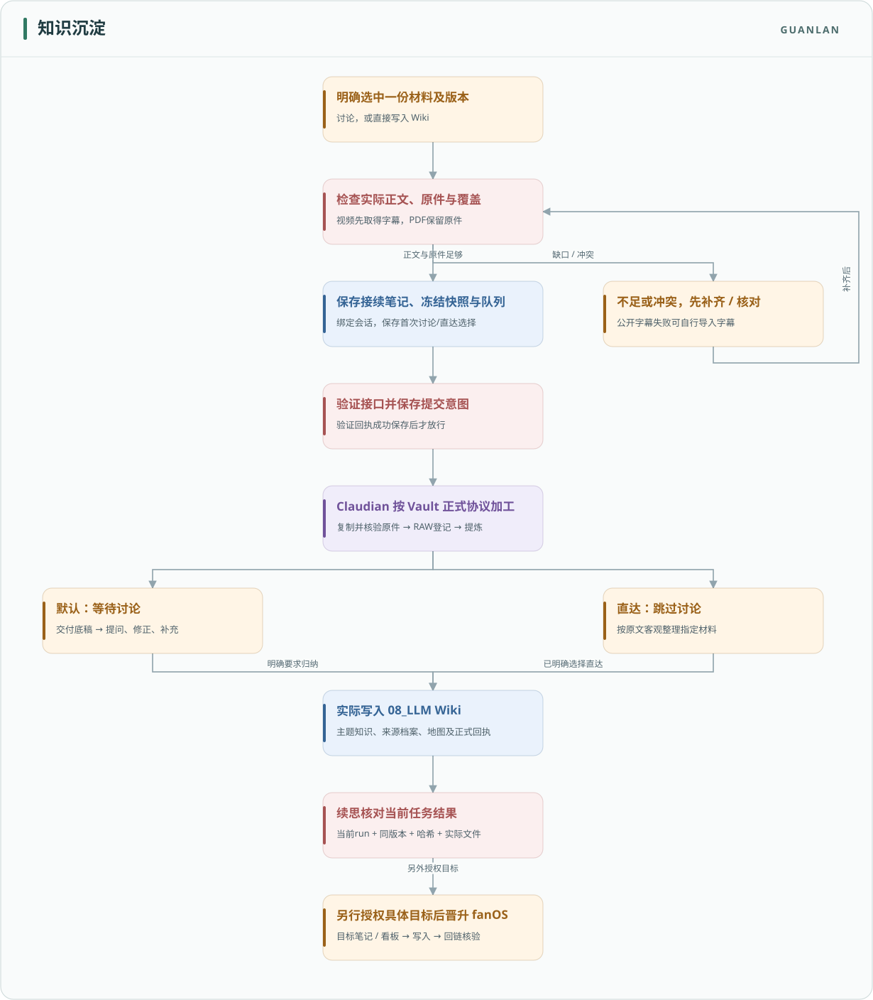
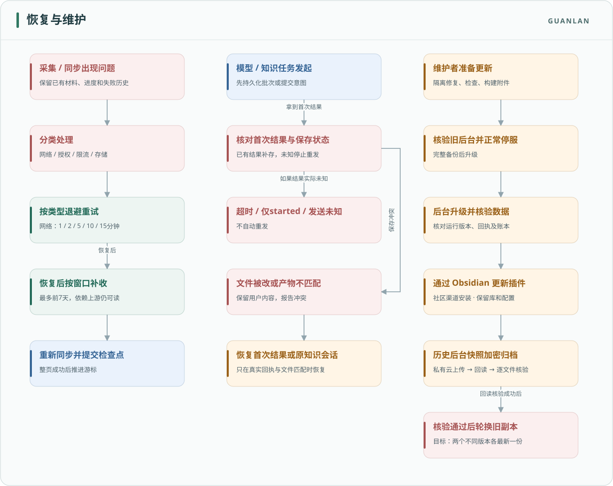

# 观澜完整工作流与技术说明

[返回项目 README](../../../../README.zh-CN.md) · [English](../en/README.md)

七张图展示 v0.22.5 的设计。每一步旁边附有契约或源码，可核对输入、输出、留存文件和失败后的处理。

绿色表示自动或规则步骤，金色表示用户操作或授权，紫色表示模型参与，蓝色表示保存，红色表示核验或保护。

[总览](#overview) · [订阅采集](#subscriptions) · [兴趣探索](#discovery) · [阅读与精选](#reading) · [导入与文字稿](#importing) · [知识沉淀](#knowledge) · [恢复与维护](#recovery)

## 总览

从发现材料到知识沉淀，三种入口汇入同一个阅读库。

- 订阅采集、Obsidian同步、探索模型、Claudian知识加工分别运行、分别核验。
- 电脑关机或休眠时不采集；Obsidian关闭时不发起插件探索或新的知识队列任务。
- 总览中的知识链路是当前可用流程，不代表所有正式材料已经加工完成。

### 逐步说明

- **固定订阅** · 在信源里维护来源、分类、检查间隔和启停。X 作为可选渠道在远眺里使用。 [实现依据](../../../../README.zh-CN.md)
- **兴趣探索** · 按兴趣和八个板块检索，用轻处理模型筛选。自动探索可启用，当天最多生成一批，默认最多推荐三条。 [实现依据](../../../active-exploration.md)
- **手动添加材料** · 可仅导入阅读，也可在导入时明确选择讨论或直接写入Wiki。 [实现依据](../../../knowledge-integration.md)
- **后台采集并保存** · 后台定时检查，文章保存原件和正文，视频订阅先保存元数据与观看链接。增量feed由ledger-index.json和ledger-entries提供。 [实现依据](../../../collection-setup.md)
- **远眺 · 推荐卡片** · 推荐记录独立保存。外部推荐不会全部自动导入阅读库；近期订阅补充候选可复用已有正文。 [实现依据](../../../active-exploration.md)
- **提取 / 导入 / 补文字稿** · 扫描PDF不冒充OCR；视频先尝试公开字幕，受限时可导入自己的SRT/VTT。外部转换稿作为独立正文版本。 [实现依据](../../../knowledge-integration.md)
- **Obsidian 阅读库** · 后台增量同步或主动导入后，保存原件、各版本正文、阅读进度、批注和索引；AI输出与原文分别保存。 [实现依据](../../../architecture.md)
  - **触发** 后台同步成功，或主动材料导入成功
  - **输入** 有来源身份、内容版本、覆盖范围的Material
  - **保存** 阅读材料/、原件/、_工作台/state.json
  - **完成依据** 实际文件与索引对应，冲突按规则报告
- **来讯 · 订阅更新** · 当天清单默认50分钟、最多3篇，不限制全部订阅。规则清单无需模型，AI精选与短导读需另行生成，自动 AI 精选默认关闭。 [实现依据](../../../../README.zh-CN.md)
- **拾遗 · 历史精选** · 全历史未读轮换，与当天探索去重。非空日清单保存后固定，已读或删除退出，当天不补位。 [实现依据](../../../history-highlights.md)
- **藏卷 · 我的材料** · 所有已收录材料集中管理。回收站保留正文、原件和版本，后续同步不会把删除内容自动加回。 [实现依据](../../../material-management.md)
- **你阅读、观看、批注、判断** · 推荐、已读和短导读都不会自动授权知识加工。探索卡片也可直接打开原链接观看或阅读。 [实现依据](../../../../README.zh-CN.md)
- **只阅读，到此完成** · 阅读和观看本身就是完整使用，不要求每篇都进入知识库。 [实现依据](../../../../README.zh-CN.md)
- **选择指定材料交给 Claudian** · 续思提供接续入口。只处理你明确选入的材料；先校验正文与原件，视频需要实际文字稿。 [实现依据](../../../knowledge-integration.md)
- **Claudian 按正式 RAW 协议加工** · 工作台准备交接与观察进度，Claudian使用当前选定知识模型调用正式fanos-raw流程。接口验证不等于加工完成。 [实现依据](../../../knowledge-integration.md)
- **先讨论，再明确归纳** · 交付讨论底稿后，你继续交流，再明确要求“归纳并写入当前Wiki”。 [实现依据](../../../knowledge-integration.md)
- **直接写入 Wiki** · 这是对指定材料在08内客观整理及最终归纳的明确授权，不混入个人批注或聊天想法。 [实现依据](../../../knowledge-integration.md)
- **08_LLM Wiki · 完成归纳** · 依据当前run正式事件、原件哈希、材料版本和实际文件核验。历史成功或回答文字不能代替本次产物。 [实现依据](../../../knowledge-integration.md)
- **另行授权后晋升 fanOS** · 只有明确目标和具体改动获授权后才晋升。Wiki完成与fanOS晋升分别核对；周期维护尚未启用。 [实现依据](../../../knowledge-integration.md)

[进程与存储边界](../../../architecture.md) · [实现范围](../../../first-release.md)

## 订阅采集

信源配置 → 平台采集 → 后台账本 → 插件同步 → 来讯。

- “同步已采集材料”读后台账本。“检查并同步”衔接本轮采集与同步。“立即检查更新”会显式检查已保存的启用来源。
- 来源识别、保存配置、读取条目、取得正文和 Vault 同步分别留有结果。

### 逐步说明

- **信源 · 添加或管理订阅** · 来源行启停立即保存；分类和间隔等弹窗设置需显式保存。关闭来源中止后续抓取，已收录材料保留。 [实现依据](../../../../README.zh-CN.md)
- **公众号 / 普通RSS** · 公众号核对账号、作者发布日期和正文；普通RSS/Atom保留feed正文，必要时回源。私密RSS只留本机。 [实现依据](../../../collection-setup.md)
- **YouTube** · 配置并验证自己的 Key 后优先调用官方接口，失败时尝试频道 Atom 和同频道公开页。列表返回的是视频元数据。获取字幕走独立流程。 [实现依据](../../../youtube-official-api.md)
- **B站** · 核对UID与视频身份，保存元数据及观看链接；适配XML不会冒充官方RSS。 [实现依据](../../../collection-setup.md)
- **核对来源、日期与内容** · 正常按来源间隔采集，默认每小时。公众号当天候选核验原页；日期未知或未来不能冒充今日发布。 [实现依据](../../../architecture.md)
  - **触发** 后台每30秒找出到期来源；正常来源默认每小时
  - **输入** 已启用来源的feed/API/公开页及首次配置快照
  - **处理** 身份、链接、作者日期、正文与有界补收窗口核验
  - **失败** 不记正文成功，不确认尚未保存的指纹
- **按身份与内容版本去重保存** · 后台先保存单条材料，再提交索引与序号。失败不确认指纹；空feed成功与正文成功分别记账。 [实现依据](../../../architecture.md)
  - **输入** 核验后的文章正文或视频元数据
  - **保存** 后台ledger-entries/<序号>-<哈希>.json，再提交ledger-index.json
  - **完成依据** 单条文件、索引序号与哈希匹配
  - **失败** 保留首次结果，索引或指纹不推进
- **失败分类并保留检查历史** · 网络按1、2、5、10、15分钟重试；授权和限流遵守各自条件。恢复检查只提前处理符合条件的网络失败。 [实现依据](../../../collection-setup.md)
- **后台增量材料 feed** · 逐条读取并核验哈希；后台保存与阅读库同步是两个步骤。旧ledger.json仅保留历史。 [实现依据](../../../architecture.md)
- **插件同步已采集材料** · “检查并同步”发起到期来源及符合条件的网络故障来源检查，同时同步账本已有材料。等待本轮结束后再同步新增材料，最多跟踪三分钟，全程无需模型。 [实现依据](../../../../src/core/subscription-refresh.ts)
  - **触发** 启用同步后，启动插件、打开工作台和定时触发。默认间隔五分钟，也可手动操作
  - **输入** /v1/feed?after=游标&instance=实例
  - **输出** 当前阅读库内的新材料和版本
  - **区别** “同步已采集材料”不发起新采集；“检查并同步”衔接两者
- **阅读库提交原件、正文与索引** · 已登记正文批注保留并报告，独立新材料可继续同步；原件缺失、校验失败或写入失败继续阻止游标推进。 [实现依据](../../../../src/core/library.ts)
  - **处理** 分页读取，每页逐条导入，再提交该页检查点
  - **保护** 保留正文批注；删除身份跳过；实际写入受比较保护
  - **完成依据** 页内材料处理成功，索引保存成功
  - **失败** 原件缺失、哈希失败、实际写入失败时不推进游标
- **来讯按作者日期展示** · 有界延迟补收最多前7天，必须先启用，且依赖上游仍保留条目及原页可读。补收归原日期，不挤进今天。 [实现依据](../../../../README.zh-CN.md)

[信源、采集与重试](../../../collection-setup.md) · [来源调度与验证](../../../../src/server/subscriptions.ts) · [检查并同步](../../../../src/core/subscription-refresh.ts) · [逐页提交](../../../../src/core/library.ts)

## 兴趣探索

探索目标、今日阅读预算和历史精选数量是三套独立规则。

- 探索推荐默认最多三条，拾遗默认两项，今日选读默认最多三篇，分别计算。
- 免费 X 无数据 API 费。模型联网和筛选各自计量。模型结果未知时保留原批次，后续可以核对落盘记录。

### 逐步说明

- **远眺 · 发现新内容** · 插件启动、工作台打开、每小时、窗口恢复时检查当天批次；恢复只处理当日，不补跑停机期间每一天。 [实现依据](../../../active-exploration.md)
- **检查当日回执，先保存历史引用** · 新的探索先准备当天历史精选，再排除其链接；历史保存失败先报错。已存在日批次复用，不因升级重新计费。 [实现依据](../../../../src/plugin/main.ts)
  - **触发** 今天首次手动探索，或启用自动探索后到达当日检查时机
  - **保存** _工作台/探索/state.json和批次日志
  - **日去重** 已完成、失败、结果未知的本日批次不重发
  - **前置** 先固定当天历史引用，防止同日重复推荐
- **网页发现** · 可选 DeepSeek 原生联网、无需检索 Key 的 Hacker News/GitHub 公开检索，或自行配置 Tavily。公开检索偏技术主题。 [实现依据](../../../active-exploration.md)
- **可选免费 X** · 最多3个Top首页，每页最多20帖，不翻页。失败或未知停止当天后续请求，不自动转付费SocialData。 [实现依据](../../../free-x-setup.md)
- **近期订阅正文补充** · 使用已经保存的实际正文，明确标注订阅补充；排除已读、拒绝和近期推过的链接。 [实现依据](../../../active-exploration.md)
- **合并候选、预筛与有限补证** · 网页最多核对6页，X每批最多补读3条实际外链。帖文、外链摘选和视频内容分别标记。 [实现依据](../../../active-exploration.md)
- **轻处理模型筛选 + 程序校验** · 还须具体增量或用途、证据足够且已评份量合格。未知作品份量留空；不把分数当真实性概率。原生联网与筛选分别计用量。 [实现依据](../../../active-exploration.md)
  - **输入** 最多24候选，主摘选每条最多2400字符
  - **模型** 使用配置的轻处理连接。DeepSeek 原生联网与模型筛选分别记录用量
  - **入选** PASS、价值≥60、相关性≥6，且有具体增量或用途等条件
  - **失败** 缺字段、越界或错误引用保留失败回执；不凑数
- **不够则如实少推或零推荐** · 不降门槛凑数，不把只有标题、互动量或未看视频当作已评价全文。 [实现依据](../../../active-exploration.md)
- **远眺 · 目标每天1～3条** · 与当天历史精选去重，并排除已读、回收站、拒绝及30天内推荐链接；推荐生成日期与内容日期分开。 [实现依据](../../../active-exploration.md)
- **直接打开原文 / 观看** · 仅打开外链不代表已经取得正文或字幕；可以只读不收录。 [实现依据](../../../active-exploration.md)
- **选择收录正文或取得文字稿** · X收录保存本条完整文字与原始对象，不包含回复、视频转写或外链全文；文章走普通导入。 [实现依据](../../../active-exploration.md)
- **拒绝该推荐** · 反馈进入去重排除，不重新生成当天推荐或改写历史评分。 [实现依据](../../../active-exploration.md)
- **进入同一阅读库** · 重复收录去重，版本独立，原有批注和位置保留；不把AI摘要合并成来源正文。 [实现依据](../../../architecture.md)
- **来讯 · 今日阅读** · 规则清单无需模型；可手动生成AI精选与短导读，默认每天一批、最多12篇，每篇前2400字符。自动 AI 精选默认关闭。 [实现依据](../../../../README.zh-CN.md)
- **拾遗 · 历史精选** · 无需新模型调用；未读至少7天、稍后读14天再推。日清单固定，已读或删除不补位。 [实现依据](../../../history-highlights.md)
- **藏卷 · 检索与批量管理** · 回收站保留原文件及各版本；删除状态阻止同步复活。未保存的阅读草稿会阻止批量改动。 [实现依据](../../../material-management.md)
- **阅读、批注、保存进度** · 推荐不会自动标已读，已读不会自动写Wiki。阅读时可继续选入知识加工。 [实现依据](../../../knowledge-integration.md)

[供给、排序及日批次](../../../active-exploration.md) · [评分校验](../../../../src/core/exploration-scoring.ts) · [外链取证](../../../../src/server/exploration-evidence.ts)

## 阅读与精选

来讯看当天，拾遗消化历史，藏卷管理所有材料；AI短导读是单独的可选路径。

- 今日阅读最多3篇、历史精选默认2项、探索目标1～3条分别计算；任何数量都不限制你查看全部材料。
- 今日阅读的AI排序门槛是40分；探索推荐门槛是60分且另有相关性等条件，两套规则不混用。
- 历史精选不新增模型调用，清单固定后不因为当天读完而继续补位；删除材料暂不释放磁盘文件。

### 逐步说明

- **同一阅读库与索引** · 三个阅读入口复用同一ReadingLibrary，使用真实文件和索引，不重复复制正文。 [实现依据](../../../architecture.md)
- **来讯 · 今日阅读候选** · 按作者真实发布日期归档，排除已读、稍后读、纯元数据和验证用途；阅读中优先。AI资讯/热点过旧时不自动精选。 [实现依据](../../../architecture.md)
- **拾遗 · 全历史候选** · 不限近7天。日期未知时按本地保存边界判断历史，不补造作者日期。视频有可打开原链接也可选，但明确没有文字稿。 [实现依据](../../../history-highlights.md)
- **藏卷 · 全部已收录材料** · 按未读、阅读中、稍后读、已读查看，也可从日期页回看历史；批量选择覆盖筛选结果的全部分页。 [实现依据](../../../material-management.md)
- **规则生成今日清单** · 预算按阅读速度估算，默认每分钟450字；板块搭配、在读优先。保存清单采用比较写入，用户修改保留并提示。 [实现依据](../../../architecture.md)
- **价值 + 积压轮换** · 先照顾少推荐的材料，兼顾优先级、在读、正向评价和最早积压；未读至少7天、稍后读至少14天再推。 [实现依据](../../../history-highlights.md)
- **批量状态与回收站操作** · 已读、未读、稍后读按文章更新，原件和批注不改；删除同一文章全部版本，仅移入索引回收站。 [实现依据](../../../material-management.md)
- **可选：生成 AI 精选与导读** · 只做轻处理，使用设置中的模型连接。每天默认1批；同批复用，失败或未知也计限额，不能通过重试重发。 [实现依据](../../../../README.zh-CN.md)
- **保存当天固定版本引用** · 不复制正文、不调用模型；非空清单提交后固定。已读或删除退出，当天不补位；后来出现新版本不替换旧引用。 [实现依据](../../../history-highlights.md)
  - **保存** _工作台/state.json中的historyDays
  - **内容** 材料身份、固定版本、推荐理由、日期，不复制正文
  - **固定规则** 当日非空清单成功提交后固定；修改数量用于后续日期
  - **恢复** 需保留完整同组阅读目录和索引，不能只恢复引用
- **可恢复删除** · 删除仅影响本阅读库，不改共享后台材料账本。同步跳过同一来源身份，不会自动复活；已有知识任务不被撤销。 [实现依据](../../../material-management.md)
- **摘选输入 → 模型 → 校验** · 编号原文证据最多8段，程序按编号回取原文。输出PASS/BLOCK/UNKNOWN；PASS且≥40分参与AI排序，未评估项继续规则排序。不能把摘选评价当全文精读。 [实现依据](../../../architecture.md)
  - **触发** 手动生成，或主动启用自动 AI 精选后按每日限额触发
  - **输入** 最多12篇，每篇前2400字符，附编号原文证据
  - **输出** 判断、分数、理由、短导读、原文证据与用量
  - **保护** 先提交started；失败/未知计日限额；保存失败只补首次结果
- **恢复原材料及全部版本** · 恢复后继续按原材料身份和版本去重；不会重跑探索或知识模型，也不等于重新授权Wiki加工。 [实现依据](../../../material-management.md)
- **独立保存导读、证据与用量** · 导读位于AI导读目录，原回答无效时保存到模型回执，不当作有效导读。保存失败只补存首次结果；原文与AI内容分别保留。 [实现依据](../../../architecture.md)
- **阅读 / 观看 / 批注 / 保存位置** · 不会因为推荐一次就标已读。未保存的正文修改要先处理，批量状态和知识队列保护草稿。 [实现依据](../../../knowledge-integration.md)
- **阅读完成即可结束** · 只阅读观看也是完整使用。工作台不因已读或赞同一句话自动生成Wiki。 [实现依据](../../../../README.zh-CN.md)
- **明确选入知识加工** · 从材料详情或推荐卡片进入续思，使用指定版本、实际正文与原件；先补足证据，再调用Claudian。 [实现依据](../../../knowledge-integration.md)

[历史精选、版本引用和轮换](../../../history-highlights.md) · [每日规则选读与导读](../../../../src/core/daily.ts) · [阅读索引和回收站](../../../../src/core/library.ts)

## 导入与文字稿

手动材料和推荐收录都先形成可追溯的材料，再选择是否进入知识流程。

- 视频条目成功、字幕取得成功和知识加工成功分别判断。公开字幕仍不包含画面信息。
- 更换阅读目录会建立独立库，不自动搬迁旧材料、索引、回收站、知识队列或RAW/Wiki引用。
- 旧的手动RAW交接准备保留，但准备文件不等于正式RAW登记，更不等于Wiki或fanOS完成。

### 逐步说明

- **添加材料 / 推荐卡片收录** · 可选择仅导入、导入并交给Claudian、导入并直接写入Wiki；实际保存失败时不冒充后续任务已完成。 [实现依据](../../../knowledge-integration.md)
- **文章链接 / X帖文** · 普通文章请求公开原页；X收录复用已校验缓存，保存本条完整文字和原始接口对象，不包含回复、外链全文或视频转写。 [实现依据](../../../active-exploration.md)
- **MD / HTML / PDF** · 同一材料更新复用identity，用内容哈希区分版本。同名不同材料需区分来源身份，不凭标题覆盖旧文件。 [实现依据](../../../integration-guide.md)
- **YouTube / B站 / SRT / VTT** · 视频订阅和推荐元数据不是文字稿；公开视频字幕端点不写订阅feed。用户自有字幕可直接导入。 [实现依据](../../../knowledge-integration.md)
- **读取原页或本条缓存** · 普通网页仅允许公网和标准端口，逐跳校验，不执行脚本或调用模型/MinerU。仅保留远程绝对图片地址，相对图片移除；保留HTML不等于完整离线页面。免费X原件缺失或哈希失败阻止收录。 [实现依据](../../../integration-guide.md)
- **解析文件 / 附加PDF转换稿** · 扫描PDF不会伪装成已OCR。MinerU等转换稿需外部取得后补充，当前不内置MinerU服务。 [实现依据](../../../knowledge-integration.md)
- **尝试公开字幕 / 解析字幕文件** · 公开字幕标记partial，注明自动字幕和画面缺口。SRT/VTT保留原字节；逆序或零时长保留句子并提示待核对。 [实现依据](../../../knowledge-integration.md)
- **形成材料及覆盖说明** · 来源原件、提取正文、AI生成内容始终分开；标题和推荐摘要不能替代缺失的实际内容。 [实现依据](../../../architecture.md)
- **服务导入先写后台账本** · POST /v1/import成功会先登记后台材料账本，再返回Material，不创建订阅。插件收到返回后直接保存阅读库；外部HTTP客户端导入后需同步已采集材料。插件本地解析的MD/SRT/VTT、视频字幕和X单帖返回不走这一步。 [实现依据](../../../../src/server/service.ts)
- **正文不足或字幕受限** · 登录限制、无公开字幕、X/其他平台视频或额外分P需要外部文字稿。没有自动下载音视频或启用付费ASR。 [实现依据](../../../knowledge-integration.md)
- **核对材料身份与内容版本** · 材料ID来自来源身份，版本哈希包含正文、覆盖等内容；板块、采集时间和AI导读不制造新正文版本。 [实现依据](../../../architecture.md)
- **同身份、同版本** · 不重复创建正文版本，保留首次保存的材料信息、阅读位置和批注；已有回收站记录要求先恢复。 [实现依据](../../../architecture.md)
- **新材料或新内容版本** · 不会用新正文覆盖原版本；同一PDF的新转换稿也不能沿用旧转换稿的Wiki成功状态。 [实现依据](../../../architecture.md)
- **原件 / 文件发生冲突** · 原件缺失、哈希变化或非法路径不能被“重试导入”绕过；已登记正文批注保留并报告，按实际原因处理。 [实现依据](../../../architecture.md)
- **恢复记录 → 原件 / 正文 → 索引** · 先保存首次材料与原件的恢复记录，再落原件和正文，最后提交索引；重试补交同一结果，不强写用户改动。 [实现依据](../../../architecture.md)
  - **输入** 稳定身份、正文版本、首次原件与覆盖说明
  - **顺序** 首次恢复记录 → 原件 → 正文 → 索引 → 清理恢复记录
  - **保护** null仅创建；已知旧内容原子比较后替换
  - **失败** 保留实际已写文件及恢复记录，不伪造全部成功
- **材料已保存到阅读库** · 插件导入弹窗把返回材料直接保存到当前阅读库。/v1/import已先写后台账本；HTTP客户端需后续同步。视频文字稿、X单帖和插件本地解析的MD/SRT/VTT不因此进入后台feed；所有这些操作都不创建订阅。 [实现依据](../../../integration-guide.md)
- **仅导入阅读** · 保存、阅读和观看不依赖Claudian可用，也不会自动正式登记RAW。 [实现依据](../../../knowledge-integration.md)
- **导入并讨论** · 明确选择后，按当前版本冻结正文、准备接续笔记和队列；实际RAW由Claudian核验与登记。 [实现依据](../../../knowledge-integration.md)
- **导入并直接写入Wiki** · 跳过讨论但保留来源、原件和正式核验；不因此授权写fanOS、Inbox或个人记忆。 [实现依据](../../../knowledge-integration.md)

[导入、同步与字幕 HTTP 契约](../../../integration-guide.md) · [订阅读取](../../../../src/server/feed-fetch.ts) · [版本与写入保护](../../../../src/core/library.ts)

## 知识沉淀

工作台负责准备与接续，Claudian负责遵循正式协议加工，最终状态由产物证明。

- 接续准备 ≠ RAW已登记；接口验证通过 ≠ 模型加工成功；Wiki完成 ≠ fanOS晋升。
- 原会话无法继续时可显式从已核验回执恢复。首轮只读；清除未发送的旧直达意图，归纳需再次明确给指令。
- 已提交但结果未知不自动重发；关闭Obsidian后不继续插件自动出队，重开仅恢复当前阅读库已授权且尚未提交的队列。

### 逐步说明

- **明确选中一份材料及版本** · 来自来讯、远眺、拾遗、藏卷或手动导入。允许只读；必须明确选择才进入加工。 [实现依据](../../../knowledge-integration.md)
- **检查实际正文、原件与覆盖** · 原件和正文快照按哈希保护。短导读或推荐摘要不能当全文，正文快照排除AI导读。 [实现依据](../../../knowledge-integration.md)
- **不足或冲突，先补齐 / 核对** · 无字幕或受限视频需要外部文字稿；扫描PDF需外部OCR/转换。用户修改和原件冲突不被覆盖。 [实现依据](../../../knowledge-integration.md)
- **保存接续笔记、冻结快照与队列** · 队列按材料身份与版本保存。多篇串行，等待当前RAW任务结束，也保护其他聊天的文字/图片草稿及正在接收的回复。 [实现依据](../../../knowledge-integration.md)
  - **保存** 知识接续/下的任务笔记与冻结正文；_工作台/知识接续/中的私有回执
  - **绑定** 材料身份 + 版本 + 原件哈希 + Claudian会话
  - **队列** 同一RAW任务结束后再提交下一篇；未发送可取消
  - **保护** 有当前文字/图片草稿或回复进行中时等待
- **验证接口并保存提交意图** · 内置历史实测2.3.17；其他版本要验证当前版本与适配契约。验证不发模型请求；发送结果未知不重发。 [实现依据](../../../../src/plugin/claudian.ts)
  - **前置** 内置历史适配版本，或确切当前版本和适配契约已验证
  - **保存** 先保存会话绑定，再保存提交意图，最后原生发送
  - **接口检查** 不发送消息、不证明模型连接与知识产物成功
  - **未知** 已提交但结果未知不自动重发；重复点击复用原会话
- **Claudian 按 Vault 正式协议加工** · 遵循当前Vault的fanos-raw真源，使用Claudian当前知识模型。工作台轻处理模型与此链路分开，不由工作台伪造登记。 [实现依据](../../../knowledge-integration.md)
- **默认：等待讨论** · 讨论后明确说“归纳并写入当前Wiki”；阅读完成或同意某句话不能代替最终归纳授权。 [实现依据](../../../knowledge-integration.md)
- **直达：跳过讨论** · 点击直达即授权在08内完成归纳。优先整合已有主题，不掺入个人批注，不把作者主张当成已验证事实。 [实现依据](../../../knowledge-integration.md)
- **实际写入 08_LLM Wiki** · 由Claudian保存产物和finalize事件。原件或版本不匹配、用户修改冲突时先停止报告。 [实现依据](../../../knowledge-integration.md)
- **续思核对当前任务结果** · RAW已登记、等待讨论、Wiki已归纳、fanOS已晋升分别显示。旧run成功不能覆盖新失败；仅发送不代表处理成功。 [实现依据](../../../knowledge-integration.md)
  - **已排队** 材料、原件、快照、接续笔记和队列意图已保存，尚未提交
  - **已提交** 发送意图已保存，等待正式RAW回执
  - **完成依据** 当前run正式事件、当前材料版本、同哈希原件与实际产物一致
  - **不等同** RAW已登记、等待讨论、Wiki已归纳、fanOS已晋升分别判断
- **另行授权具体目标后晋升 fanOS** · 晋升需明确目标和改动，校验写后哈希及来源/Wiki/看板回链；目标后续被编辑则保留并提示核对。 [实现依据](../../../knowledge-integration.md)

[RAW、Wiki、恢复与晋升](../../../knowledge-integration.md) · [回执与产物校验](../../../../src/core/knowledge.ts) · [Claudian 接口适配](../../../../src/plugin/claudian.ts)

## 恢复与维护

三条保障链独立于日常阅读；这张图说明处理规则，不表示已执行维护。

- 三列分别展示网络恢复、模型与知识恢复、程序更新和备份；流程可独立进行。
- 未启用：受限字幕 / ASR、Wiki周期维护、云端运行和关机持续采集。
- 自然跨日、登录变化、物理开机 / 休眠和长期稳定性仍需实际观察。

### 逐步说明

- **采集 / 同步出现问题** · 不因一次网络错误例行重配订阅或密钥，先看错误类型、重试时间和来源检查记录。 [实现依据](../../../collection-setup.md)
- **模型 / 知识任务发起** · 每日AI、探索和知识发送分别记录首次任务，保留原始模型配置、结果与用量。 [实现依据](../../../architecture.md)
- **维护者准备更新** · 代码变更执行适用检查；真实材料库不导入合成测试材料。插件与后台分别核验旧版本及更新结果。 [实现依据](../../../plugin-updates.md)
- **分类处理** · 网络恢复只提前处理符合条件的网络来源；授权与限流不能因网络恢复而绕过。 [实现依据](../../../collection-setup.md)
- **核对首次结果与保存状态** · 已拿到首次结果时先保存日志与回执，再保存导读、推荐和索引。没有最终结果则保留未知；已有结果保存失败只补存，不再次调用模型。 [实现依据](../../../architecture.md)
- **核验旧后台并正常停服** · 只停止核实身份的自有进程。完整备份包含当前分段材料账本与索引，不拿旧ledger.json代替。 [实现依据](../../../operator-runbook.md)
- **按类型退避重试** · 暂时验证页或正文暂缺等失败可退避至1小时；其他错误按各自策略。排定时间不保证上游已恢复。 [实现依据](../../../collection-setup.md)
- **超时 / 仅started / 发送未知** · 保留原记录，等待明确结果或核对已有产物；未知结果不能通过重建批次来规避限制。 [实现依据](../../../architecture.md)
- **后台升级并核验数据** · 程序升级、后台启动和材料保留分别核验。升级成功不表示旧备份已云端归档。 [实现依据](../../../plugin-updates.md)
- **恢复后按窗口补收** · 需要已启用延迟补收，且不早于开始使用日；停机不保证全量补齐。原件与正文成功后才能记材料成功。 [实现依据](../../../collection-setup.md)
- **文件被改或产物不匹配** · 正文版本独立；已登记批注可保留并报告，原件缺失/哈希失败或写入失败需先处理。 [实现依据](../../../architecture.md)
- **通过 Obsidian 更新插件** · 在 Obsidian 的第三方插件页面安装更新。更新前保存草稿，启用后核对阅读目录和已有材料。 [实现依据](../../../plugin-updates.md)
- **重新同步并提交检查点** · 原件缺失、哈希错误、实际写入失败继续阻止游标；已有批注保护不阻止独立新材料保存。 [实现依据](../../../../src/core/library.ts)
- **恢复首次结果或原知识会话** · 已落盘首次结果可补存。知识会话显式恢复首轮只读，不默默重发旧任务。 [实现依据](../../../knowledge-integration.md)
- **历史后台快照加密归档** · 云端依赖附件全部保留，密码独立保管。失败时保留本地未核验副本；不涉及当前运行数据清理。 [实现依据](../../../backup-retention.md)
- **核验通过后轮换旧副本** · 云端回读和逐文件核验通过后，本机历史后台快照保留两个不同版本各最新一份。云端依赖单独保留，活跃运行数据和 Vault 在该规则范围之外。 [实现依据](../../../backup-retention.md)
  - **目标** 云端回读和逐文件核验成功后，保留两个不同版本各最新一份
  - **云端** 历史依赖附件全部保留，不套用本地两版本规则
  - **范围** 仅历史后台快照；不是完整Vault/源码备份，不提供云端采集

[本机运维](../../../operator-runbook.md) · [插件安装与更新](../../../plugin-updates.md) · [私有归档与轮换](../../../backup-retention.md)
